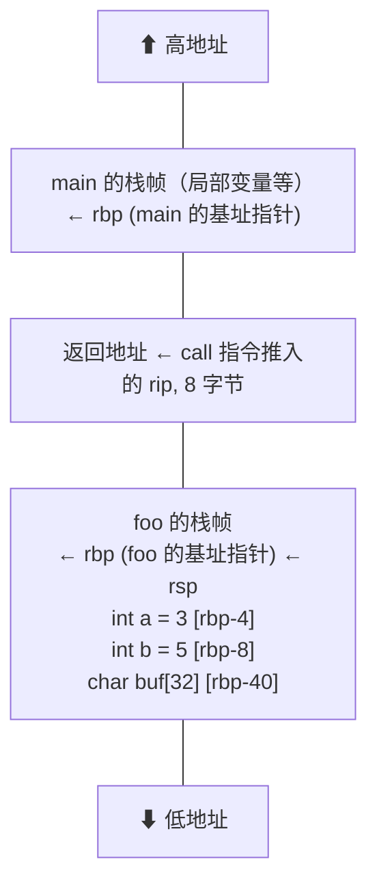
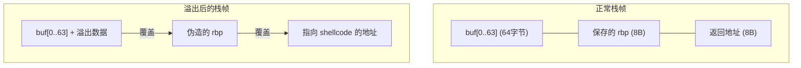
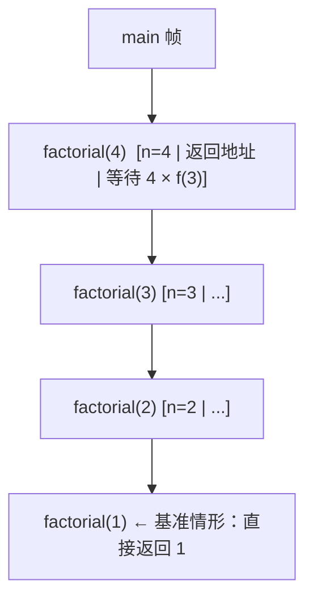
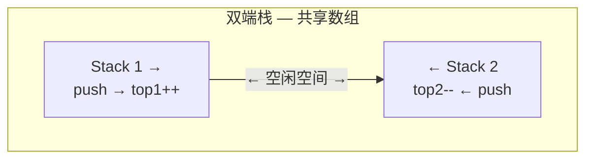
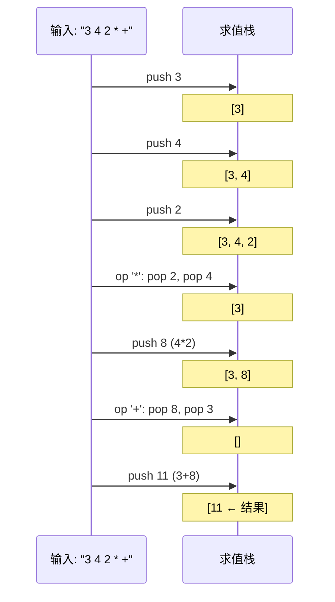

建议先阅读: [[G_容器_Container|容器概览]] — 理解栈的底层存储（数组 vs 链表）和扩容机制。


---

## 原理

![[../assets/images/后进先出.png]]
![[../assets/images/栈操作.png]]

栈（Stack）是受限的线性数据结构——所有操作均发生在同端（栈顶），遵循后进先出（LIFO: Last In, First Out）。这种"单向开口"的约束看似限制了灵活性，实则赋予了栈一种精确的时序语义：最近入栈的数据最优先被处理。

### 栈在哪里

在写第一行栈代码之前，先看它已经在哪运转：每次函数调用都在向调用栈压入一个新栈帧，`return` 就是弹栈；编辑器的 Ctrl-Z 弹出的正是最近一次操作；浏览器的后退按钮弹出的是上一个页面；编译器判断 `({[]})` 是否配对靠的是括号栈。这些场景的共同主题——**需要按"最近发生优先"的次序回溯**——正是 LIFO 的用武之地。本章沿这条线展开：先把基础操作写扎实，再逐一拆解括号匹配与表达式求值，最后深入到硬件调用栈的底层机制。

| 操作 | 描述 | 时间复杂度 |
|------|------|:---------:|
| `push(x)` | 将 x 压入栈顶 | $O(1)$ |
| `pop()` | 弹出栈顶元素 | $O(1)$ |
| `top()` | 不弹出，只读栈顶 | $O(1)$ |
| `empty()` | 是否为空 | $O(1)$ |
| `size()` | 元素个数 | $O(1)$ |

![[stack_push_pop.gif]]

### 栈的物理实现

栈作为抽象数据类型，有两种物理实现方式。选择取决于对容量、内存开销和缓存行为的需求。

**数组实现**（连续存储）：
- 在内存中预留一块连续区域，用 `top` 索引标记栈顶
- 扩容策略见 [[G_容器_Container|容器章节]] 的均摊分析
- 缓存友好——push/pop 都是顺序访问栈顶附近的内存

**链表实现**（节点存储）：
- 无容量上限，每个节点单独 `malloc`
- 每次 push 带有堆分配开销（~50-200ns），pop 有释放开销
- 由于只在头部操作，链表的"指针追踪"问题比完整链表遍历轻微——但连续 10 万次 push/pop 的累计堆开销远超数组版

### 栈的抽象数据类型、逻辑结构与存储结构

学习任何一个数据结构，都要回答四个问题：它的**逻辑结构**是什么、**存储结构**可能有哪几种、定义了哪些**运算**、这些运算如何用一套**抽象数据类型（ADT）**接口描述。栈的答案是：

| 维度 | 栈 |
|------|-----|
| 逻辑结构 | 线性结构（元素一对一），但**运算受限**：只允许在同一端（栈顶）插入和删除 |
| 存储结构 | 顺序栈（数组）/ 链栈（单链表头部）/ 共享栈 |
| 基本运算 | `InitStack`、`DestroyStack`、`StackEmpty`、`Push`、`Pop`、`GetTop` |
| 重要特性 | 后进先出（LIFO）；栈顶是唯一"活跃端" |

> 栈属于**操作受限的线性表**：逻辑上仍是一对一的线性关系，只是把"任意位置插删"收紧为"只能在端点插删"。因此顺序表的两种存储方式（顺序/链式）在这里都适用，只是实现更简单——所有操作都围绕端点。这与 [[C_顺序表_SequentialList|线性表]] 中"同一套 ADT 接口，底层换数组或指针"的思想一脉相承。

### 栈与队列：共同点与差异

栈和队列经常成对出现，把它们的异同一张表理清，后面遇到组合题可以直接调用：

| 对比项 | 栈 | 队列 |
|--------|-----|------|
| 操作规则 | 后进先出 LIFO | 先进先出 FIFO |
| 逻辑结构 | 线性结构（一对一） | 线性结构（一对一） |
| 受限方式 | 仅在**同一端**（栈顶）插入、删除 | 在**一端**（队尾）插入、另一端（队首）删除 |
| 顺序存储 | 顺序栈（`top` 指针） | 循环队列（`front`/`rear`） |
| 链式存储 | 链栈（在头部操作，无需尾指针） | 链队列（需队首、队尾两个指针） |
| 空判定（顺序） | `top == -1`（视约定） | `front == rear` |
| 经典应用 | 括号匹配、表达式求值、递归、DFS | BFS、缓冲区、调度、生产者-消费者 |

**共同点归纳**：

1. 都是**操作受限的线性表**，逻辑结构都是线性的（一对一），属于线性结构而非非线性；
2. 都可以用**顺序存储**或**链式存储**实现，存储方式与逻辑结构无关；
3. 插入、删除都只在**端点**进行，因此核心操作均为 $O(1)$（数组版在扩容均摊意义下也是 $O(1)$）；
4. 都可以用**双端队列（Deque）**统一描述——限制 Deque 的一端只出不进得到栈，限制两端一进一出得到队列；
5. 都能用于**保存中间状态、消除递归、处理具有先后次序要求的问题**。

> 一句话记忆：**栈是"单端受限"的线性表，队列是"双端分工"的线性表，二者都是 Deque 的退化**。

---

## 深入底层

### 硬件级栈：x86-64 调用栈

栈不仅是抽象数据结构，更是 CPU 硬件原生支持的核心机制。x86-64 架构通过 `rsp`（栈指针寄存器）和 `rbp`（基址指针寄存器）提供硬件级栈支持：



```nasm
; C 代码: int add(int a, int b) { return a + b; }

add:
 push rbp ; 保存调用者的 rbp
 mov rbp, rsp ; 建立自己的栈帧基址
 mov DWORD PTR [rbp-4], edi ; 参数 a (通过 edi 传入)
 mov DWORD PTR [rbp-8], esi ; 参数 b (通过 esi 传入)
 mov eax, DWORD PTR [rbp-4]
 add eax, DWORD PTR [rbp-8] ; eax = a + b
 pop rbp ; 恢复调用者的 rbp
 ret ; 弹出返回地址并跳转
```

`call` 指令等价于 `push rip; jmp target`。`ret` 指令等价于 `pop rip`。这两个指令在硬件层面由 CPU 的返回栈缓冲器（Return Stack Buffer, RSB）加速——RSB 是 CPU 内部的一个微型硬件栈，专门缓存返回地址，使得 `ret` 指令可以达到接近 0 周期的延迟。

**栈溢出（Stack Overflow）**：

栈段的大小受操作系统限制（Linux 默认 8MB，`ulimit -s`）。以下场景触发栈溢出：
- 递归过深（如无终止条件的递归）
- 局部变量过大（如在栈上声明 `int arr[1000000]`，占 4MB，超出剩余栈空间）
- 无限递归相互调用（A 调 B，B 调 A）

栈溢出的后果是 **SIGSEGV**——CPU 访存时 MMU 检测到访问地址超出栈的映射范围，硬件触发 page fault，内核检查发现地址不合法后向进程发送段错误信号。

**栈溢出利用（Stack Smashing）**：

在安全领域，栈溢出是最经典的攻击向量。当程序向栈上的局部缓冲区写入超出其大小的数据时，溢出数据会覆盖更高的栈帧内容——包括返回地址。攻击者构造恶意输入，使返回地址指向其注入的 shellcode 或 ROP 链中的 gadget。

```c
// 典型的栈溢出漏洞
void vulnerable(char* input) {
 char buf[64];
 strcpy(buf, input); // 如果 input 长度 > 64，覆盖返回地址
}
```



现代防御：栈 canary（返回地址前放随机值，`ret` 前检查）、W^X（栈页不可执行）、ASLR（随机化地址）、影子栈（shadow stack，硬件/软件维护一份返回地址副本用于验证）。

#### 递归如何映射到栈帧

![[stack_recursion.gif]]

"递归就是系统替你维护了一个栈"——落到硬件上，每次递归调用执行 `call` 压入一个新栈帧（返回地址 + 参数 + 局部变量），基准情形触发后逐层 `ret` 弹栈。以 `factorial(4)` 为例，递推阶段栈帧的堆积：



随后进入回归阶段：factorial(1) 返回 → 其帧弹出 → factorial(2) 拿到结果算出 2 → 弹出……直到 main。三个要点：

1. **空间消耗 = 递归深度**：同时存活的帧数即深度，$O(depth)$——这正是链表章递归反转空间为 O(n) 的原因
2. **深度超限 = 栈溢出**：8MB 栈 ÷ 每帧几十字节 ≈ 十万量级深度上限（E2 实验可实测）
3. **尾递归可优化**：若递归调用是函数的最后一个动作（返回值不依赖后续计算），编译器可复用当前帧——gcc -O2 会做此优化，但 C 标准并不保证，不能依赖


### 单调栈（Monotonic Stack）

![[stack_monotonic.gif]]

单调栈是栈的最强大变体之一——它维护栈内元素的单调性（递增或递减），通过 pop 掉破坏单调性的元素来找到"下一个更大/更小"的位置。

**问题**：给定数组 $A[0..n-1]$，对每个位置 $i$，找出右侧第一个比 $A[i]$ 大的元素的下标。

```
例: A = [73, 74, 75, 71, 69, 72, 76, 73]

i=0 (73): 栈空，push 0
i=1 (74): A[1]=74 > A[栈顶=0]=73 → 答案[0]=1, pop 0, push 1
i=2 (75): A[2]=75 > A[栈顶=1]=74 → 答案[1]=2, pop 1, push 2
i=3 (71): A[3]=71 < A[栈顶=2]=75 → 栈单调递减，直接 push 3
i=4 (69): push 4
i=5 (72): A[5]=72 > A[栈顶=4]=69 → 答案[4]=5, pop 4
 A[5]=72 > A[栈顶=3]=71 → 答案[3]=5, pop 3, push 5
i=6 (76): A[6]=76 逐个弹出 5,2 → 答案[5]=6, 答案[2]=6, push 6
i=7 (73): A[7]=73 < A[栈顶=6]=76 → push 7
```

```c
// 单调递减栈：找右侧第一个更大元素
void next_greater(const int* A, int n, int* result) {
 int* stk = malloc(n * sizeof(int));
 int top = 0;
 for (int i = 0; i < n; i++) {
 while (top > 0 && A[i] > A[stk[top - 1]]) {
 result[stk[--top]] = i; // 当前元素是栈顶的"第一个更大"
 }
 stk[top++] = i;
 }
 while (top > 0)
 result[stk[--top]] = -1; // 无更大元素
 free(stk);
}
```

时间复杂度 $O(n)$ —— 每个元素入栈一次、出栈至多一次，总操作数不超过 $2n$。这是均摊分析在栈上的典型应用。

单调栈揭示了一个深层原理：需要比较"前后元素关系"的问题，往往可以通过维护一个单调序列来避免 $O(n^2)$ 的朴素扫描。从直方图最大矩形到每日温度，单调栈是这类问题的统一解法框架。

---

## 实现

### 基于动态数组的栈

```c
#include <stdlib.h>

typedef struct {
 int* data;
 size_t capacity;
 size_t top; // 指向下一个空位，也是元素个数
} ArrayStack;

void as_init(ArrayStack* s) {
 s->data = NULL;
 s->capacity = 0;
 s->top = 0;
}

void as_destroy(ArrayStack* s) {
 free(s->data);
 s->data = NULL;
 s->capacity = s->top = 0;
}

static int as_expand(ArrayStack* s) {
 size_t new_cap = s->capacity == 0 ? 8 : s->capacity * 2;
 int* new_data = realloc(s->data, new_cap * sizeof(int));
 if (!new_data) return -1;
 s->data = new_data;
 s->capacity = new_cap;
 return 0;
}

int as_push(ArrayStack* s, int value) {
 if (s->top >= s->capacity)
 if (as_expand(s) != 0) return -1;
 s->data[s->top++] = value;
 return 0;
}

int as_pop(ArrayStack* s) {
 if (s->top == 0) return -1;
 s->top--;
 return 0;
}

int as_top(const ArrayStack* s, int* out) {
 if (s->top == 0) return -1;
 *out = s->data[s->top - 1];
 return 0;
}
```

### 顺序栈的两种栈顶指针约定（易错点）

顺序栈所有的判空、判满、入栈、出栈都依赖 `top` 的初值约定。教材主要有两种流派，做题第一步必须先看清题目用的是哪一种：

| 约定 | `top` 的初值 | `top` 指向 | 判空 | 判满（容量 MaxSize） | 入栈 | 出栈 |
|------|:---:|------|------|------|------|------|
| **约定 A（主流）** | `-1` | 栈顶**元素** | `top == -1` | `top == MaxSize - 1` | `S[++top] = x` | `x = S[top--]` |
| **约定 B** | `0` | **下一个**可写位置 | `top == 0` | `top == MaxSize` | `S[top++] = x` | `x = S[--top]` |

两种约定都能正确工作，但**判界的表达式与代码完全互换**：约定 A 的 `++top`/`top--` 到了约定 B 就成了 `top++`/`--top`。本节"基于动态数组的栈"用的是**约定 B**（`top` 指向下一个空位，同时也是元素个数）。408 选择题常给出其中一种约定，让你写出另一操作的语句或判断边界，务必按题给约定推导，不要凭记忆套公式。

> 记忆抓手：约定 A 的 `top` 是"**元素下标**"，所以空在 `-1`、满在 `MaxSize-1`；约定 B 的 `top` 是"**元素个数**"，所以空在 `0`、满在 `MaxSize`。

### 基于链表的栈

链表版栈所有操作均在头部——单向链表的 `push_front` + `pop_front`：

```c
#include <stdlib.h>

typedef struct SNode {
 int data;
 struct SNode* next;
} SNode;

typedef struct {
 SNode* head;
 size_t count;
} LinkedStack;

void ls_init(LinkedStack* s) { s->head = NULL; s->count = 0; }

void ls_destroy(LinkedStack* s) {
 while (s->head) {
 SNode* tmp = s->head;
 s->head = s->head->next;
 free(tmp);
 }
 s->count = 0;
}

int ls_push(LinkedStack* s, int value) {
 SNode* node = malloc(sizeof(SNode));
 if (!node) return -1;
 node->data = value;
 node->next = s->head;
 s->head = node;
 s->count++;
 return 0;
}

int ls_pop(LinkedStack* s) {
 if (!s->head) return -1;
 SNode* tmp = s->head;
 s->head = s->head->next;
 free(tmp);
 s->count--;
 return 0;
}
```

### 两栈共享空间（双端栈）

![[stack_two_shared.gif]]

固定大小的内存区域里，两个栈从两端向中间生长，共享同一段空间——这是经典模型：



```c
typedef struct {
 int* data;
 size_t capacity;
 size_t top1; // Stack 1: 从左向右增长
 size_t top2; // Stack 2: 从右向左增长
} TwoStacks;

void ts_init(TwoStacks* ts, size_t cap) {
 ts->data = malloc(cap * sizeof(int));
 ts->capacity = cap;
 ts->top1 = 0;          // 栈 1 的下一个写入位（左端起）
 ts->top2 = cap - 1;    // 栈 2 的下一个写入位（右端起）
}

// push 到栈 1
int ts_push1(TwoStacks* ts, int value) {
 if (ts->top1 > ts->top2) return -1; // 两栈碰撞
 ts->data[ts->top1++] = value;
 return 0;
}

// push 到栈 2
int ts_push2(TwoStacks* ts, int value) {
 if (ts->top1 > ts->top2) return -1;
 ts->data[ts->top2--] = value; // 索引递减
 return 0;
}
```

三个必背结论（本代码的下标约定：top1 从 0 起、top2 从 cap−1 起，均指向"下一个写入位"）：

$$
\text{栈1元素数} = top1 \qquad \text{栈2元素数} = cap - 1 - top2 \qquad \text{栈满}： top1 > top2
$$

**栈满条件推导**：空闲格是下标区间 $[top1,\ top2]$，共 $top2 - top1 + 1$ 个；它归零等价于 $top2 < top1$，即代码里的碰撞检查。这种设计让两侧空间动态调剂——比对半分成两个独立数组更抗溢出，且全程无 realloc。

注意教材另有 top1=-1 / top2=cap 的"指向栈顶元素"约定，其判满为 $top2 - top1 == 1$、判空分别为 -1 与 cap——**做题第一步先确认题目采用哪种初始值**。

手算示范：cap=8，栈 1 压 3 次、栈 2 压 2 次 → top1=3，top2=5；空闲格 $= 5-3+1 = 3$ 个，总元素 $= 3+2 = 5$ 个。

**自测：两栈共享**

cap=10，栈 1 已压 4 次、栈 2 已压 3 次。① 当前还能再压几个元素？② 若此后只在栈 1 一侧继续压，压几次溢出？

> 答案：
>
> ① top1=4、top2=6，空闲格 $= 6-4+1 = 3$ 个——两侧合计最多再压 **3 个**。
> ② 只压栈 1：top1 从 4 走到 7 时 $7 > 6$ 触发拒绝，故能再压 **3 次**（top1=5、6 时都还满足 $top1 \le top2$，第 4 次被拒）。注意临界：top1==top2 时那一格仍可写入，属于最后的机会。

### 括号匹配：栈的第一应用

![[bracket_match.gif]]


规则只有三条：左括号一律进栈；右括号到来时弹栈比对类型（`(` 配 `)`、`[` 配 `]`、`{` 配 `}`）；扫描结束时栈必须为空。对应三种失败情形：

| 失败时机 | 错误类型 | 例 |
|---------|---------|-----|
| 弹栈时类型不符 | 交叉嵌套 | `([)]` |
| 栈空遇右括号 | 右括号多余 | `())` |
| 结束时栈非空 | 左括号多余 | `(()` |

```c
int brackets_ok(const char* s) {
    char stk[256]; int top = 0;
    for (int i = 0; s[i]; i++) {
        char ch = s[i];
        if (ch == '(' || ch == '[' || ch == '{') {
            stk[top++] = ch;
        } else if (ch == ')' || ch == ']' || ch == '}') {
            if (top == 0) return 0;                    // 右括号多余
            char open = stk[--top];
            if ((ch == ')' && open != '(') ||
                (ch == ']' && open != '[') ||
                (ch == '}' && open != '{')) return 0;  // 类型交叉
        }
    }
    return top == 0;                                   // 结束时必须空
}
```

**手算轨迹**：判定 `{[()]}`——

| 步 | 字符 | 动作 | 栈内容（底→顶）|
|:-:|:---:|------|----------------|
| 1 | `{` | 进栈 | `{` |
| 2 | `[` | 进栈 | `{ [` |
| 3 | `(` | 进栈 | `{ [ (` |
| 4 | `)` | 弹 `(`，匹配 | `{ [` |
| 5 | `]` | 弹 `[`，匹配 | `{` |
| 6 | `}` | 弹 `{`，匹配 | （空）|

结束时空栈 → **合法**。反例 `([)]`：第 3 步遇 `)` 时弹出的却是 `[`，类型不符立即失败。

**自测：括号匹配**

① 判定 `([]{})` 的合法性并写出栈变化。
② 判定 `((]` 在哪一步失败、属于哪种错误。
③ 若串中只含一种括号 `()`，能否用 $O(1)$ 空间判定合法性？

> 答案：
>
> ① 合法。轨迹：`(`→`([`→`]`弹出后剩`(`→`({`→`}`弹出后剩`(`→`)`弹出后空；结束空栈，判定成立。
> ② 第 3 步失败：遇 `]` 时弹出的栈顶是 `(`，类型不符——属于交叉嵌套错误（`]` 只应配 `[`）。
> ③ **可以**。用一个计数器：左括号 +1、右括号 −1；中途出现负值（右多）或结束时非零（左多）即非法。这是栈在"只有一种括号"时的退化形式，也是面试的经典追问。

### 最小栈（MinStack）—— 用差值压缩空间

常规 MinStack 用两个同步栈（一个存数据，一个存前缀最小值）。更紧凑的做法是只存差值：栈内不存原始值，而存"当前值与当前最小值的差值"。

```c
// 差值法：栈存储 value - min_sofar。通过差值的正负恢复 value 和 min
typedef struct {
 long* diff; // value - min_sofar (可能需要 long 防溢出)
 int* min_val; // 栈顶元素对应的当前最小值
 size_t capacity;
 size_t top;
} MinStackDiff;
```

此方案将空间从 2n 降至 n+1（只需 `diff` 数组和当前 `min_val` 变量），但每个 push 都涉及一次减法计算和溢出判断。常规的双栈法（空间 2n）因其简单性和无溢出风险，在实际工程中更为常用。

### 表达式求值

#### 中缀 → 后缀（调度场算法）

![[infix_to_postfix.gif]]


```c
int precedence(char op) {
 if (op == '+' || op == '-') return 1;
 if (op == '*' || op == '/') return 2;
 return 0;
}

// 将中缀表达式转为后缀（RPN）表示
void infix_to_postfix(const char* expr, char* output) {
 int len = strlen(expr);
 char* stk = malloc(len);
 int top = 0, out_idx = 0;
 for (int i = 0; i < len; i++) {
 char ch = expr[i];
 if (ch >= '0' && ch <= '9') {
 output[out_idx++] = ch;
 } else if (ch == '(') {
 stk[top++] = ch;
 } else if (ch == ')') {
 while (top > 0 && stk[top - 1] != '(')
 output[out_idx++] = stk[--top];
 top--; // 丢弃 '('
 } else { // 运算符
 while (top > 0 && precedence(stk[top - 1]) >= precedence(ch))
 output[out_idx++] = stk[--top];
 stk[top++] = ch;
 }
 }
 while (top > 0)
 output[out_idx++] = stk[--top];
 output[out_idx] = '\0';
 free(stk);
}
```

**手算轨迹**：把 `9+(3-1)*3+10/2` 转为后缀——逐步列出运算符栈与输出区：

| 步 | 读入 | 动作 | 运算符栈（底→顶）| 输出区 |
|:-:|:---:|------|------------------|--------|
| 1 | `9` | 直接入输出 | （空）| `9` |
| 2 | `+` | 栈空，进栈 | `+` | `9` |
| 3 | `(` | 进栈 | `+ (` | `9` |
| 4 | `3` | 入输出 | `+ (` | `9 3` |
| 5 | `-` | 栈顶是 `(`，进栈 | `+ ( -` | `9 3` |
| 6 | `1` | 入输出 | `+ ( -` | `9 3 1` |
| 7 | `)` | 弹栈输出至 `(`：弹出 `-`，丢弃 `(` | `+` | `9 3 1 -` |
| 8 | `*` | 栈顶 `+` 优先级低，进栈 | `+ *` | `9 3 1 -` |
| 9 | `3` | 入输出 | `+ *` | `9 3 1 - 3` |
| 10 | `+` | 弹出 `*`、`+`（均 ≥ 新运算符），再进栈 | `+` | `9 3 1 - 3 * +` |
| 11 | `10` | 入输出 | `+` | `9 3 1 - 3 * + 10` |
| 12 | `/` | 栈顶 `+` 优先级低，进栈 | `+ /` | 同上 |
| 13 | `2` | 入输出 | `+ /` | `... 10 2` |
| 14 | 结束 | 连续弹栈：先 `/` 后 `+` | （空）| `9 3 1 - 3 * + 10 2 / +` |

最终后缀式 **`9 3 1 - 3 * + 10 2 / +`**。三个关键规则对照表格记忆：括号内的运算符被 `(` 保护（第 5 步 `-` 得以压在 `+` 上）；弹栈条件是"栈顶优先级 ≥ 当前"（左结合）；`)` 触发一次性清到 `(` 为止。

**自测**：写出 `(a+b)*c-d` 的后缀式。

> 答案：**`a b + c * d -`**。轨迹要点：`)` 把 `+` 弹入输出；`*` 进栈后遇到 `-`，因 `*` ≥ `-` 先弹 `*` 再压 `-`；结尾弹 `-`。

#### 后缀表达式求值

```c
// 计算后缀表达式（操作数为单个数字 0-9）
int eval_postfix(const char* postfix) {
 int len = strlen(postfix);
 int* stk = malloc(len * sizeof(int));
 int top = 0;
 for (int i = 0; i < len; i++) {
 char ch = postfix[i];
 if (ch >= '0' && ch <= '9') {
 stk[top++] = ch - '0';
 } else {
 int b = stk[--top]; // 弹出右操作数
 int a = stk[--top]; // 弹出左操作数
 switch (ch) {
 case '+': stk[top++] = a + b; break;
 case '-': stk[top++] = a - b; break;
 case '*': stk[top++] = a * b; break;
 case '/': stk[top++] = a / b; break;
 }
 }
 }
 int result = stk[0];
 free(stk);
 return result;
}
```



#### 前缀表达式（波兰表达式）的转换与求值

后缀（逆波兰）由 Lukasiewicz 提出，前缀（波兰）也是同一思想：**运算符写在操作数之前**。例如中缀 `1 + 2` 的前缀式是 `+ 1 2`。三种记法对照：

| 中缀 | 前缀（波兰） | 后缀（逆波兰） |
|------|:---:|:---:|
| `a + b` | `+ a b` | `a b +` |
| `(a + b) * c` | `* + a b c` | `a b + c *` |
| `a + b * c` | `+ a * b c` | `a b c * +` |

前缀式**没有括号**且**求值方向从右向左**：从右往左扫描，遇到操作数就压栈，遇到运算符就弹出两个操作数（**先弹出的是左操作数**）做运算，再把结果压栈。以 `- * + 3 4 5 6`（即 `((3+4)*5)-6`）为例：

| 扫描（右→左）| 动作 | 栈（底→顶）|
|:-:|------|-----------|
| `6` | 压栈 | `6` |
| `5` | 压栈 | `6 5` |
| `4` | 压栈 | `6 5 4` |
| `3` | 压栈 | `6 5 4 3` |
| `+` | 弹 3、4 → 3+4=7 | `6 5 7` |
| `*` | 弹 7、5 → 7×5=35 | `6 35` |
| `-` | 弹 35、6 → 35−6=29 | `29` |

```c
// 前缀（波兰）表达式求值：从右向左扫描
int eval_prefix(const char* prefix) {
    int len = strlen(prefix);
    int* stk = malloc(len * sizeof(int));
    int top = 0;
    for (int i = len - 1; i >= 0; i--) {
        char ch = prefix[i];
        if (ch == ' ') continue;
        if (ch >= '0' && ch <= '9') {
            stk[top++] = ch - '0';
        } else {
            int a = stk[--top];   // 先弹出的是左操作数
            int b = stk[--top];
            switch (ch) {
                case '+': stk[top++] = a + b; break;
                case '-': stk[top++] = a - b; break;
                case '*': stk[top++] = a * b; break;
                case '/': stk[top++] = a / b; break;
            }
        }
    }
    int result = stk[0];
    free(stk);
    return result;
}
```

**中缀 → 前缀**（两种写法都要会）：

1. **先转后缀、再翻前缀**（适合手算）：把中缀表达式整体**倒序**（同时交换左右括号），当成普通中缀转后缀得到后缀式，再把这个后缀式**整体倒序**，即为前缀式。
   例：`a + b * c` → 倒序得 `c * b + a` → 转后缀得 `c b * a +` → 再倒序得 `+ a * b c` ✅
2. **双栈法**（适合写代码）：一个操作数栈、一个运算符栈，**从右向左**扫描；遇到操作数入操作数栈，遇到运算符按优先级弹栈，最后把两栈拼成"运算符 + 左操作数 + 右操作数"。

> 408 与期末题里，**中缀转前缀的要求出现得比后缀少**，但"给中缀写前缀/给前缀求值"很常见。记住对照：**前缀 = 后缀整体倒序**，只是运算符落在最左。

---

## 高频考点（选择 / 填空 / 推演）

> 这一节把栈的**概念题与手算推演题**集中起来，与正文的教学内容分开，便于考前对照复习。历年统考真题另见下一节 [[#408 真题精选]]。

### 考点 1：出栈序列合法性判定

![[stack_valid_sequence.gif]]

**问题**：给定入栈序列（通常为 $1,2,\dots,n$）与一个候选出栈序列，判断后者能否由前者产生。

**判定准则**：对任意一个元素 $x$，在它之后出栈、且比它后入栈的元素，必须保持"入栈顺序的逆序"出现。等价地说，若候选序列中存在 $i<j<k$ 使得 $p_k < p_i < p_j$（即出现 **312 模式**），则不合法——这就是"栈排序排列"与 312 模式的关系（见 [[#扩展：更多栈模型与数学]]）。

**通用判定算法（模拟法，$O(n)$）**：

```c
// 入栈序列固定为 1..n，判断 pop[] 是否为合法出栈序列
int is_valid_pop(int n, const int* pop) {
    int stk[100]; int top = 0; int next_push = 1;
    for (int i = 0; i < n; i++) {
        while (top == 0 || stk[top - 1] != pop[i]) {
            if (next_push > n) return 0;   // 已无可压入的元素，仍未匹配
            stk[top++] = next_push++;      // 继续压入，直到栈顶正好是目标
        }
        top--;                             // 匹配成功，弹出
    }
    return 1;
}
```

**手算口诀**：**先入者必后出**。例如入栈顺序 `1 2 3`，出栈序列 `3 1 2` 不合法——要让 3 先出，1、2 必然都已按序入栈，栈顶是 2，因此 2 只能比 1 先出。

### 考点 2：出栈序列的枚举与计数（卡特兰数）

$n$ 个**互不相同**的元素依次入栈，所有可能的出栈序列个数为第 $n$ 个**卡特兰数**：

$$
C_n = \frac{1}{n+1}\binom{2n}{n} = \frac{(2n)!}{n!\,(n+1)!}
$$

| $n$ | 1 | 2 | 3 | 4 | 5 | 6 |
|:---:|:---:|:---:|:---:|:---:|:---:|:---:|
| $C_n$ | 1 | 2 | 5 | 14 | 42 | 132 |

**记忆与推导**：把"入栈"记作 $+1$、"出栈"记作 $-1$，则任意前缀和都 $\ge 0$（不能出多于入）。所有 $\binom{2n}{n}$ 个含 $n$ 个 $+1$、$n$ 个 $-1$ 的序列中，**不合法**的序列（存在某前缀和 $=-1$）与"含 $n+1$ 个 $+1$、$n-1$ 个 $-1$"的序列一一对应（反射原理），故

$$
C_n = \binom{2n}{n} - \binom{2n}{n+1} = \frac{1}{n+1}\binom{2n}{n}
$$

> 注意区分：卡特兰数说的是"$n$ 个**不同**元素的出栈序列数"。若元素有重复，需去重，不能直接套 $C_n$。出栈序列的个数也等于：$n$ 个结点能构成的**不同形态的二叉树**个数、$n$ 对括号的合法匹配方案数——它们都是卡特兰数族（见 [[#扩展：更多栈模型与数学]]）。

### 考点 3：由入栈序列与目标出栈序列反推操作序列

**问题**：给入栈序列与想要的出栈序列，写出每一步执行的是 `push` 还是 `pop`。

**方法**：从左到右扫描目标出栈序列，维护指针 `i` 指向下一个待压入元素。对每个目标元素 `x`：若栈顶等于 `x`，则 `pop`；否则把尚未压入的元素依次 `push`，直到把 `x` 压入，再 `pop`。若所有元素都压完仍无法匹配，则目标序列非法。

**例**：入栈 `1 2 3 4 5`，目标出栈 `2 4 5 3 1`：

```
push 1, push 2, pop(2), push 3, push 4, pop(4),
push 5, pop(5), pop(3), pop(1)
```

即操作序列 `P P O P P O P O O O`（P=push，O=pop）。这套操作序列是**唯一确定的**（对应 LeetCode 946 验证栈序列）。

### 考点 4：根据操作序列 / 出栈序列计算栈的最小容量

**问题**：给定入栈与出栈的完整操作序列，求栈在整个过程中达到过的**最大深度**，就是能完成该任务的最小栈容量。

**方法**：直接模拟，用计数器 `size` 记录当前栈内元素数，每 `push` 加一、每 `pop` 减一，全程取最大值。

**例**：入栈顺序 `1 2 3 4`，操作序列 `P P P O O P O O`：

| 操作 | P | P | P | O | O | P | O | O |
|------|:-:|:-:|:-:|:-:|:-:|:-:|:-:|:-:|
| 栈内数 | 1 | 2 | **3** | 2 | 1 | 2 | 1 | 0 |

最大深度为 **3**，故栈容量至少为 3。

### 考点 5：栈与队列组合模拟求栈容量

当元素的**输入顺序由队列决定**时（队列出队的元素才依次入栈），求栈的最小容量，思路仍是模拟——只是"下一个入栈元素"要从队首取。题目常见的两种表述：

- **队列 → 栈 → 输出**：元素先按 $a_1,a_2,\dots$ 入队，允许"出队并入栈"或"出栈"，求实现目标输出所需的最小栈容量；
- **栈 → 队列 → 输出**：类似。

统一做法：把"队首元素"当作考点 4 中"下一个待压入元素"，按同一套模拟统计栈内最大元素数即可。**不要**被"队列"干扰——队列只改变"入栈次序"，栈容量的定义不变。

### 考点 6：限制连续退栈次数的出栈序列判定

**问题**：入栈序列 `a b c d e f` 依次入栈，允许进栈、退栈交替进行，但**不允许连续三次退栈**，判断某出栈序列是否可能（2010 年 408 第 1 题，见 [[#408 真题精选]]）。

**快速判定法**：连续退栈时，弹出的必然是**入栈顺序的逆序**连续片段。因此**若出栈序列中含长度 $\ge 3$ 的连续逆序子串（就题给字母表而言），则违反"不允许连续三次退栈"**。例如 `d c e b f a` 中没有连续三个逆序，可行；而 `a f e d c b` 的尾部 `f e d c b` 是连续 5 个逆序，必然需要连续退栈 ≥ 3 次，因此不可能。

### 考点 7：栈空时弹出元素构成序列的判定

**问题**：在"允许任意时刻入栈/出栈（含入栈未完成时）"的混合操作下，判定一个带限制的目标序列是否可达。

- 若允许**任意时刻进出**，判定方法与考点 1 的模拟法一致；
- 若**限制某一侧的操作**（如"入栈未完成前不允许出栈""只允许在某时刻出栈"），则在模拟时把限制编码进状态机，枚举/回溯所有合法操作序列；
- 若问"栈为空时还能否 pop"，答案是**不能**：对空栈执行 pop 属于**下溢（underflow）**，是非法操作。

### 考点 8：中缀转后缀时运算符栈的最大容量估算

**问题**：把一个中缀表达式转成后缀，估算运算符栈（调度场算法里那个栈）最多需要多少格。

**结论**：运算符栈的最大深度 = **括号的最大嵌套深度** + **同时挂起的运算符个数**。而"同时挂起的运算符"至多等于表达式涉及的不同优先级层数（通常 $+,-$ 一层、$\times,\div$ 一层，共 2 层；含括号时再加 1 层保护），所以一个实用的上界是

$$
\text{栈容量} \le \text{括号最大嵌套深度} + \text{优先级层数}
$$

**例**：`9+(3-1)*3+10/2` 的运算符栈最多同时容纳 2 个运算符（`+ *` 或 `+ /`），嵌套深度 1、优先级层数 2，故容量 3 足够。最坏情况也不会超过"运算符总数"，但通常远小于它。**填估算值时要按具体表达式逐步模拟，不要直接写运算符个数。**

### 考点 9：顺序栈栈顶指针的不同初始约定

见 [[#顺序栈的两种栈顶指针约定（易错点）]]：约定 A（`top=-1`，指向栈顶元素）与约定 B（`top=0`，指向下一个空位）的判空、判满、入栈、出栈表达式全部成对互换。**做题第一步确认约定**，再套公式。

### 考点 10：递归调用次数计算

**定义**：递归调用次数 = 递归树中**结点的总数**（含初始调用），递归深度 = 递归树的**最大层数**。

| 递归 | 递推关系 | 调用次数 | 深度 |
|------|---------|---------|------|
| `factorial(n)` | $T(n)=T(n-1)+1,\ T(1)=1$ | $n$ | $n$ |
| Fibonacci（朴素）| $T(n)=T(n-1)+T(n-2)+1$ | 约 $\phi^n$ 量级 | $n$ |
| 汉诺塔 `hanoi(n)` | $T(n)=2T(n-1)+1,\ T(0)=0$ | $2^n-1$ | $n$ |
| 二分查找 | $T(n)=T(n/2)+1$ | $O(\log n)$ | $O(\log n)$ |

**汉诺塔推导**：$T(n)=2T(n-1)+1$ 展开得 $2^n-1$ 次移动，也对应 $2^n-1$ 次函数调用。

**复杂度对比**：递归调用次数决定**时间**，递归深度决定**空间**（系统栈帧数）。二者不一定同阶——斐波那契朴素递归调用是 $O(\phi^n)$、但深度只有 $O(n)$。

### 考点 11：算法设计策略与递归技术的关系

递归不是一种独立的算法，而是**实现策略的通用手段**。常见关系：

| 策略 | 与递归的关系 | 是否必须递归 |
|------|------------|:---:|
| 分治 | 把问题分成同类子问题递归求解，再合并（快排、归并、大整数乘法）| 可用递归或显式栈/循环 |
| 减治 | 每步排除一部分规模（二分、快速选择），是递归的特例 | 通常可改写成循环 |
| 动态规划 | 递归 + 记忆化 = 自顶向下；填表 = 自底向上 | 可递归可迭代 |
| 回溯 | 递归枚举所有候选，失败则撤销（N 皇后、全排列）| 强烈依赖递归 |
| 树/图遍历 | DFS 天然递归，BFS 用队列迭代 | DFS 可手动栈改写 |

> **任何递归都能用显式栈改写为迭代**（"栈消除递归"的核心）；反过来，用栈模拟系统调用就是手动维护栈帧。

### 考点 12：递归算法必须包含终止条件与递归部分

一个正确的递归算法由三要素构成，缺一不可（选择题高频）：

1. **终止条件（基准情形 / base case）**：满足时直接返回，不再递归；
2. **递归部分（递归步）**：把问题规模缩小后调用自身；
3. **收敛性**：每次递归都让规模严格减小，保证有限步内到达终止条件。

缺少终止条件会导致无限递归、进而**栈溢出**；缺少收敛性则可能永远到不了终止条件。例如 `factorial` 的终止条件是 `n == 0 || n == 1`，递归部分是 `n * factorial(n-1)`。

---

## 408 真题精选

> 这一节**只放历年 408 统考真题**，按年份排列。栈与队列、双端队列的题目互相穿插，队列相关的真题汇总在 [[F_队列_Queue#408 真题精选]]，两处用交叉链接互相引用。

### 真题索引（栈与双端队列相关）

| 年份 | 题号 | 题目 | 本题解位置 |
|:----:|:----:|------|-----------|
| 2010 | 1 | 不允许连续三次退栈，不可能的出栈序列 | [[#2010 第 1 题：不允许连续三次退栈]] |
| 2013 | 2 | 入栈 $1..n$、$p_2=3$ 时 $p_3$ 的取值个数 | [[#2013 第 2 题：出栈序列中元素取值个数]] |
| 2018 | 1 | 操作数栈 + 运算符栈，调用 3 次 F() | [[#2018 第 1 题：双栈求表达式值]] |
| 2020 | 2 | 空栈 Push/Pop 操作序列的出栈序列 | [[#2020 第 2 题：给定操作序列求输出]] |

> 双端队列的真题（2010 第 2 题、2014 第 3 题、2021 第 2 题）与循环链队列应用题（2019 第 42 题）见 [[F_队列_Queue#408 真题精选]]。

### 2010 第 1 题：不允许连续三次退栈

**真题题干**：

> 若元素 a, b, c, d, e, f 依次进栈，允许进栈、退栈操作交替进行，但不允许连续三次进行退栈操作，则不可能得到的出栈序列是（ ）。
> A. d, c, e, b, f, a　B. c, b, d, a, e, f　C. b, c, a, e, f, d　D. a, f, e, d, c, b

**考察内容**：把"连续退栈"翻译成"连续逆序子串"。连续退栈时弹出的元素必然按入栈顺序的**逆序**排列，因此只要出栈序列中出现长度 $\ge 3$ 的连续逆序片段，就必然需要连续退栈至少 3 次。

**解析**：D 的尾部 `f, e, d, c, b` 是长度 5 的连续逆序，需要连续退栈 5 次，违反约束，故不可能。其余选项都能找到不含"连续 3 次退栈"的操作序列。

> **正确答案：D**。

### 2013 第 2 题：出栈序列中元素取值个数

**真题题干**：

> 一个栈的入栈序列为 $1,2,3,\dots,n$，其出栈序列是 $p_1,p_2,p_3,\dots,p_n$。若 $p_2=3$，则 $p_3$ 可能取值的个数是（ ）。
> A. $n-3$　B. $n-2$　C. $n-1$　D. 无法确定

**考察内容**：在不写出完整序列的前提下，分析 $p_3$ 能否取某值。

**解析**：

- 由 $p_2=3$ 可知只有两种开局：先弹出 2（$p_1=2$，此时 1 还在栈中），或先弹出 1（$p_1=1$，随后 2、3 入栈再弹出 3）；
- 若 $p_1=2$，栈中剩 1，后续元素 $4,5,\dots$ 尚未入栈，$p_3$ 可取 $1,4,5,\dots,n$；
- 若 $p_1=1$，栈中剩 2，$p_3$ 可取 $2,4,5,\dots,n$；
- 合并后 $p_3$ 可取除 3 以外的全部值，共 $n-1$ 个。

> **正确答案：C（$n-1$）**。

### 2018 第 1 题：双栈求表达式值

**真题题干**：

> 若栈 S1 中保存整数，栈 S2 中保存运算符，函数 F() 依次执行下述各步操作：① 从 S1 中依次弹出两个操作数 a 和 b；② 从 S2 中弹出一个运算符 op；③ 执行相应的运算 b op a；④ 将运算结果压入 S1。假定 S1 中的操作数依次是 5, 8, 3, 2（2 在栈顶），S2 中的运算符依次是 ×, −, +（+ 在栈顶）。调用 3 次 F() 后，S1 栈顶保存的值是（ ）。
> A. −15　B. 15　C. −20　D. 20

**考察内容**：后缀表达式求值的过程，以及"弹出顺序反了会算错"这一易错点。注意题目明确 `b op a`，即**先弹的 a 是右操作数**。

**解析**：

| 次数 | S1（底→顶）| S2（底→顶）| a, b | op | 计算 b op a | 结果入栈后 S1 |
|:-:|------|------|:---:|:-:|:---:|------|
| 1 | 5, 8, 3, 2 | ×, −, + | a=2, b=3 | + | 3+2=5 | 5, 8, 5 |
| 2 | 5, 8, 5 | ×, − | a=5, b=8 | − | 8−5=3 | 5, 3 |
| 3 | 5, 3 | × | a=3, b=5 | × | 5×3=15 | 15 |

> **正确答案：B（15）**。

### 2020 第 2 题：给定操作序列求输出

**真题题干**：

> 对空栈 S 进行 Push 和 Pop 操作，入栈序列为 a, b, c, d, e，经过 Push, Push, Pop, Push, Pop, Push, Push, Pop 操作后得到的出栈序列是（ ）。
> A. b,a,c　B. b,a,e　C. b,c,a　D. b,c,e

**考察内容**：纯模拟，逐个操作手推栈状态。

**解析**：

| 操作 | 栈内（底→顶）| 出栈元素 |
|------|------|:---:|
| Push | a | |
| Push | a b | |
| Pop | a | **b** |
| Push | a c | |
| Pop | a | **c** |
| Push | a d | |
| Push | a d e | |
| Pop | a d | **e** |

出栈序列为 **b, c, e**。

> **正确答案：D**。

---

## 扩展：更多栈模型与数学

> 这一节是"比较深入的地方"，不追求覆盖考纲；对栈的数学结构与工程变体感兴趣的读者可以读。

### 卡特兰数为什么是 $n$ 个元素出栈序列的个数

用**反射原理**给出严格证明。把一次入栈记作向上的 $+1$、一次出栈记作向下的 $-1$，则整个操作序列是一条从 $(0,0)$ 到 $(2n,0)$、含 $n$ 步上升与 $n$ 步下降的路径；合法操作序列要求路径**始终不低于横轴**（任意时刻出栈数 ≤ 入栈数），即从不触及直线 $y=-1$。

- 所有路径数为 $\binom{2n}{n}$；
- 由反射原理，触及 $y=-1$ 的非法路径与"从 $(0,0)$ 到 $(2n,0)$、含 $n+1$ 步上升、$n-1$ 步下降"的路径一一对应（把起点反射到 $(0,-2)$），后者数为 $\binom{2n}{n+1}$。

于是合法数 $C_n = \binom{2n}{n} - \binom{2n}{n+1} = \dfrac{1}{n+1}\binom{2n}{n}$。同一结构还出现在：括号匹配方案数、不同形态二叉树个数、凸多边形三角剖分数——它们都归约为"始终不低于横轴的格路"，属**卡特兰数族**。

### 栈排序与 312 模式

一个排列能否由"入栈 $1..n$、出栈得到目标排列"产生，等价于它是否**避免 312 模式**：不存在下标 $i<j<k$ 使 $p_k < p_i < p_j$。Knuth 证明：排列是栈排序可达的当且仅当它避免 312 模式，其个数正是卡特兰数 $C_n$——与"出栈序列个数"殊途同归。

### 多轨道火车调度问题（Railroad / 列车编组）

**问题**：列车由输入轨道驶入，经过若干条**旁轨（栈）**，要求按目标顺序驶出输出轨道，求最少需要几条旁轨。

- **单旁轨（单栈）**：能得到的输出顺序正是"栈排序排列"（避免 312 模式）；经典变体问"某输出顺序能否只用一条旁轨完成"。
- **多旁轨（多栈）**：旁轨数对应栈的条数，问题升级为"用 $k$ 个栈能否排序该排列"；$k$ 足够大时任何排列都可排。这与**栈的容量/条数**、递推计数有关，是栈在调度中的经典映射。
- **工程对应**：列车编组站、洗车流水线的"缓存轨道"，本质都是受限的栈/队列组合；生产-消费流水线也常用这种"输入序列 → 栈/队列 → 输出序列"的抽象。

### 表达式树与三种遍历

表达式除用栈求值外，还可建成**表达式树**：叶子是操作数，内部结点是运算符。

- **中序遍历** → 中缀表达式（需补括号还原优先级）；
- **前序遍历** → 前缀（波兰）式；
- **后序遍历** → 后缀（逆波兰）式。

这解释了"前缀/后缀不需要括号"：树的前/后序天然携带运算结构，而中序会丢失父子优先级信息。用栈构造表达式树再遍历求值，是编译器表达式处理的标准流程。

### 栈的工程变体

- **带最小值的栈**（MinStack）：辅助栈或差值法（见正文）；
- **栈的池化**：预分配大块内存，避免频繁 `malloc`（对应链栈的分配开销）；
- **调用栈的硬件化**：x86 的返回栈缓冲器 RSB、影子栈（见 [[#硬件级栈：x86-64 调用栈]]）。

---

## 各语言标准库对比

| 语言 | 栈类型 | 说明 |
|------|--------|------|
| C | 无（手写） | 标准库不提供容器 |
| C++ | `std::stack<T>` | 适配器，默认底层 `std::deque` |
| Java | `ArrayDeque<T>` | 推荐；`Stack` 是遗留类 |
| Python | `list` | `append()` / `pop()` |
| Rust | `Vec<T>` | `push()` / `pop()` |
| Go | 无内置 | 用 slice 模拟：`stack = append(stack, x)` |

---

## 应用场景

- **函数调用**：x86-64 的硬件栈。每次函数调用（`call` 指令）自动 push 返回地址，返回时（`ret`）自动 pop。C++ 异常处理中的栈展开（stack unwinding）沿调用链逐帧 destroy 局部对象
- **表达式求值**：编译器将中缀表达式转后缀（RPN），用栈求值。计算器、SQL 查询引擎的表达式树求值均依赖此模型
- **括号匹配**：编译器/编辑器的语法验证。左括号 push，右括号时检查栈顶是否匹配。栈空但仍有右括号 = 多余右括号；结束时栈非空 = 多余左括号
- **DFS 非递归**：手动用显式栈替代递归，避免系统调用栈的深度限制。详见 [[U_图_Graph|图的 DFS]]
- **撤销（Undo）**：编辑器将每个编辑操作推入栈。Ctrl-Z = pop 栈顶操作并执行反向操作。Text Editor 的 Undo/Redo 用两个栈（undo stack + redo stack）
- **浏览器的前进/后退**：两个栈分别维护后退历史与前进历史。每次跳转将当前页面推入后退栈，清空前进栈

---

## 练习

### LeetCode 题单

**基础与括号类**

| 题号 | 题目 | 难度 | 知识点 |
|------|------|:----:|--------|
| [20](https://leetcode.cn/problems/valid-parentheses/) | 有效的括号 | 简单 | 栈匹配（见正文括号匹配节） |
| [921](https://leetcode.cn/problems/minimum-add-to-make-parentheses-valid/) | 使括号有效的最少添加 | 中等 | 计数器退化（呼应自测③） |
| [1249](https://leetcode.cn/problems/minimum-remove-to-make-valid-parentheses/) | 移除无效的括号 | 中等 | 栈记录下标 + 标记删除 |
| [1021](https://leetcode.cn/problems/remove-outermost-parentheses/) | 删除最外层的括号 | 简单 | 括号深度计数 |
| [856](https://leetcode.cn/problems/score-of-parentheses/) | 括号的分数 | 中等 | 栈 / 深度计数 |
| [32](https://leetcode.cn/problems/longest-valid-parentheses/) | 最长有效括号 | 困难 | 栈存下标 / DP |
| [1190](https://leetcode.cn/problems/reverse-substrings-between-each-pair-of-parentheses/) | 反转每对括号间的子串 | 中等 | 栈保存前缀 |
| [394](https://leetcode.cn/problems/decode-string/) | 字符串解码 | 中等 | 双栈（数字栈 + 字符栈） |

**表达式求值类**

| 题号 | 题目 | 难度 | 知识点 |
|------|------|:----:|--------|
| [150](https://leetcode.cn/problems/evaluate-reverse-polish-notation/) | 逆波兰表达式求值 | 中等 | 后缀表达式 |
| [224](https://leetcode.cn/problems/basic-calculator/) | 基本计算器 | 困难 | 中缀求值 + 括号 |
| [227](https://leetcode.cn/problems/basic-calculator-ii/) | 基本计算器 II | 中等 | 优先级 + 栈 |
| [772](https://leetcode.cn/problems/basic-calculator-iii/) | 基本计算器 III（会员） | 困难 | 中缀转后缀完整版 |
| [682](https://leetcode.cn/problems/baseball-game/) | 棒球比赛 | 简单 | 简单栈模拟 |

**设计类（用栈）**

| 题号 | 题目 | 难度 | 知识点 |
|------|------|:----:|--------|
| [155](https://leetcode.cn/problems/min-stack/) | 最小栈 | 中等 | 辅助栈（正文有差值法变体） |
| [面试题 03.02](https://leetcode.cn/problems/min-stack-lcci/) | 栈的最小值 | 简单 | 同上 |
| [232](https://leetcode.cn/problems/implement-queue-using-stacks/) | 用栈实现队列 | 简单 | 双栈摊还（与队列章成对） |
| [225](https://leetcode.cn/problems/implement-stack-using-queues/) | 用队列实现栈 | 简单 | 队列模拟栈 |

**出栈序列 / 栈模拟类（呼应考点 1–7）**

| 题号 | 题目 | 难度 | 知识点 |
|------|------|:----:|--------|
| [946](https://leetcode.cn/problems/validate-stack-sequences/) | 验证栈序列 | 中等 | 出栈序列合法性判定（考点 1/3） |
| [1047](https://leetcode.cn/problems/remove-all-adjacent-duplicates-in-string/) | 删除字符串中的所有相邻重复项 | 简单 | 栈消消乐 |
| [1209](https://leetcode.cn/problems/remove-all-adjacent-duplicates-in-string-ii/) | 删除字符串中的所有相邻重复项 II | 中等 | 栈存 (字符, 计数) |
| [71](https://leetcode.cn/problems/simplify-path/) | 简化路径 | 中等 | 栈处理 `..`/`.` |
| [1598](https://leetcode.cn/problems/crawler-log-folder/) | 文件夹操作日志搜集器 | 简单 | 路径栈 |

**单调栈类**

| 题号 | 题目 | 难度 | 知识点 |
|------|------|:----:|--------|
| [739](https://leetcode.cn/problems/daily-temperatures/) | 每日温度 | 中等 | 下一个更大元素 |
| [496](https://leetcode.cn/problems/next-greater-element-i/) | 下一个更大元素 I | 简单 | 单调栈 + 哈希 |
| [503](https://leetcode.cn/problems/next-greater-element-ii/) | 下一个更大元素 II | 中等 | 环形数组单调栈 |
| [42](https://leetcode.cn/problems/trapping-rain-water/) | 接雨水 | 困难 | 单调栈 / 双指针 |
| [84](https://leetcode.cn/problems/largest-rectangle-in-histogram/) | 柱状图中最大的矩形 | 困难 | 单调栈经典 |
| [85](https://leetcode.cn/problems/maximal-rectangle/) | 最大矩形 | 困难 | 逐行转 84 |
| [316](https://leetcode.cn/problems/remove-duplicate-letters/) | 去除重复字母 | 中等 | 单调栈 + 贪心 |
| [402](https://leetcode.cn/problems/remove-k-digits/) | 移掉 K 位数字 | 中等 | 单调栈 + 贪心 |

### 核心推演清单

练习题与上面的 LeetCode 互补——侧重手算推演，全部在正文中带完整答案：

| 自测 | 位置 | 内容 |
|------|------|--------|
| 两栈共享 ×2 问 | 双端栈节末 | top 推演、剩余容量、临界格判断 |
| 括号匹配 ×3 问 | 括号匹配节 | 三种失败情形识别、单括号计数器退化 |
| 中缀转后缀 | 表达式求值节 | 运算符栈逐步轨迹与三条弹栈规则 |
| 出栈序列合法性/计数 | 高频考点 1、2 | 模拟判定、卡特兰数 $C_n$ |
| 反推操作序列 / 求栈容量 | 高频考点 3、4 | push/pop 序列、最大深度 |
| 连续退栈限制 | 高频考点 6 | 连续逆序子串判定 |

## 动手实验

| 编号 | 题目 | 说明 |
|:----:|------|------|
| E1 | 中缀→后缀→求值流水线 | 手写中缀表达式 `(3+4)*(5-2)/2`，先后通过调度场算法转后缀和求值，验证结果。对比直接用 C 的运算符优先级计算，确认两者结果一致 |
| E2 | 递归深度 vs 手动栈 | 实现深度优先遍历二叉树：(a) 递归方式，(b) 手动栈方式。对深度为 100000 的退化树（链）分别运行，记录递归的栈溢出阈值和手动栈的无限制特性 |
| E3 | 单调栈图形化验证 | 随机生成长度 100 的数组 A，用单调递减栈计算每个位置的"右侧第一个更大元素"。打印 A 和结果数组，人工检查：对每个 i，`A[result[i]]` 确实是 i 右侧第一个 > A[i] 的元素 |
