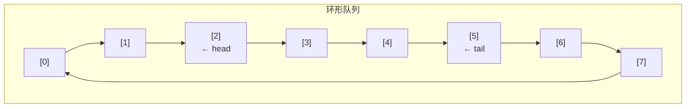
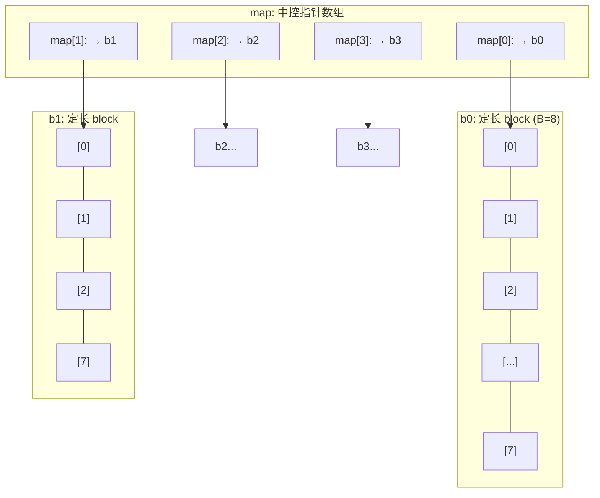
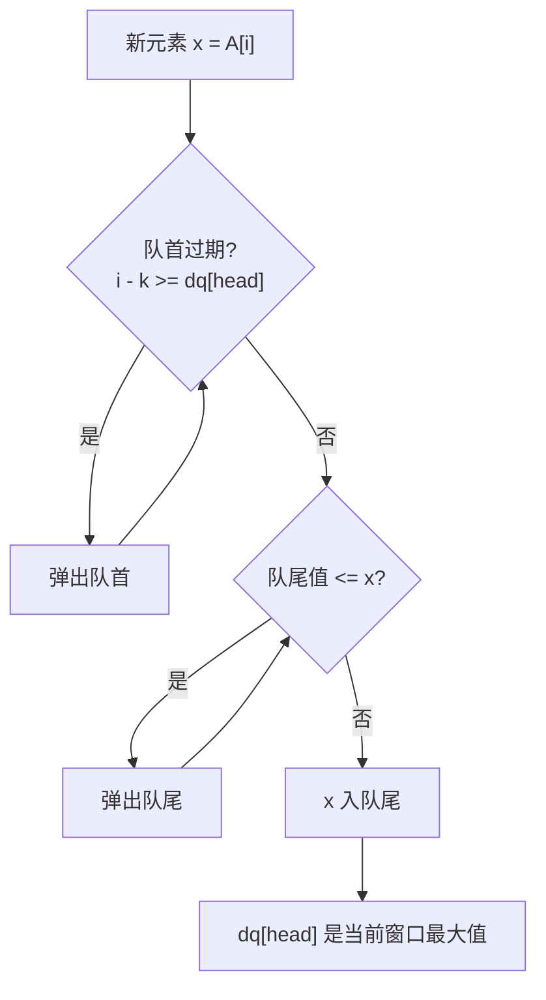
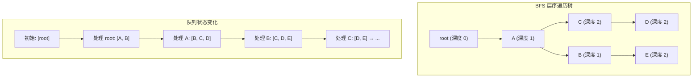
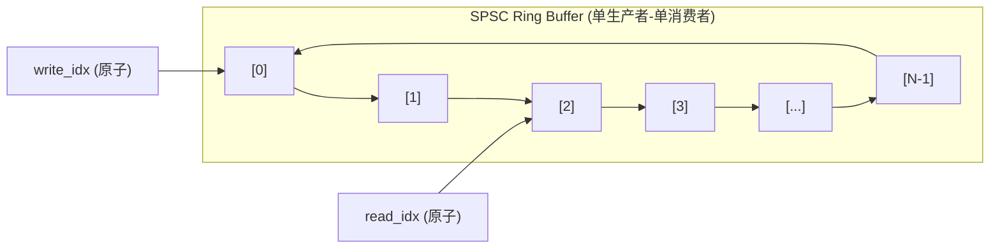

建议先阅读: [[G_容器_Container|容器概览]], [[E_栈_Stack|栈]]


---

## 原理

队列（Queue）遵循先进先出（FIFO: First In First Out）。元素从队尾（back）入队，从队首（front）出队。与栈的"后进先出"形成对称——栈模拟"时间倒流"（最近 = 最重要），队列模拟"时间流逝"（最早 = 最优先）。

### 队列在哪里

打印任务按提交顺序输出；操作系统把就绪进程排成等待 CPU 的队列，先来先服务；消息中间件让生产者与消费者解耦，请求按到达顺序被处理；BFS 逐层展开图节点，靠的正是队列的 FIFO 次序。这些场景的共同主题——**保持到达顺序的公平性：先到先服务**——正是 FIFO 的用武之地。本章沿这条线展开：先解决数组实现中的假溢出问题（循环队列），再看两端都要进出的双端队列，最后深入内核 Ring Buffer 与网卡 DMA 的硬件队列。

| 操作 | 描述 | 时间复杂度 |
|------|------|:---------:|
| `push(x)` / `enqueue(x)` | 从队尾插入 x | $O(1)$ |
| `pop()` / `dequeue()` | 弹出队首元素 | $O(1)$ |
| `front()` | 读取队首（不弹出） | $O(1)$ |
| `back()` | 读取队尾 | $O(1)$ |
| `empty()` | 是否为空 | $O(1)$ |

![[queue_enqueue_dequeue.gif]]

### 队列的抽象数据类型、逻辑结构与存储结构

| 维度 | 队列 |
|------|------|
| 逻辑结构 | 线性结构（一对一），**运算受限**：只允许在队尾插入、队首删除 |
| 存储结构 | 顺序队列 / **循环队列**（解决假溢出）/ 链队列 / 双端队列 |
| 基本运算 | `InitQueue`、`DestroyQueue`、`QueueEmpty`、`EnQueue`、`DeQueue`、`GetHead` |
| 重要特性 | 先进先出（FIFO）；队首与队尾分工明确 |

> 队列与栈一样属于**操作受限的线性表**。二者完整的共同点、差异与存储方式对比表见 [[E_栈_Stack#栈与队列：共同点与差异]]，这里不重复。记住结论：**栈是单端受限，队列是双端分工，两者都是双端队列的退化。**

### 队列的三种实现

| | 循环队列（数组） | 链表队列 | 双端队列（deque） |
|------|:---:|:---:|:---:|
| 存储 | 连续数组 + 取模 | 节点链式 | 分段连续（map+block） |
| 随机访问 | $O(1)$（下标映射） | 不支持 | $O(1)$（两层寻址） |
| 两端 Push/Pop | 仅单向或需额外设计 | 仅单向 | $O(1)$ 双向 |
| 扩容 | 需 realloc + 重排 | 无容量限制 | map 扩容 + 新 block |
| 缓存友好 | 好（连续访问） | 差（指针追踪） | 中等（block 内好，跨 block 差） |

### 循环队列的假溢出与取模运算

最简单的数组队列：head 指向队首，tail 指向队尾。入队 tail++，出队 head++。随着 push/pop 交替，可用空间从 [0, capacity-1] 退化为 [head, capacity-1]，head 前方的空间无法利用——称为**假溢出**。

循环队列通过取模运算将一维数组在逻辑上卷成环：



核心操作：
```
push: data[tail] = x; tail = (tail + 1) % capacity;
pop: head = (head + 1) % capacity;
```

#### 取模的硬件代价

`% capacity` 在 CPU 层对应 `idiv` 指令（整数除法），延迟约 20-80 个周期。对于高频 push/pop 循环，取模可能成为瓶颈。**技巧**：当 `capacity` 是 2 的幂时，`% capacity` 可替换为 `& (capacity - 1)`——位与操作仅 1 个周期。

```c
// 如果 capacity = 256 (2^8 = 0x100)
// tail % 256 → 等效于 tail & 0xFF
// 编译器在 -O2 下会自动优化，但需 capacity 是编译时常量
```

实际上，大多数编译器的 `-O2` 优化可以在常量 capacity 时自动将取模转为位与，但若 capacity 是运行时变量，这一优化无法生效。因此高性能循环队列实现中，常显式使用 `capacity` 为 2 的幂并手动 `& (capacity - 1)`。

#### 满队列的判定：浪费一个槽位

![[circular_queue_full_empty.gif]]

当 head == tail 时，可能是空队列也可能是满队列。两种区分策略：

**浪费一个槽位**（最常见）：保证 tail 永远不追上 head——当 `(tail + 1) % capacity == head` 时视为满，此时数组中始终有一个空闲槽位：
```
capacity=8, head=0, tail=7 → 满 (尾部 slot 保持空, 防止混淆)
capacity=8, head=0, tail=0 → 空
```

**显式计数**（本章采用）：维护 `count` 变量单独计数。`count == 0` 为空，`count == capacity` 为满。多一个变量但不需要浪费槽位。

#### 两种策略的对比

选择题常考两种策略的表达式差异——并排对比：

| | 牺牲一格（空闲单元法） | 显式计数（计数器法） |
|--|--|--|
| 额外变量 | 无 | 一个 `count` |
| 判空 | `head == tail` | `count == 0` |
| 判满 | `(tail + 1) % capacity == head` | `count == capacity` |
| 实际容量 | capacity − 1 | capacity |
| 元素个数公式 | `(tail - head + capacity) % capacity` | 直接读 `count` |

**手算示范**（牺牲一格法）：capacity=8，head=5，tail=2。元素个数 $= (2-5+8)\%8 = 5$；判满：$(2+1)\%8 = 3 \ne 5$，未满；还能连续入队几次？入队推进 tail 直到 $(tail+1)\%8 = 5$ 即 tail=4——从 2 走到 4 需 **2 次**。

**自测：循环队列状态推演**

① 牺牲一格法，capacity=10，head=3，tail=9。当前元素个数？还能连续入队几次？
② 同一物理状态下改用显式计数法：实际容量是多少？
③ 牺牲一格法，capacity=4，从空队开始依次执行：push A、push B、push C、pop ×2、push E、push F、pop——写出每步后 head/tail 与队内内容；哪一步之后队列满？

答案：

① 元素个数 $=(9-3+10)\%10=6$；满的条件是 tail 绕回到 2（$(2+1)\%10=3=head$），从 9 出发经 0、1 到 2，还能入队 **3 次**。
② 计数法不牺牲槽位，实际容量就是 **10**（牺牲一格法只有 9）。同一 head/tail 下若 count=9，则还能入队 **1 次**。
③ 逐步轨迹：

| 操作 | head | tail | 队内（首→尾）| 说明 |
|------|:---:|:---:|------|------|
| push A/B/C | 0 | 3 | A B C | 再 push 会撞上 head，被拒 |
| pop ×2 | 2 | 3 | C | A、B 出队 |
| push E | 2 | 0 | C E | tail 绕环到 0——wrap-around |
| push F | 2 | 1 | C E F | $(1+1)\%4=2=head$ → **满** |
| pop | 3 | 1 | E F | C 出队，又腾出一格 |

满发生在 push F 之后。注意第 4 步正是"绕环追上"的经典场景：tail 从 3 绕回 0 再走到 1，靠取模保持下标合法。

### 双端队列（Deque）的内部架构

Deque 支持 $O(1)$ 两端插入/删除和 $O(1)$ 随机访问。它既不是 vector（插入非尾部 O(n)）也不是 list（随机访问 O(n)），而是用**分段连续存储**在两者之间取得平衡：



- **map**：动态指针数组，每个元素指向一个 block
- **block**：固定大小（通常为 `max(1, 512/sizeof(T))` 或 8），真正存储数据
- **随机访问**：`arr[i] = map[(start_block + (head_offset + i) / B) % map_size][(head_offset + i) % B]`。两次算术运算，仍然是 O(1)，但比 vector 多了一次间接寻址

**Deque 的 map 扩容**：当 head 或 tail 侧的 map 已无空闲 slot 时，分配 2 倍大的新 map，将旧 map 拷贝到新 map 的**中央区域**，预留两侧空间：

```
旧 map (4 slots, 满): [b0][b1][b2][b3]
新 map (8 slots): [ ][ ][b0][b1][b2][b3][ ][ ]
 ↑ 中央对齐，两侧各 2 个空闲 slot
```

这个"中央对齐"技巧保证了后续 `push_front` 和 `push_back` 都有足够的两侧扩展空间，避免了频繁的 map 重分配。

#### 简易 Deque 实现

```c
#define BLOCK_SIZE 8

typedef struct {
 int** map;
 int map_cap; // map 总 slot 数
 int map_start; // map 中第一个有效 block 的索引
 int block_count; // 已用 block 数
 int head_off; // 第一个 block 内的偏移
 int tail_off; // 最后一个 block 内的偏移
 int total;
} SimpleDeque;

// 随机访问: arr[i]
int sd_at(SimpleDeque* dq, int i) {
 int global_idx = dq->head_off + i;
 int blk = (dq->map_start + global_idx / BLOCK_SIZE) % dq->map_cap;
 return dq->map[blk][global_idx % BLOCK_SIZE];
}

void sd_push_front(SimpleDeque* dq, int value) {
 if (dq->head_off > 0) {
  dq->head_off--;
 } else {
  int new_map_cap = dq->map_cap * 2;
  int** new_map = calloc(new_map_cap, sizeof(int*));
  int center = new_map_cap / 2;
  for (int i = 0; i < dq->block_count; i++)
   new_map[center + i] = dq->map[(dq->map_start + i) % dq->map_cap];
  free(dq->map);
  dq->map = new_map;
  dq->map_cap = new_map_cap;
  dq->map_start = center;
  int blk = (dq->map_start - 1 + dq->map_cap) % dq->map_cap;
  dq->map[blk] = malloc(BLOCK_SIZE * sizeof(int));
  dq->block_count++;
  dq->head_off = BLOCK_SIZE - 1;
  dq->map_start = blk;
 }
 dq->map[(dq->map_start + dq->head_off / BLOCK_SIZE) % dq->map_cap][dq->head_off % BLOCK_SIZE] = value;
 dq->total++;
}

void sd_push_back(SimpleDeque* dq, int value) {
 int global_idx = dq->head_off + dq->total;
 int blk = (dq->map_start + global_idx / BLOCK_SIZE) % dq->map_cap;
 int off = global_idx % BLOCK_SIZE;
 if (dq->total > 0 && off == 0) {
  int next = (blk + 1) % dq->map_cap;
  if (next == dq->map_start) {
   int new_map_cap = dq->map_cap * 2;
   int** new_map = calloc(new_map_cap, sizeof(int*));
   int center = new_map_cap / 2;
   for (int i = 0; i < dq->block_count; i++)
    new_map[center + i] = dq->map[(dq->map_start + i) % dq->map_cap];
   free(dq->map);
   dq->map = new_map;
   dq->map_cap = new_map_cap;
   dq->map_start = center;
   blk = (dq->map_start + global_idx / BLOCK_SIZE) % dq->map_cap;
  }
  dq->map[(blk + 1) % dq->map_cap] = malloc(BLOCK_SIZE * sizeof(int));
  dq->block_count++;
 }
 dq->map[blk][off] = value;
 dq->total++;
}

int sd_pop_front(SimpleDeque* dq, int* out) {
 if (dq->total == 0) return -1;
 int blk = (dq->map_start + dq->head_off / BLOCK_SIZE) % dq->map_cap;
 int off = dq->head_off % BLOCK_SIZE;
 if (out) *out = dq->map[blk][off];
 dq->head_off++;
 dq->total--;
 if (dq->head_off >= BLOCK_SIZE && dq->total > 0) {
  free(dq->map[blk]);
  dq->map[blk] = NULL;
  dq->map_start = (dq->map_start + 1) % dq->map_cap;
  dq->block_count--;
  dq->head_off = 0;
 } else if (dq->total == 0) {
  dq->head_off = 0;
 }
 return 0;
}

int sd_pop_back(SimpleDeque* dq, int* out) {
 if (dq->total == 0) return -1;
 dq->total--;
 int global_idx = dq->head_off + dq->total;
 int blk = (dq->map_start + global_idx / BLOCK_SIZE) % dq->map_cap;
 int off = global_idx % BLOCK_SIZE;
 if (out) *out = dq->map[blk][off];
 if (dq->total == 0) {
  dq->head_off = 0;
 }
 return 0;
}

int sd_size(const SimpleDeque* dq) {
 return dq->total;
}
```

#### 双端队列的受限类型：输入受限 / 输出受限

![[deque_restricted.gif]]

双端队列（Deque）允许两端插入、两端删除。考试常考它的两种**受限变体**（2010 年、2021 年 408 都考过，见 [[#408 真题精选]]）：

| 类型 | 允许的操作 | 等价于 |
|------|-----------|--------|
| **输入受限双端队列**（input-restricted）| 只允许在**一端插入**，两端都可以删除 | "入的时候排队、出的时候自由" |
| **输出受限双端队列**（output-restricted）| 两端都可以插入，只允许在**一端删除** | "入的时候自由、出的时候排队" |

**判定方法**：不管哪种受限 Deque，元素**入队顺序固定**（依次为 $a_1,a_2,\dots$）。手工判定就是**枚举每一步"从哪端入、从哪端出"**，看能否拼出目标序列；更快的观察是：

- 在**输出受限**双端队列（两端入、一端出）中，**相邻入队的元素在出队序列中必须相邻**——因为先入的两个元素必然一个在前端、一个在后端（或都在同一端），一旦有元素从中间被出队，后来的元素就无法插到它们之间；
- 在**输入受限**双端队列（一端入、两端出）中，**出队序列可以看成把入队序列不断从两端取出**：从队首出得到某个"前缀的逆序"，从队尾出得到"后缀的正序"。

> 一句话：输出受限 = 入队自由、出队受约束；输入受限 = 入队受约束、出队自由。做题优先枚举端口，再用上面的"相邻性"快速排除。

**例**（2010 第 2 题，输出受限）：元素 a,b,c,d,e 依次入队，只有一端能出队，则 `d,b,c,a,e` 不可能——a、b 相邻入队，而 d 若要第一个出，d 必须从 a、b 的外侧加入；之后 d 出、b 出，剩 a，c 无法再插到 b 与 a 之间。

### 单调队列（Monotonic Queue）

单调队列是滑动窗口问题的标准解法。它在队列中维护元素值的单调性（递减或递增），利用单调性使得队首始终是窗口内的极值。

**核心性质**：对于给定的数组 $A$ 和滑动窗口大小 $k$，维护一个单调递减队列 `dq`（存的是下标）。窗口取闭区间 $[i-k+1,\ i]$（以 $i$ 为右端、长度为 $k$）。对于每个新元素 $A[i]$：
1. 若队首下标已滑出窗口（`i - k >= dq[head]`，即下标 $\le i-k$ 都已过期），弹出队首
2. 弹出队尾所有 $\leq A[i]$ 的元素（因为它们永远不会成为之后窗口的最大值——它们位置在前，值却不大，当它们还"活着"时不可能赢 $A[i]$）
3. 将 $i$ 入队尾



单调队列的时间复杂度 $O(n)$——每个下标入队一次、出队至多一次。这是一个典型的均摊线性算法：表面上每个新元素都可能"踢掉"多个元素，但每个元素被踢最多一次，总操作数不超过 $2n$。

```c
int* max_sliding_window(const int* nums, int n, int k, int* result_size) {
 int* result = malloc((n - k + 1) * sizeof(int));
 int* dq = malloc(n * sizeof(int));
 int head = 0, tail = 0, ri = 0;
 for (int i = 0; i < n; i++) {
 // 窗口为闭区间 [i-k+1, i]：下标 <= i-k 均已过期
 while (tail > head && dq[head] <= i - k)
 head++;
 while (tail > head && nums[dq[tail-1]] <= nums[i]) // 保持递减
 tail--;
 dq[tail++] = i;
 if (i >= k - 1)
 result[ri++] = nums[dq[head]];
 }
 *result_size = ri;
 free(dq);
 return result;
}
```

---

## 深入底层

### 队列与 BFS：深度的天性

广度优先搜索（BFS）使用队列实现。BFS 的一个核心保证——首次发现某节点的路径即是最短路径——源于队列的 FIFO 性质：同一层的所有节点先于下一层的任何节点被处理。



BFS 用队列的 FIFO 顺序保证了"先发现先处理"。在无权重图中，节点在 BFS 树中的深度 = 从起点到该节点的最短路径长度。Dijkstra 算法是 BFS 的加权推广——将队列替换为优先队列（堆）。详见 [[U_图_Graph|图的 BFS]]。

### Lock-Free 队列：环形缓冲区（Ring Buffer）

在并发编程和操作系统内核中，无锁队列（lock-free queue）使用**环形缓冲区**实现——生产者（writer）和消费者（reader）各自持有一个原子变量（`head` 和 `tail`），通过 CAS（Compare-And-Swap）无锁地更新：



Linux 内核的 `kfifo`（kernel FIFO buffer）和 DPDK 的 `rte_ring` 是典型的无锁环形队列实现。它们使用 `power-of-two` 容量和内存屏障（memory barrier）确保多核环境下的正确性。关键设计：write_idx 仅由生产者更新，read_idx 仅由消费者更新——避免了需要 CAS 的复杂争用。但在多生产者/多消费者（MPMC）场景，仍然需要原子比较交换。

### 硬件中的队列：DMA 环形描述符

网卡驱动程序中的数据包收发使用与队列结构同构的**DMA 环形描述符**（DMA ring descriptor）。网卡通过 DMA 引擎将接收到的数据包直接写入主机内存中的环形缓冲区，通过 head/tail 指针（由硬件和驱动分别管理）协调读写：

```
网卡 → DMA 写入 → [接收缓冲区环形队列] → 驱动软件读取 → 网络栈
```

这个结构在硬件层面利用了队列的 FIFO 语义——数据包按到达顺序被软件处理。队列的"先进先出"在硬件层面对应"先到达的数据包先被处理"，保证各层网络协议的时序正确性。

---

## 实现

### 循环队列（数组版）

![[circular_queue.gif]]


```c
#include <stdlib.h>

typedef struct {
 int* data;
 size_t head, tail;
 size_t capacity;
 size_t count;
} CircularQueue;

void cq_init(CircularQueue* q, size_t cap) {
 q->data = malloc(cap * sizeof(int));
 q->head = q->tail = 0;
 q->capacity = cap;
 q->count = 0;
}

void cq_destroy(CircularQueue* q) { free(q->data); }

static int cq_resize(CircularQueue* q) {
 size_t new_cap = q->capacity * 2;
 int* new_data = malloc(new_cap * sizeof(int));
 if (!new_data) return -1;
 // 按逻辑顺序拷贝: [head .. tail) wrap-around 后平坦化
 for (size_t i = 0; i < q->count; i++)
 new_data[i] = q->data[(q->head + i) % q->capacity];
 free(q->data);
 q->data = new_data;
 q->head = 0;
 q->tail = q->count;
 q->capacity = new_cap;
 return 0;
}

int cq_push(CircularQueue* q, int value) {
 if (q->count >= q->capacity)
 if (cq_resize(q) != 0) return -1;
 q->data[q->tail] = value;
 q->tail = (q->tail + 1) % q->capacity;
 q->count++;
 return 0;
}

int cq_pop(CircularQueue* q) {
 if (q->count == 0) return -1;
 q->head = (q->head + 1) % q->capacity;
 q->count--;
 return 0;
}

int cq_front(const CircularQueue* q, int* out) {
 if (q->count == 0) return -1;
 *out = q->data[q->head];
 return 0;
}
```

### 链表队列

![[linked_queue.gif]]

```c
#include <stdlib.h>

typedef struct QNode {
 int data;
 struct QNode* next;
} QNode;

typedef struct {
 QNode* head;
 QNode* tail;
 size_t count;
} LinkedQueue;

void lq_init(LinkedQueue* q) { q->head = q->tail = NULL; q->count = 0; }

void lq_destroy(LinkedQueue* q) {
 while (q->head) {
 QNode* tmp = q->head;
 q->head = q->head->next;
 free(tmp);
 }
 q->tail = NULL; q->count = 0;
}

int lq_push(LinkedQueue* q, int value) {
 QNode* node = malloc(sizeof(QNode));
 if (!node) return -1;
 node->data = value;
 node->next = NULL;
 if (q->tail) q->tail->next = node;
 else q->head = node;
 q->tail = node;
 q->count++;
 return 0;
}

int lq_pop(LinkedQueue* q) {
 if (!q->head) return -1;
 QNode* tmp = q->head;
 q->head = q->head->next;
 if (!q->head) q->tail = NULL;
 free(tmp);
 q->count--;
 return 0;
}
```

### 用循环单链表实现链队列（408 高频）

普通链队列需要 `head`（队首）和 `tail`（队尾）两个指针：入队在 `tail` 处 $O(1)$，出队在 `head` 处 $O(1)$。若题目只给一个**尾指针**，用**循环单链表**也能实现队列：`rear` 指向队尾结点；由于成环，头结点是 `rear->next`，首元结点是 `rear->next->next`。

```c
// 带头结点的循环单链表实现链队列，只用一个尾指针 rear
typedef struct QNode { int data; struct QNode* next; } QNode;

// 初始化为空：头结点自环
void cq_init(QNode** rear) {
    QNode* head = malloc(sizeof(QNode));  // 头结点（不存数据）
    head->next = head;
    *rear = head;
}

// 入队：在尾结点与头结点之间插入
void cq_enqueue(QNode** rear, int x) {
    QNode* node = malloc(sizeof(QNode));
    node->data = x;
    node->next = (*rear)->next;   // 新结点指向头结点
    (*rear)->next = node;         // 旧尾结点指向新结点
    *rear = node;                 // rear 移到新尾结点
}

// 出队：删首元结点
int cq_dequeue(QNode** rear, int* out) {
    QNode* head = (*rear)->next;          // 头结点
    if (head->next == head) return -1;    // 空队列
    QNode* first = head->next;            // 首元结点
    *out = first->data;
    head->next = first->next;
    if (first == *rear) *rear = head;     // 删的是最后一个结点，恢复空态
    free(first);
    return 0;
}
```

**时间复杂度**：入队、出队都是 $O(1)$（直接改指针，无需遍历）。**判空**：`(*rear)->next == *rear`（头结点自环）——注意与"带头结点循环单链表判空 `head->next == head`"是同一条件。

### 链队列适合的链表结构选择（结构选型）

| 链表形态 | 是否适合做链队列 | 原因 |
|----------|:---:|------|
| 带头结点单链表（head、tail 两指针）| ✅ 最常用 | 入队尾插 $O(1)$、出队头删 $O(1)$，空表处理统一 |
| 不带头结点单链表（head、tail）| ✅ 可用 | 出队删首元结点时要单独处理"删空后 tail 置 NULL" |
| 只带尾指针的**循环单链表** | ✅ 最省指针 | 一个 `rear` 同时定位队首 `rear->next->next` 与队尾，入队出队均 $O(1)$ |
| 只带头指针的单链表 | ⚠️ 差 | 入队要遍历到尾部，$O(n)$，不适合 |
| 双向链表 | ✅ 但浪费 | 队列只在两端操作，用不着前驱指针 |
| 带头结点循环**双**链表 | ✅ 但浪费 | 同上，多一个指针域，队列用不到 |

**结论**：链队列的"标准答案"是**带头结点单链表 + 队首队尾双指针**；若题目强调"只给一个指针 / 只给队尾指针"，则用**只带尾指针的循环单链表**。判断依据是**能否让入队、出队都 $O(1)$**，以及**空表是否好处理**。

> 408 综合应用题（2019 第 42 题）正是"循环链式队列"，见 [[#408 真题精选]]。

---

## 高频考点（选择 / 填空 / 推演）

> 这一节把队列的**概念题与手算推演题**集中起来，与正文分开，便于考前对照复习。历年真题另见下一节 [[#408 真题精选]]。

### 考点 1：循环队列初始 front/rear 的设置

**问题**：已知 front/rear 的指向约定，问**初始值**应设为多少，才能让**第一个入队元素落在指定下标**（2011 真题）。

**通用方法**：先写出题给约定下的**入队公式**，令"第一个元素入队后的位置"等于目标位置，再反解初始值。

| 约定 | `front` 指向 | `rear` 指向 | 入队 | 出队 | 让首元素存 `A[0]` 的初始值 |
|------|------|------|------|------|:---:|
| 约定① | 队头元素 | 队尾元素 | 先 `rear=(rear+1)%M` 再存 `A[rear]` | `front=(front+1)%M` | `front=0, rear=M-1` |
| 约定② | 队头元素 | 队尾的**后一位置** | 先存 `A[rear]` 再 `rear=(rear+1)%M` | 同左 | `front=0, rear=0` |

> 约定①的推导：入队是"先移尾指针再存"，要让第一个元素存到 `A[0]`，需 `(rear0+1)%M = 0`，故 `rear0=M-1`；队头元素就是 `A[0]`，故 `front0=0`。做题时先确认约定，再套公式。

### 考点 2：区分队空与队满的三种方法

循环队列当 `front == rear` 时无法区分空与满，常见三种区分策略（对照 [[#两种策略的对比]]）：

| 方法 | 判空 | 判满 | 实际容量 | 元素个数 |
|------|------|------|:---:|------|
| **牺牲一个单元** | `front == rear` | `(rear+1)%M == front` | $M-1$ | `(rear-front+M)%M` |
| **设 `size` 计数** | `size == 0` | `size == M` | $M$ | `size` |
| **设标志 `flag`** | `front==rear && flag==0` | `front==rear && flag==1` | $M$ | 视实现 |

- `flag` 法：`flag=0` 表示最近一次操作是出队（则相等即空），`flag=1` 表示最近一次是入队（则相等即满）。初值 `front=rear=0, flag=0`。
- 牺牲单元法**必定浪费一格**；计数法、标志法不浪费，但多一个变量/一位。
- **表达式差异是选择/填空题最爱考的点**，务必分清 `%M` 与 `%(M-1)`、以及 `front`、`rear` 谁在左边。

### 考点 3：输入受限 / 输出受限双端队列的序列判定

两种受限 Deque 的定义、判定口诀与图示见 [[#双端队列的受限类型：输入受限 / 输出受限]]。做判定题时：

1. 先判断是**输入受限**（一端入、两端出）还是**输出受限**（两端入、一端出）；
2. **枚举每一步从哪端入、从哪端出**，或利用"相邻性/前缀逆序"快速剪枝；
3. 遇到"不可能"选项，给出直观反例即可（2010、2021 真题见专节）。

**输出受限（两端入、一端出）的判定要点**：所有出队都发生在**同一端**，因此出队序列是"从一端依次取出"，未被取出的元素之间的相对次序受入队端影响。典型不可能序列是"把相邻入队的元素在输出中拆开、且插入顺序无法解释"的那种。

**输入受限（一端入、两端出）的判定要点**：出队序列可以看成一个栈的弹出序列与一个队列的出队序列的"混合"——从入队端出得到**正序**，从另一端出得到**逆序**。

### 考点 4：队列与栈混合操作的序列判定

**问题**（2018 第 2 题）：有一个队列 Q（元素 1..6 依次在队中）和一个空栈 S，只允许：① 出队并输出；② 出队并入栈；③ 出栈并输出。判断某输出序列是否可能。

**判定方法**：关键在于"**进栈的元素在出栈时顺序被颠倒，而队列始终保持 FIFO**"。具体步骤：

1. 队列保证**入栈的先后顺序 = 出队顺序**；
2. 一旦某些元素进了栈，它们只能**逆序**回到输出；
3. 综合起来，任何合法输出序列都满足：**若 $x$ 比 $y$ 先入栈，且二者都在栈里，则 $x$ 一定比 $y$ 后输出**。违反此约束即不可能。

> 这类题建议直接**模拟 + 反证**：先假设目标序列可达，看能否构造操作序列；若在某步发现"想输出的元素既不在队首、又不可能出现在栈顶"，则不可能。

### 考点 5：中缀转后缀时运算符栈最大容量估算

见 [[E_栈_Stack#考点 8：中缀转后缀时运算符栈的最大容量估算]]：运算符栈最大深度 ≤ 括号最大嵌套深度 + 优先级层数。这是同一个考点在队列/表达式章节的复用。

### 考点 6：链队列适合的链表结构选择

见 [[#链队列适合的链表结构选择（结构选型）]]：标准答案是**带头结点单链表 + 队首队尾双指针**；只给一个指针时用**只带尾指针的循环单链表**。核心判据是入队、出队都能 $O(1)$ 且空表好处理。

### 考点 7：队列在打印机缓冲区等具体应用

队列的 FIFO 语义天然适合"先到先服务"的缓冲与调度（打印缓冲区、就绪队列、消息中间件等），详细分析见 [[#扩展：队列的更多模型与应用]]。

---

## 408 真题精选

> 这一节**只放历年 408 统考真题**。栈相关的真题汇总在 [[E_栈_Stack#408 真题精选]]，两处交叉引用。凡涉及双端队列、循环队列、链队列的题目都放在这里。

### 真题索引（队列与双端队列相关）

| 年份 | 题号 | 题目 | 类型 | 本题解位置 |
|:----:|:----:|------|:----:|-----------|
| 2010 | 2 | 两端入队、一端出队的出队序列 | 输出受限 Deque | [[#2010 第 2 题：输出受限双端队列]] |
| 2011 | 3 | 循环队列初始 front/rear 使首元素存 A[0] | 循环队列 | [[#2011 第 3 题：循环队列的初始值]] |
| 2014 | 3 | 两端可操作的循环队列判空判满 | 循环队列 | [[#2014 第 3 题：两端可操作的循环队列]] |
| 2018 | 2 | 队列 + 栈三种操作的输出序列 | 混合操作 | [[#2018 第 2 题：队列与栈混合操作]] |
| 2019 | 42 | 设计一个空间只增不减、操作 O(1) 的队列 | 综合应用题 | [[#2019 第 42 题：循环链式队列设计（应用题）]] |
| 2021 | 2 | 一端只入、一端可入可出的出队序列 | 输出受限 Deque | [[#2021 第 2 题：受限双端队列]] |

### 2010 第 2 题：输出受限双端队列

**真题题干**：

> 某队列允许在其两端进行入队操作，但仅允许在一端进行出队操作。若元素 a, b, c, d, e 依次入此队列后再进行出队操作，则不可能得到的出队序列是（ ）。
> A. b, a, c, d, e　B. d, b, a, c, e　C. d, b, c, a, e　D. e, c, b, a, d

**考察内容**：输出受限双端队列的序列判定。

**解析**：本题是"两端入队、一端出队"的**输出受限双端队列**。逐项构造入队方案：

- A `b,a,c,d,e`：a 入、b 从左入、c/d/e 从右入 → 队首到队尾 `b,a,c,d,e` ✅
- B `d,b,a,c,e`：a 入、b 从左入、c 从右入、d 从左入、e 从右入 → `d,b,a,c,e` ✅
- D `e,c,b,a,d`：a 入、b 从左入、c 从左入、d 从右入、e 从左入 → `e,c,b,a,d` ✅
- C `d,b,c,a,e`：不管 a 从左还是右入，b 紧接着入队后一定与 a 相邻。要让 d 第一个出，d 必须从 a、b 的外侧加入；d 出、b 出后只剩 a，无论 c 何时入队，都无法使 c 出现在 b 与 a 之间。

> **正确答案：C**。

### 2011 第 3 题：循环队列的初始值

**真题题干**：

> 已知循环队列存储在一维数组 `A[0..n-1]` 中，且队列非空时 `front` 和 `rear` 分别指向队头元素和队尾元素。若初始时队列为空，且要求第 1 个进入队列的元素存储在 `A[0]` 处，则初始时 `front` 和 `rear` 的值分别是（ ）。
> A. 0, 0　B. 0, n-1　C. n-1, 0　D. n-1, n-1

**考察内容**：循环队列"先移尾指针再存"的入队约定，以及如何设置初值满足存储位置要求。

**解析**：题给约定下入队为 `rear = (rear+1)%n; A[rear] = x`。要让第一个元素存到 `A[0]`，需 `(rear+1)%n == 0`，故 `rear = n-1`；非空时 `front` 指向队头元素（即 `A[0]`），故 `front = 0`。

> **正确答案：B（front=0, rear=n-1）**。

### 2014 第 3 题：两端可操作的循环队列

**真题题干**：

> 循环队列放在一维数组 `A[0..M-1]` 中，`end1` 指向队头元素，`end2` 指向队尾元素的后一个位置。假设队列两端均可进行入队和出队操作，队列中最多能容纳 `M-1` 个元素。初始时为空。下列判断队空和队满的条件中，正确的是（ ）。
> A. 队空：`end1 == end2`；队满：`end1 == (end2+1) mod M`
> B. 队空：`end1 == end2`；队满：`end2 == (end1+1) mod (M-1)`
> C. 队空：`end2 == (end1+1) mod M`；队满：`end1 == (end2+1) mod M`
> D. 队空：`end1 == (end2+1) mod M`；队满：`end2 == (end1+1) mod (M-1)`

**考察内容**：左闭右开区间 `[end1, end2)` 的循环队列判空、判满；"最多容纳 M-1 个元素"提示采用**牺牲一个单元**法。

**解析**：`end1` 指队头、`end2` 指队尾后一位置，区间为 `[end1, end2)`。队空即区间为空，`end1 == end2`。牺牲一个单元判满：当"下一个尾位置"追上队头时满，即 `(end2+1) mod M == end1`，等价于 `end1 == (end2+1) mod M`。

> **正确答案：A**。

### 2018 第 2 题：队列与栈混合操作

**真题题干**：

> 现有队列 Q 与栈 S，初始时 Q 中的元素依次是 1,2,3,4,5,6（1 在队头），S 为空。若仅允许下列 3 种操作：① 出队并输出出队元素；② 出队并将出队元素入栈；③ 出栈并输出出栈元素。则不可能得到的输出序列是（ ）。
> A. 1,2,5,6,4,3　B. 2,3,4,5,6,1　C. 3,4,5,6,1,2　D. 6,5,4,3,2,1

**考察内容**：队列（FIFO）与栈（LIFO）混合后的序列可达性。

**解析**：逐一给出操作序列：

- A：①②①②②①①③③ → 输出 `1,2,5,6,4,3`
- B：②①①①①①③ → 输出 `2,3,4,5,6,1`
- D：②②②②②①③③③③ → 输出 `6,5,4,3,2,1`
- C：要输出 3，则 1、2 必须先依次入栈；一旦 1、2 都进了栈，**2 必然比 1 先输出**，因此无法得到 "1 在 2 之前" 的输出顺序。

> **正确答案：C**。

### 2019 第 42 题：循环链式队列设计（应用题）

**真题题干（10 分）**：

> 请设计一个队列，要求满足：① 初始时队列为空；② 入队时，允许增加队列占用空间；③ 出队后，出队元素所占用的空间可重复使用，即整个队列所占用的空间只增不减；④ 入队操作和出队操作的时间复杂度始终保持为 $O(1)$。请回答下列问题：
> (1) 该队列是应选择链式存储结构，还是顺序存储结构？
> (2) 画出队列的初始状态，并给出判断队空和队满的条件。
> (3) 画出第一个元素入队后的队列状态。
> (4) 给出入队操作和出队操作的基本过程。

**考察内容**：循环队列思想迁移到链式存储；空间复用；空/满判定。这是 408 数据结构极少出现的"队列应用题"。

**参考答案**：

**(1)** 选择**链式存储结构**。顺序存储无法既在入队时方便增加空间、又让出队释放的空间被重复利用（固定数组要么扩容搬移、要么无法回收队首空间）；链式存储方便开辟新结点，出队的结点不必真正释放，可被后续入队复用。

**(2)** 采用**首尾相接的循环单链表**（类似循环队列的思想）。初始时创建一个**只有一个空闲结点**的循环单链表，`front` 和 `rear` 均指向该空闲结点，并令该结点 `next` 指向自己（自环）：

```
   ┌──────────┐
   │ 空闲结点  │◄── front, rear
   └────┬─────┘
        └──────► (自环)
```

- **队空**：`front == rear`
- **队满**：`front == rear->next`

**(3)** 第一个元素入队后，`rear` 指向的结点存放数据并前移（或在该结点写入后新增空闲结点），状态为：

```
front ─► [ 空闲结点 ] ─► [ 数据结点 e1 ] ◄─ rear
```

即始终保留一个空闲结点用于区分队空/队满（"牺牲一个单元"思想的链式版）。

**(4)** 基本过程：

```
入队：
    if (front == rear->next)          // 队满
        在 rear 后面插入一个新的空闲结点；
    将入队元素保存到 rear 所指结点中；
    rear = rear->next；返回。

出队：
    if (front == rear)                // 队空
        出队失败，返回；
    取 front 所指结点中的元素 e；
    front = front->next；返回 e。
```

> 由于链表的结点不会真正释放，`front` 推进后腾出的结点会在环上被后面入队复用，从而满足"空间只增不减"且入队、出队均 $O(1)$。

### 2021 第 2 题：受限双端队列

**真题题干**：

> 已知初始为空的队列 Q 的一端仅能进行入队操作，另外一端既能进行入队操作又能进行出队操作。若 Q 的入队序列是 1, 2, 3, 4, 5，则不能得到的出队序列是（ ）。
> A. 5,4,3,1,2　B. 5,3,1,2,4　C. 4,2,1,3,5　D. 4,1,3,2,5

**考察内容**：输出受限双端队列的序列判定（两端入队、一端出队）。

**解析**：因为出队只在"既能入又能出的那一端"进行，所以是**输出受限**。逐项测试：

- A `5,4,3,1,2`：1、2 从后入；3、4、5 依次从前入 → 队列 `5,4,3,1,2`，依次出队 ✅
- B `5,3,1,2,4`：1、2 从后入，3 从前入，4 从后入，5 从前入 → `5,3,1,2,4` ✅
- C `4,2,1,3,5`：1 后入、2 前入、3 后入、4 前入、5 后入 → `4,2,1,3,5` ✅
- D `4,1,3,2,5`：要让 4 先出，4 必须加到队首；4 之后要出 1，则 1 必须紧跟在 4 后面；但 2、3 在 1 之后、4 之前入队，且 2 排在 3 之前入队，无法让 3 排在 1 与 2 之间，故不可能。

> **正确答案：D**。

---

## 扩展：队列的更多模型与应用

> 这一节是"比较深入的地方"，介绍队列在工程与建模中的典型形态。

### 打印机缓冲区（Spooling）与各类"先来先服务"缓冲

打印机的处理速度远低于主机发送数据的速度，因此操作系统设置一个**打印缓冲区**：多个打印任务按提交顺序排成队列，打印机逐个取出执行，这就是 **Spooling（假脱机）**。队列在这里承担两个作用：

- **速度匹配**：主机不必等待慢速设备，任务先入队；
- **公平性**：按提交顺序执行，先到先服务。

同类应用还包括：键盘缓冲区、网卡接收队列、消息中间件（RabbitMQ/Kafka 的分区队列）、线程池任务队列——它们的共同点是**生产者与消费者速度不匹配，用队列解耦并按到达顺序处理**。

### 离散事件模拟：银行排队模型

用队列可以对"顾客到达—排队—服务—离开"的随机过程建模仿真：

- **到达事件**：新顾客入队（可能按泊松分布生成到达间隔）；
- **离开事件**：服务完的顾客出队；
- 用**优先队列（事件表）**按时间顺序处理事件，用**普通队列**保存等待的顾客。

这是队列在运筹学/系统仿真中的经典用法，也是"事件驱动模拟"的骨架。

### 双端队列的更多变体

- **输出受限 / 输入受限 Deque**：见 [[#双端队列的受限类型：输入受限 / 输出受限]]；
- **滑动窗口最值**：单调队列（见 [[#单调队列（Monotonic Queue）]]）；
- **0-1 BFS / 单调队列优化 DP**：双端队列在算法竞赛中的高频用途；
- **工作窃取（work-stealing）调度**：每个线程一个双端队列，自己从一端取、窃取者从另一端取，可减少竞争。

### 多轨道火车调度问题

队列/栈在调度中的经典模型——旁轨（栈）数量与排列可排序性的关系，见 [[E_栈_Stack#多轨道火车调度问题（Railroad / 列车编组）]]。队列对应"输入轨道"的到达顺序，栈对应"旁轨"的缓冲顺序。

### 队列与优先队列

普通队列出队的是"最早到达"的元素；若改为"优先级最高"的元素先出队，就得到**优先队列（priority queue）**，通常用**堆**实现，详见 [[K_堆_Heap|堆]]。理解"队列 = 按到达顺序，优先队列 = 按优先级顺序"是选型的关键。

---

## 各语言标准库对比

| 语言 | 队列 | 双端队列 | 说明 |
|------|------|----------|------|
| C | 无 | 无 | 手写或使用 TAILQ 宏 |
| C++ | `std::queue<T>` | `std::deque<T>` | queue 是 deque 适配器 |
| Java | `Queue<T>`（interface） | `ArrayDeque<T>` | 推荐 ArrayDeque 而非 LinkedList |
| Python | `collections.deque` | `collections.deque` | 线程安全的 `queue.Queue` |
| Rust | `VecDeque<T>` | `VecDeque<T>` | 环形缓冲区实现 |

---

## 应用场景

- **BFS 遍历**：图的层序遍历、迷宫最短路径。BFS 的 FIFO 性质天然保证"先发现=最短"
- **生产者-消费者模型**：消息队列（message queue）、线程池任务队列。RabbitMQ 等中间件的核心数据结构
- **操作系统调度**：就绪队列（ready queue）按 FIFO 分配 CPU 时间片。详见 [[../操作系统/D_CPU调度|操作系统 — CPU 调度]]
- **网络数据包缓冲**：网卡驱动的环形缓冲区、TCP 重组缓冲区。DMA 引擎通过环形队列与驱动的软件栈交互
- **滑动窗口**：任意固定窗口内的最大/最小值查询，用单调队列从 $O(nk)$ 暴力降至 $O(n)$
- **IO 请求队列**：NVMe 驱动中的 Submission Queue / Completion Queue，使用环形缓冲区实现

---

## 练习

### LeetCode 题单

**设计类（循环队列 / 双端队列）**

| 题号 | 题目 | 难度 | 知识点 |
|------|------|:----:|--------|
| [622](https://leetcode.cn/problems/design-circular-queue/) | 设计循环队列 | 中等 | 循环队列判空判满（考点 1、2） |
| [641](https://leetcode.cn/problems/design-circular-deque/) | 设计循环双端队列 | 中等 | 两端操作的取模实现（呼应 2014 真题） |
| [1670](https://leetcode.cn/problems/design-front-middle-back-queue/) | 设计前中后队列 | 中等 | 双端队列组合 |
| [232](https://leetcode.cn/problems/implement-queue-using-stacks/) | 用栈实现队列 | 简单 | 双栈摊还 |
| [225](https://leetcode.cn/problems/implement-stack-using-queues/) | 用队列实现栈 | 简单 | 与 232 成对 |
| [面试题 03.04](https://leetcode.cn/problems/implement-queue-using-stacks-lcci/) | 化栈为队 | 简单 | 同上 |
| [933](https://leetcode.cn/problems/number-of-recent-calls/) | 最近的请求次数 | 简单 | 队列 + 时间窗口 |

**单调队列 / 滑动窗口**

| 题号 | 题目 | 难度 | 知识点 |
|------|------|:----:|--------|
| [239](https://leetcode.cn/problems/sliding-window-maximum/) | 滑动窗口最大值 | 困难 | 单调队列 |
| [剑指 Offer 59 - I](https://leetcode.cn/problems/hua-dong-chuang-kou-de-zui-da-zhi-lcof/) | 滑动窗口的最大值 | 困难 | 同 239 |
| [剑指 Offer 59 - II](https://leetcode.cn/problems/dui-lie-de-zui-da-zhi-lcof/) | 队列的最大值 | 中等 | 单调队列设计 |
| [862](https://leetcode.cn/problems/shortest-subarray-with-sum-at-least-k/) | 和至少为 K 的最短子数组 | 困难 | 单调队列 + 前缀和 |

**双端队列（Deque）应用**

| 题号 | 题目 | 难度 | 知识点 |
|------|------|:----:|--------|
| [950](https://leetcode.cn/problems/reveal-cards-in-increasing-order/) | 按递增顺序显示卡牌 | 中等 | Deque 模拟 |
| [649](https://leetcode.cn/problems/dota2-senate/) | Dota2 参议院 | 中等 | 队列模拟投票 |
| [1700](https://leetcode.cn/problems/number-of-students-unable-to-eat-lunch/) | 无法吃午餐的学生数量 | 简单 | 队列 + 栈混合 |
| [1823](https://leetcode.cn/problems/find-the-winner-of-the-circular-game/) | 找出游戏的获胜者 | 中等 | 队列模拟约瑟夫环 |

**BFS（队列的经典应用）**

| 题号 | 题目 | 难度 | 知识点 |
|------|------|:----:|--------|
| [102](https://leetcode.cn/problems/binary-tree-level-order-traversal/) | 二叉树的层序遍历 | 中等 | BFS 模板 |
| [200](https://leetcode.cn/problems/number-of-islands/) | 岛屿数量 | 中等 | BFS/DFS |
| [994](https://leetcode.cn/problems/rotting-oranges/) | 腐烂的橘子 | 中等 | 多源 BFS |
| [542](https://leetcode.cn/problems/01-matrix/) | 01 矩阵 | 中等 | 多源 BFS |
| [127](https://leetcode.cn/problems/word-ladder/) | 单词接龙 | 困难 | BFS 最短转换 |
| [210](https://leetcode.cn/problems/course-schedule-ii/) | 课程表 II | 中等 | 拓扑排序（队列） |

### 核心推演清单

练习题与上面的 LeetCode 互补——侧重手算推演，全部在正文中带完整答案：

| 自测 | 位置 | 内容 |
|------|------|--------|
| 状态推演 ×3 问 | 循环队列判定节 | 两种策略的表达式差异、剩余容量、wrap-around 轨迹与判满时刻 |
| 初值设置 | 高频考点 1 | 让首元素落在指定下标的 front/rear 初值 |
| 空/满三法 | 高频考点 2 | 牺牲单元、size、flag 三种策略 |
| 受限 Deque 判定 | 高频考点 3 | 输入受限/输出受限的序列可达性 |
| 队列+栈混合 | 高频考点 4 | 2018 真题的模拟与反证 |

## 动手实验

| 编号 | 题目 | 说明 |
|:----:|------|------|
| E1 | 循环队列边界条件测试 | 实现循环队列（capacity=8），依次执行：空队 pop、满队 push（填满后继续 push）、half-full 时的 wrap-around push/pop。所有操作均用 `assert` 验证状态（count, head, tail 的一致性） |
| E2 | 取模 vs 位与微基准 | 实现两个版本的循环队列 push：一个用 `% capacity`（capacity 为质数），一个用 `& (capacity-1)`（capacity 为 2 的幂）。各做 1000 万次 push/pop，记录 cpu 周期数差异 |
| E3 | BFS 层边界统计 | 在 20x20 的随机迷宫中运行 BFS 搜索，每处理完一层打印当前队列长度。观察 BFS 层宽度变化（随搜索半径扩大，队列长度先增后减） |
