建议先阅读: [[G_容器_Container|容器概览]], [[E_栈_Stack|栈]]（递归与栈的关系），[[F_队列_Queue|队列]]（层序遍历依赖队列）

---

## 原理

树（Tree）是计算机科学中最丰富的非线性结构。它是递归定义的自然体现——一棵树的子树仍然是树。这种自相似性使得递归成为树操作的首选范式。

### 树在哪里

文件系统是一棵倒挂的树——根目录 `/` 在顶部，子目录层层展开。编译器把源代码解析成抽象语法树（AST），每个表达式是一棵子树。HTML 的 DOM 是一棵树——`<html>` 是根，每个标签是子节点，CSS 选择器沿着树路径匹配。数据库的 B+ 树索引让百万行查询从全表扫描的 $O(n)$ 降到 $O(\log n)$。这些场景的共同主题——**层次关系的自然表达与高效检索**——正是树的核心用武之地。

### 术语体系

![[../assets/images/二叉树.png]]
![[../assets/images/树形结构.png]]

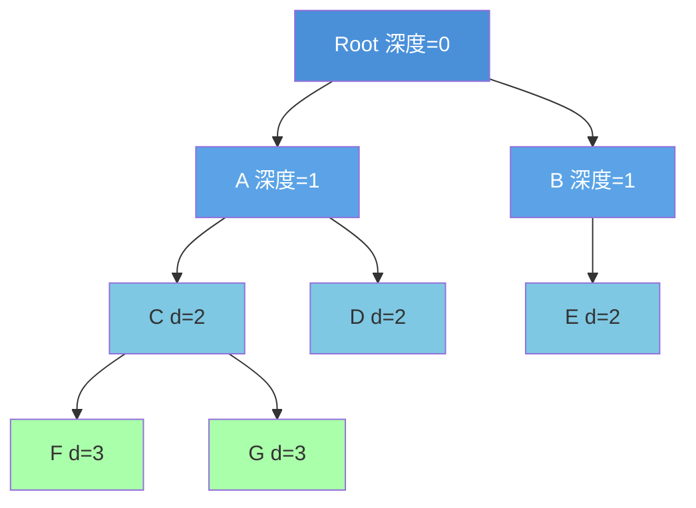

节点 F 的高度 = 0 (叶子), 节点 A 的高度 = 2, 树的高度 = 3
节点 F 的深度 = 3 (从根起的边数)

| 术语 | 定义 | 例（以 F 为参考） |
|------|------|---------|
| 深度（Depth） | 从根到该节点的边数 | 3 |
| 高度（Height） | 该节点到最深叶子的边数 | 0（叶子） |
| 层（Level） | 深度 + 1 | 第 4 层 |
| 平衡因子（BF） | 左子树高度 - 右子树高度 | — |

### 二叉树的性质与计算公式

这一节是选择题的"公式库"。先约定：**层从 1 开始**（根在第 1 层）；若题目把高度定义为"边的条数"，则高度 $h$ 对应层数 $h+1$，套公式前先看题目约定。

**（1）基本性质**

| 性质 | 公式 | 说明 |
|------|------|------|
| 第 $i$ 层最多结点数 | $2^{i-1}$ | $i\ge1$ |
| 层数为 $h$ 的二叉树最多结点数 | $2^h-1$ | 即满二叉树 |
| 叶子数与度为 2 的结点数 | $n_0=n_2+1$ | **最高频**，直接秒杀 |
| 结点总数 | $n=n_0+n_1+n_2$ | 二叉树只有 0/1/2 度 |
| 边数 | $n-1=n_1+2n_2$ | 每条边对应一个孩子 |

> $n_0=n_2+1$ 的推导：设结点总数 $n=n_0+n_1+n_2$；除根外每个结点都有一条来自双亲的边，故边数 $=n-1$；另一方面边数 $=n_1+2n_2$。联立得 $n_0+n_1+n_2-1=n_1+2n_2$，即 $n_0=n_2+1$。

**（2）完全二叉树**

| 性质 | 公式 / 结论 |
|------|------|
| 结点数 $n$ 与层数 $h$ | $h=\lfloor\log_2 n\rfloor+1$ |
| 度为 1 的结点数 | 只能是 $0$ 或 $1$ |
| 叶子结点数 | 由 $n_0=n_2+1$ 与 $n_0+n_1+n_2=n$ 联立求 |
| 双亲/孩子编号（根为 1）| 双亲 $\lfloor i/2\rfloor$；左孩子 $2i$；右孩子 $2i+1$ |
| 顺序存储所需最大下标 | 层数 $h$ 的斜树可达 $2^h-2$ |

**完全二叉树叶子数的快速算法**：先求层数 $h=\lfloor\log_2 n\rfloor+1$，最后一层结点数 $m=n-(2^{h-1}-1)$；最后一层的父结点数为 $\lceil m/2\rceil$（即第 $h-1$ 层中有孩子的结点数）。第 $h-1$ 层共有 $2^{h-2}$ 个结点，其中叶子数为 $2^{h-2}-\lceil m/2\rceil$。总叶子数 $=m+\big(2^{h-2}-\lceil m/2\rceil\big)$。例：$n=1001$，$h=10$，$m=490$，$\lceil m/2\rceil=245$，叶子 $=490+(256-245)=501$。

**（3）二叉链表空指针数**

$n$ 个结点的二叉链表有 $2n$ 个指针域，其中 $n-1$ 个指向孩子（除根外每个结点恰有一条入边），故空指针域

$$
2n-(n-1)=n+1
$$

> 线索二叉树正是把这 $n+1$ 个空指针改成前驱/后继线索，所以**线索数 $=n+1$**。

**（4）一般树（非二叉树）的结点数与度数**

设度为 $i$ 的结点有 $n_i$ 个（$i=0,1,\dots,m$），则

$$
n=\sum_{i=0}^{m}n_i,\qquad n-1=\sum_{i=1}^{m} i\cdot n_i
$$

联立可求叶子数 $n_0$。例：度为 4 的树中 $n_1=4,n_2=2,n_3=1,n_4=1$，则边数 $=4+4+3+4=15$，$n=16$，$n_0=16-(4+2+1+1)=8$。

**（5）满 $m$ 叉树与正则二叉树**

| 概念 | 结论 |
|------|------|
| 满 $m$ 叉树第 $k$ 层 | 最多 $m^{k-1}$ 个结点 |
| 层数为 $h$ 的满 $m$ 叉树 | 总数 $\dfrac{m^h-1}{m-1}$ |
| 正则二叉树（每个分支结点度都为 2）| $n_0=n_2+1$；层数 $h$ 时最少 $2h-1$ 个结点 |
| 满二叉树 | 是正则二叉树的特例，且所有叶子同层 |

> **易混**："$m$ 叉树"指每个结点最多有 $m$ 个孩子（允许某些结点度小于 $m$）；"度为 $m$ 的树"指**至少有一个**结点度为 $m$。两者不是一回事。

### 树、森林与二叉树的相互转换

**（1）树 → 二叉树：左孩子右兄弟**

规则只有一句：**每个结点的第一个孩子变成它的左孩子，其余孩子依次变成前一个孩子的右孩子**（即"左孩子右兄弟"）。

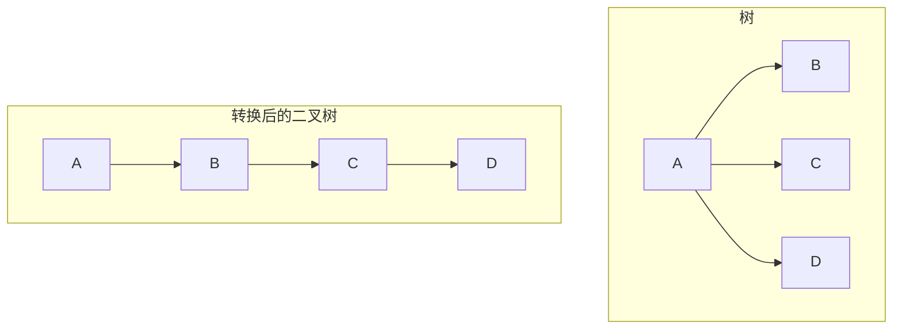

- 转换是**唯一**的；
- 转换后**根结点没有右子树**（因为根没有兄弟）；
- 树的前序/后序与二叉树遍历的对应见下。

**（2）森林 → 二叉树**

1. 先把每棵树各自转成二叉树；
2. 从第一棵树的根开始，把后一棵树的根作为前一棵树根的**右孩子**依次串起来。

转换后：
- 若森林只有一棵树 → 二叉树根**无右子树**；
- 若森林有多棵树 → 二叉树根**有右子树**（右链就是各棵树的根）；
- **森林中树的棵数 = 转换后二叉树根结点沿右链的结点数**。

**（3）二叉树 → 树 / 森林**

逆规则：若结点是双亲的左孩子，则把它作为双亲的第一个孩子；若结点是双亲的右孩子，则把它作为其双亲（左孩子）的下一个兄弟。反复应用即可还原。若二叉树根有右子树，则还原为森林；否则还原为一棵树。

**（4）遍历的对应关系**

| 树 / 森林 | 对应二叉树 |
|-----------|-----------|
| 树的**先根**遍历 | 二叉树的**先序**遍历 |
| 树的**后根**遍历 | 二叉树的**中序**遍历 |
| 森林的**先根**遍历 | 二叉树的**先序**遍历 |
| 森林的**后根**遍历 | 二叉树的**中序**遍历 |

> 记忆：**先根对先序，后根对中序**；森林只是把多棵树的根用右链串起来，遍历对应关系不变。

**（5）右指针为空的结点数**

森林有 $n$ 个**非终端结点**，转换成二叉树后，**右指针域为空的结点有 $n+1$ 个**。

直观理解：转换后，一个结点的右指针为空 ⇔ 它没有"下一个兄弟"。森林中每棵树的根、每一条兄弟链的末尾都会贡献一个空右指针，归纳后恰好比非终端结点数多 1。做题直接套 $n+1$。

### 二叉树的四种遍历

![[inorder_traversal.gif]]


二叉树遍历是递归应用的经典场景。每种遍历将"处理当前节点"的动作放在递归调用的不同位置：

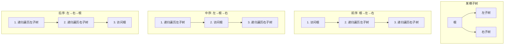

| 遍历方式 | 顺序 | 典型应用 |
|----------|------|---------|
| 前序（Pre-order） | 根 → 左 → 右 | 序列化/反序列化（`[根, 左子树序列, 右子树序列]` 唯一确定一棵树）、前缀表达式 |
| 中序（In-order） | 左 → 根 → 右 | BST 的中序遍历输出升序序列 |
| 后序（Post-order） | 左 → 右 → 根 | 释放树的内存（必须先释放子树再释放根）、后缀表达式、计算目录总大小 |
| 层序（Level-order） | 逐层、从左到右 | BFS 搜索、判断完全二叉树、二叉树的最大宽度 |

![[../assets/images/二叉树遍历.png]]

#### 遍历手算轨迹

以这棵完全二叉树为例：

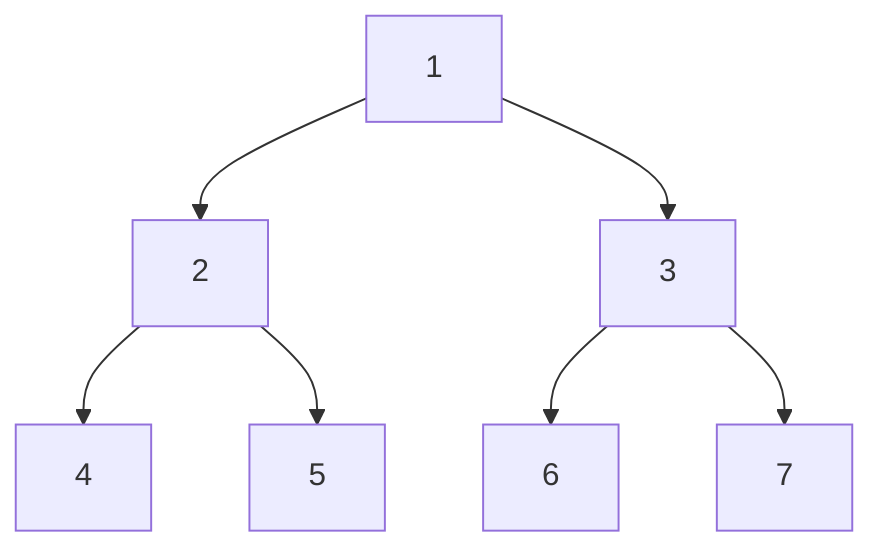

| 遍历 | 序列 | 过程 |
|------|------|------|
| 前序 | 1, 2, 4, 5, 3, 6, 7 | 根→左→右：先访问 1，递归左子树(2→4→5)，递归右子树(3→6→7) |
| 中序 | 4, 2, 5, 1, 6, 3, 7 | 左→根→右：最左 4，回退 2，右 5，回退 1，右子树同理 |
| 后序 | 4, 5, 2, 6, 7, 3, 1 | 左→右→根：叶子先输出，根最后 |
| 层序 | 1, 2, 3, 4, 5, 6, 7 | 逐层从左到右：BFS 遍历 |

**自测：遍历序列**

给定二叉树：
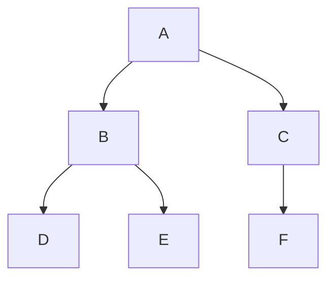
写出前序、中序、后序、层序遍历序列。

> 答案：
>
> 前序：A, B, D, E, C, F
> 中序：D, B, E, A, C, F
> 后序：D, E, B, F, C, A
> 层序：A, B, C, D, E, F

**前序+中序唯一确定二叉树**：给定前序和中序遍历序列，可以重建一棵二叉树。前序的第一个元素是根，在中序中找出根的位置后，左边是左子树的中序序列，右边是右子树的中序序列。递归即可构建。这是分治思想的典型应用——每个子问题是一个子树的构建。

#### 前序+中序重建手算

给定前序 `[A,B,D,E,C,F]` 和中序 `[D,B,E,A,F,C]`，重建二叉树：

**第 1 步**：前序首元素 A 是根。在中序中 A 的位置 → 左子树中序 `[D,B,E]`，右子树中序 `[F,C]`。

**第 2 步**：左子树的前序为 `[B,D,E]`，首元素 B 是左子树的根。中序 `[D,B,E]` 中 B 的位置 → B 的左子树中序 `[D]`，右子树中序 `[E]`。

**第 3 步**：D 和 E 都是叶子。

**第 4 步**：右子树的前序为 `[C,F]`，首元素 C 是右子树的根。中序 `[F,C]` 中 C 的位置 → C 的左子树中序 `[F]`。

**第 5 步**：F 是叶子。


**自测**：前序 `[1,2,4,5,3,6,7]` + 中序 `[4,2,5,1,6,3,7]`，画出二叉树。

> 答案：即正文遍历手算轨迹中的完全二叉树——根 1，左子树(2,4,5)，右子树(3,6,7)。

### 遍历序列的推导与性质

**（1）已知两种序列求第三种**

- **前序 + 中序 → 后序**：前序首元素是根；在中序中定位根，分出左右子树；递归处理左右子树，最后输出根。
- **后序 + 中序 → 前序**：后序末元素是根；在中序中定位根，分出左右子树；先输出根，再递归左右。
- **前序 + 后序不能唯一确定二叉树**：前序定根，但无法区分"左子树为空"还是"右子树为空"；只有**满二叉树**（每个结点 0 或 2 个孩子）时，前序+后序才能唯一确定。

**手算模板（前序 + 中序）**：

1. 前序第一个是根 $R$；
2. 在中序中找到 $R$，左边是左子树中序，右边是右子树中序；
3. 用左子树结点个数在前序中切出左子树前序，剩下的是右子树前序；
4. 对左右子树递归。

**例**：前序 `ABCDEF`、中序 `CBAEDF` → 根 A；中序左 `CB`、右 `EDF`；左子树前序 `BC`，根 B，中序 `CB` → B 的左 C；右子树前序 `DEF`，根 D，中序 `EDF` → D 的左 E、右 F。后序为 `C B E F D A`，即 `CBEFDA`。

**（2）遍历序列的重合 / 相反性质**

| 条件 | 结论 | 原因 |
|------|------|------|
| 前序 = 中序 | 所有结点**没有左孩子**（只有右子树）| 前序"根左右"、中序"左根右"；要相同，左必须为空 |
| 前序 = 后序 | 只有**根结点**（非空时）| 前序根在前、后序根在后，相同只能是单结点 |
| 前序与后序**相反** | 树是**单分支**的（每个结点至多一个孩子），等价于**只有一个叶子** | 单分支时前序与后序互为逆序 |
| 中序 = 后序 | 所有结点**没有右孩子**（只有左子树）| 中序"左根右"、后序"左右根"；要相同，右必须为空 |
| 叶子结点相对次序 | 在前序、中序、后序中**都不变** | 叶子之间没有祖先关系，遍历只改变"根"的位置 |

> 注意："前序与后序相反 ⇒ 只有一个叶子"是**必要条件**，不是"所有结点都无左孩子/无右孩子"——单分支树可以左右交替（zigzag），所以不能选"所有结点都无左孩子"。

**（3）用遍历实现编号 / 交换**

- **要求"双亲编号大于孩子编号"**：先访问孩子、后访问双亲 → **后序遍历**。
- **交换所有结点的左右子树**：先递归交换左右子树，再交换当前结点的左右孩子 → **后序遍历**（前序/中序也能做，但教材标准答案多写后序）。
- **要求"左孩子编号小于右孩子编号"**：在同一层内先左后右，配合后序即可。

### 其他重要概念

**（1）树的存储结构**

| 存储方式 | 做法 | 特点 |
|----------|------|------|
| 双亲表示法 | 数组存每个结点 + 双亲下标 | 找双亲 $O(1)$，找孩子 $O(n)$ |
| 孩子链表表示法 | 每个结点挂一条孩子链表 | 找孩子方便，找双亲需遍历 |
| 孩子兄弟表示法 | 左指针指第一个孩子，右指针指下一个兄弟 | 把树转成二叉树，最常用 |
| 顺序存储 | 用数组按下标存 | **只适合完全二叉树**；一般树不适用 |

> 注意：顺序存储不是"树的标准存储形式"；它只对完全二叉树/满二叉树自然，因为下标能直接算父子关系。

**（2）树的度与 $m$ 叉树**

- **树的度** = 树中所有结点度的最大值；
- **$m$ 叉树** = 每个结点最多有 $m$ 个孩子（允许某些结点度小于 $m$）；
- **度为 $m$ 的树** = 至少有一个结点恰有 $m$ 个孩子；
- 因此"$m$ 叉树" $\ne$ "度为 $m$ 的树"：前者是"上限"，后者是"取到上限"。

**（3）表达式树**

- 中缀表达式 → 表达式树：操作数在叶子，运算符在内部结点；
- 前序遍历 → 前缀（波兰）式；中序遍历 → 中缀式（需补括号）；后序遍历 → 后缀（逆波兰）式；
- 后缀式求值：用栈，遇操作数压栈，遇运算符弹两个操作数计算后压回；
- 中缀转后缀：调度场算法（见 [[E_栈_Stack|栈]]）。

**（4）完全二叉树与堆**

- **堆一定是完全二叉树**（大根堆/小根堆都用数组顺序存储）；
- **完全二叉树不一定是堆**——还必须满足"父结点 ≥/≤ 孩子"的堆序性质；
- 因此"完全二叉树"是形状条件，"堆"是形状 + 有序性条件，二者不能划等号。

**（5）顺序存储的极端情况**

层数为 $h$ 的二叉树用数组顺序存储时，最坏情况是**斜树**（每层只有一个结点，且一直往右），最后一个结点的下标可达

$$
2^h-2
$$

所以数组至少要开 $2^h-1$ 个单元（下标 $0..2^h-2$）。例：层数 $h=5$ 的斜树最大下标为 $2^5-2=30$，共需要 $2^5-1=31$ 个存储单元。这也是"完全二叉树适合顺序存储、一般二叉树不适合"的原因。

---

### 二叉搜索树（BST）

![[bst_insert.gif]]


BST 通过有序性约束将查找从 $O(n)$ 加速到 $O(\log n)$（平衡情况下）：

```
性质：对于任意节点 X，
 左子树中的所有节点值 < X 的值 < 右子树中的所有节点值
```

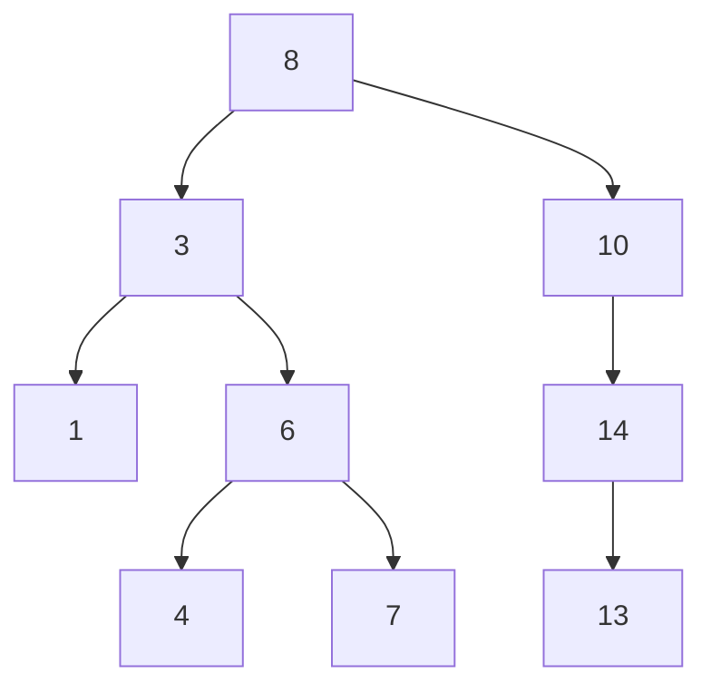

中序遍历这棵 BST：1 → 3 → 4 → 6 → 7 → 8 → 10 → 13 → 14。即升序输出。

**BST 的三个操作**：

| 操作 | 平均 | 最坏 | 核心步骤 |
|------|:---:|:---:|------|
| 查找（search） | $O(\log n)$ | $O(n)$ | 与根比较：小则走左，大则走右 |
| 插入（insert） | $O(\log n)$ | $O(n)$ | 查找到失败位置，在 leaf 的空位上插入 |
| 删除（delete） | $O(\log n)$ | $O(n)$ | 三种情况：叶子（直删）、单子（用子代替）、双子（用后继代替） |

**BST 删除的三个情况**：


中序后继是 BST 中 key 排序下"正好比当前节点大的下一个节点"。选择它替代被删节点，可以保证 BST 性质完全保持不变——所有左子树的值 < 后继的值 < 所有右子树的值。

#### BST 删除手算轨迹

以 BST `[8, 3, 10, 1, 6, 14, 4, 7, 13]` 为例，逐步删除：

**初始树**：


**删除 7（情况 1：叶子）**：直接删除，父节点 6 的 right 置 NULL。
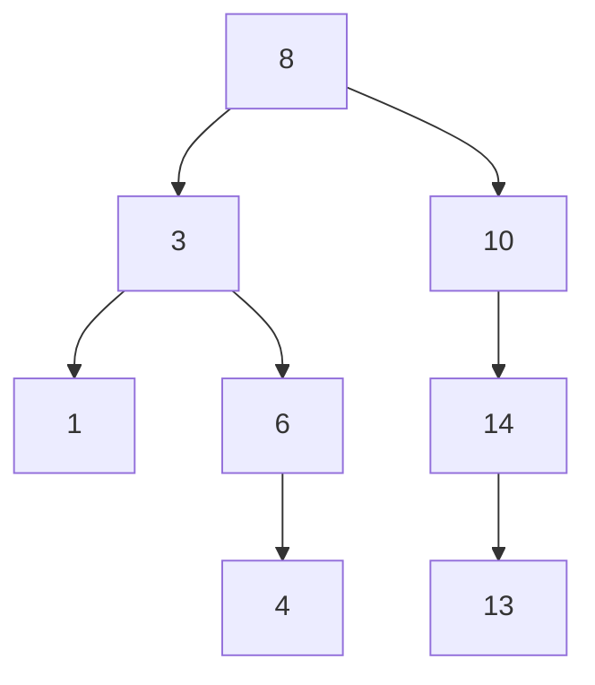

**删除 6（情况 2：单子）**：6 只有左子 4，用 4 代替 6 的位置。
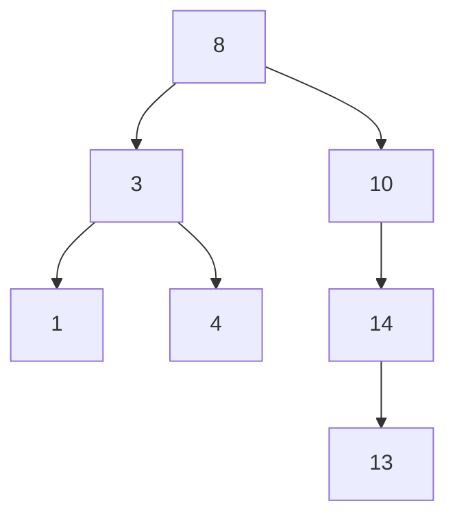

**删除 3（情况 3：双子）**：3 有左子 1 和右子 4。找中序后继——右子树最小值 = 4。将 4 复制到 3 的位置，删除原 4 节点（叶子）。
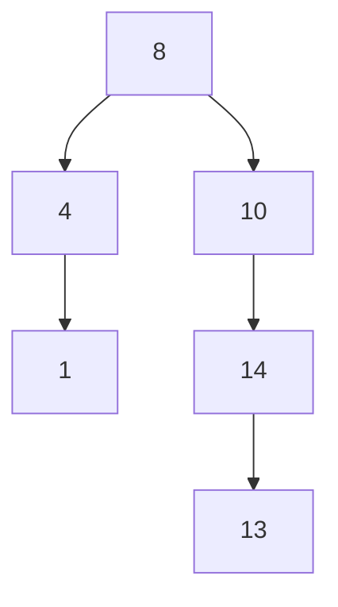

**自测：BST 删除**

给定 BST `[15, 6, 18, 3, 7, 17, 20, 2, 4, 13, 9]`，删除 6 后画出新树（写出所用情况）。

> 答案：
>
> 6 有左子(3)和右子(7) → 情况 3。中序后继 = 右子树最小值 = 7。
> 用 7 替换 6，删除原 7（叶子）。
> ```mermaid
> graph TD
>     N15["15"] --> N7["7"]
>     N15 --> N18["18"]
>     N7 --> N3["3"]
>     N18 --> N17["17"]
>     N18 --> N20["20"]
>     N3 --> N2["2"]
>     N3 --> N4["4"]
> ```
> 右子树：13 和 9 仍在 15 的左子树中——等一下，需要重新检查原始树的结构。
>
> 更正：原始 BST 中 13 在 18 的左子树路径上（15→18→17→13 不对）。按 BST 性质，13 < 15 应在 15 的左子树。实际原始树为：15(根), 左子树(6→3→(2,4), 7→(...)), 右子树(18→17, 20)。13 应在 15 的左子树中——它大于 6 小于 15，所以在 6 的右子树中。6 的右子树有 7 和 13。13 > 7 所以在 7 的右子树。删除 6 后 7 替上来，13 仍在 7 的右子树：
>
> ```mermaid
> graph TD
>     N15["15"] --> N7["7"]
>     N15 --> N18["18"]
>     N7 --> N3["3"]
>     N7 --> N13["13"]
>     N18 --> N17["17"]
>     N18 --> N20["20"]
>     N3 --> N2["2"]
>     N3 --> N4["4"]
> ```
> 情况 3（双子）：用中序后继 7 替换 6。

**BST 退化的致命性**：

按递增顺序插入 $n$ 个元素到空 BST：
- 第一个元素成为根
- 每个后续元素都比之前的所有元素大
- 因此每个新元素都是在"最右叶子"上追加

结果是一棵深度为 $n$ 的单链——退化为链表。此时查找从 $O(\log n)$ 变为 $O(n)$。这正是自平衡二叉搜索树存在的根本原因。

![[../assets/images/二叉树退化为链表示意图.png]]

### AVL 树——通过旋转维持平衡

AVL 树是最早的自平衡 BST（Adelson-Velsky & Landis, 1962）。核心约束：任意节点的左右子树高度差 $\in \{-1, 0, 1\}$。

**平衡因子（BF）**：

$$
\text{BF}(node) = \text{height}(\text{left}) - \text{height}(\text{right})
$$

$$
\text{BF}(node) \in \{-1, 0, 1\}
$$

当插入或删除导致某个节点的 $|\text{BF}| \geq 2$ 时，需要通过旋转恢复平衡。

**四种旋转场景**：

```mermaid
graph TD
 subgraph "LL — 右旋"
 LL_BEFORE["节点 X (BF=2)<br/> /<br/> Y (BF=1)<br/> /<br/>Z<br/>失衡: 左子树的左子树太重"]
 LL_BEFORE -->|"右旋(X)"| LL_AFTER["Y<br/>/<br/>Z X<br/>平衡恢复"]
 end
 subgraph "RR — 左旋"
 RR_BEFORE["节点 X (BF=-2)<br/> \\<br/> Y (BF=-1)<br/> \\<br/> Z<br/>失衡: 右子树的右子树太重"]
 RR_BEFORE -->|"左旋(X)"| RR_AFTER["Y<br/>/<br/>X Z<br/>平衡恢复"]
 end
 subgraph "LR — 先左旋后右旋"
 LR_BEFORE["节点 X (BF=2)<br/> /<br/> Y (BF=-1)<br/> \\<br/> Z<br/>失衡: 左子树的右子树太重"]
 LR_BEFORE -->|"左旋(Y) → LL"| LR_MID["X (BF=2)<br/> /<br/> Z<br/> /<br/>Y<br/>变成 LL 情形"]
 LR_MID -->|"右旋(X)"| LR_AFTER["Z<br/>/<br/>Y X<br/>平衡恢复"]
 end
 subgraph "RL — 先右旋后左旋"
 RL_BEFORE["节点 X (BF=-2)<br/> \\<br/> Y (BF=1)<br/> /<br/> Z<br/>失衡: 右子树的左子树太重"]
 RL_BEFORE -->|"右旋(Y) → RR"| RL_MID["X (BF=-2)<br/> \\<br/> Z<br/> \\<br/> Y<br/>变成 RR 情形"]
 RL_MID -->|"左旋(X)"| RL_AFTER["Z<br/>/<br/>X Y<br/>平衡恢复"]
 end
```

**旋转的原理**——以 LL 右旋为例：将失衡节点的左子节点"提上来"成为新的子树根，原根成为新根的右子节点。旋转保持了 BST 性质（中序遍历不变），同时将左子树的高度降低了 1，右子树的高度增加了 1——左右高度从不平衡的 2 恢复到 0 或 1。

#### AVL 建树手算轨迹

给定插入序列 `[3, 2, 1, 4, 5, 6, 7]`，逐步构建 AVL 树并标注旋转类型：

| 步 | 插入 | 树状态（简化） | 失衡节点 | 旋转 | 结果 |
|:-:|:---:|------|:---:|:---:|------|
| 1 | 3 | `(3)` | — | — | BF(3)=0 |
| 2 | 2 | `(3,(2))` | — | — | BF(3)=-1 |
| 3 | 1 | `(3,(2,(1)))` | 3 | **LL** | 右旋 → `(2,(1),(3))` |
| 4 | 4 | `(2,(1),(3,(4)))` | — | — | BF(3)=-1, BF(2)=-1 |
| 5 | 5 | `(2,(1),(3,(4,(5))))` | 3 | **RR** | 左旋 → `(2,(1),(4,(3),(5)))` |
| 6 | 6 | `(2,(1),(4,(3),(5,(6))))` | 4,2 | **RR** x2 | 先左旋4 → `(2,(1),(5,(3),(4),(6)))`；BF(2)=-2 再左旋2 → `(5,(2,(1),(4)),(6))` |
| 7 | 7 | `(5,(2,(1),(4)),(6,(7)))` | 6 | **RR** | 左旋 → `(5,(2,(1),(4)),(7,(6)))`，检查 5 的 BF：左高=2，右高=1 → BF=1 OK |

**关键判断**：每插入一个节点后，沿路径回溯更新高度，遇到 $|BF| \geq 2$ 时根据 BF 值和新插入值的方向判定旋转类型：
- BF=2 且新值 < 左子值 → **LL**（右旋）
- BF=-2 且新值 > 右子值 → **RR**（左旋）
- BF=2 且新值 > 左子值 → **LR**（先左旋后右旋）
- BF=-2 且新值 < 右子值 → **RL**（先右旋后左旋）

**自测：AVL 建树**

插入序列 `[10, 20, 30, 25, 28, 27]`，画出每次插入后的 AVL 树并标注旋转类型。

> 答案：
>
> ① 插入 10：`(10)` — BF=0
>
> ② 插入 20：`(10,(20))` — BF(10)=-1
>
> ③ 插入 30：`(10,(20,(30)))` — BF(10)=-2，RR → 左旋 → `(20,(10),(30))`
>
> ④ 插入 25：`(20,(10),(30,(25)))` — BF(30)=-1, BF(20)=-1
>
> ⑤ 插入 28：`(20,(10),(30,(25,(28))))` — BF(30)=-2，RR → 左旋 → `(20,(10),(28,(25),(30)))`，BF(20)=-1 OK
>
> ⑥ 插入 27：`(20,(10),(28,(25,(27)),(30)))` — BF(28)=1, BF(20)=-1 → OK 无需旋转
>
> 旋转汇总：第 3 步 LL 一次，第 5 步 RR 一次，第 6 步 RR 两次，第 7 步 RR 一次，共 **4 次旋转**。

**AVL 高度上界的推导**：

设 $N_h$ 为高度为 $h$ 的 AVL 树中的最小节点数。最"瘦"的 AVL 树是斐波那契树——左右子树高度差恰好为 1：

$$
N_h = N_{h-1} + N_{h-2} + 1
$$

这与斐波那契数列 $F_h$ 有相同的递推关系，因此 $N_h \approx \phi^h / \sqrt{5}$，其中 $\phi = (\sqrt{5}+1)/2 \approx 1.618$（黄金比）。由此反推：

$$
h \leq \log_{\phi}(n+2) - 1 \approx 1.44 \cdot \log_2 n
$$

即 AVL 树的高度不超过 $1.44 \log_2 n$，保证查找、插入、删除均为 $O(\log n)$。AVL 是最严格的平衡二叉搜索树——代价是插入/删除时可能需要 $O(\log n)$ 次旋转（向根方向传播）。

---

## 实现

### BST

```c
#include <stdlib.h>

typedef struct BSTNode {
 int data;
 struct BSTNode* left;
 struct BSTNode* right;
} BSTNode;

BSTNode* bst_insert(BSTNode* root, int value) {
 if (!root) {
 BSTNode* node = malloc(sizeof(BSTNode));
 node->data = value;
 node->left = node->right = NULL;
 return node;
 }
 if (value < root->data)
 root->left = bst_insert(root->left, value);
 else if (value > root->data)
 root->right = bst_insert(root->right, value);
 return root;
}

BSTNode* bst_search(BSTNode* root, int value) {
 if (!root || root->data == value) return root;
 if (value < root->data) return bst_search(root->left, value);
 return bst_search(root->right, value);
}

// 删除节点: 返回新的子树根
BSTNode* bst_delete(BSTNode* root, int value) {
 if (!root) return NULL;
 if (value < root->data)
 root->left = bst_delete(root->left, value);
 else if (value > root->data)
 root->right = bst_delete(root->right, value);
 else {
 // 情况1/2: 叶子或单子节点
 if (!root->left) { BSTNode* tmp = root->right; free(root); return tmp; }
 if (!root->right) { BSTNode* tmp = root->left; free(root); return tmp; }
 // 情况3: 双子节点 — 找中序后继
 BSTNode* succ = root->right;
 while (succ->left) succ = succ->left;
 root->data = succ->data; // 替换值
 root->right = bst_delete(root->right, succ->data); // 删除后继
 }
 return root;
}

void bst_destroy(BSTNode* root) {
 if (!root) return;
 bst_destroy(root->left);
 bst_destroy(root->right);
 free(root);
}

// 树的三种递归遍历
void preorder(BSTNode* root) {
 if (!root) return;
 printf("%d ", root->data);
 preorder(root->left);
 preorder(root->right);
}

void inorder(BSTNode* root) {
 if (!root) return;
 inorder(root->left);
 printf("%d ", root->data);
 inorder(root->right);
}

void postorder(BSTNode* root) {
 if (!root) return;
 postorder(root->left);
 postorder(root->right);
 printf("%d ", root->data);
}

// 层序遍历 (BFS): 依赖队列
void level_order(BSTNode* root) {
 if (!root) return;
 BSTNode** q = malloc(sizeof(BSTNode*) * 1024);
 int front = 0, back = 0;
 q[back++] = root;
 while (front < back) {
  BSTNode* n = q[front++];
  printf("%d ", n->data);
  if (n->left) q[back++] = n->left;
  if (n->right) q[back++] = n->right;
 }
 free(q);
}
```

### AVL 树

```c
typedef struct AVLNode {
 int data;
 int height; // 该节点子树的高度 (叶子=0)
 struct AVLNode* left;
 struct AVLNode* right;
} AVLNode;

static int height(AVLNode* n) { return n ? n->height : -1; }
static int max(int a, int b) { return a > b ? a : b; }
static int bf(AVLNode* n) { return height(n->left) - height(n->right); }

// 右旋
static AVLNode* rotate_right(AVLNode* y) {
 AVLNode* x = y->left;
 AVLNode* T2 = x->right;
 x->right = y;
 y->left = T2;
 y->height = max(height(y->left), height(y->right)) + 1;
 x->height = max(height(x->left), height(x->right)) + 1;
 return x; // 新根
}

// 左旋
static AVLNode* rotate_left(AVLNode* x) {
 AVLNode* y = x->right;
 AVLNode* T2 = y->left;
 y->left = x;
 x->right = T2;
 x->height = max(height(x->left), height(x->right)) + 1;
 y->height = max(height(y->left), height(y->right)) + 1;
 return y;
}

AVLNode* avl_insert(AVLNode* root, int value) {
 if (!root) {
 AVLNode* node = malloc(sizeof(AVLNode));
 node->data = value; node->height = 0;
 node->left = node->right = NULL;
 return node;
 }
 if (value < root->data)
 root->left = avl_insert(root->left, value);
 else if (value > root->data)
 root->right = avl_insert(root->right, value);
 else
 return root; // 重复值不插入

 root->height = max(height(root->left), height(root->right)) + 1;
 int balance = bf(root);

 // LL: 左子树的左子树过重
 if (balance > 1 && value < root->left->data)
 return rotate_right(root);
 // RR: 右子树的右子树过重
 if (balance < -1 && value > root->right->data)
 return rotate_left(root);
 // LR: 左子树的右子树过重
 if (balance > 1 && value > root->left->data) {
 root->left = rotate_left(root->left);
 return rotate_right(root);
 }
 // RL: 右子树的左子树过重
 if (balance < -1 && value < root->right->data) {
 root->right = rotate_right(root->right);
 return rotate_left(root);
 }
 return root;
}
```

### AVL 删除

删除比插入复杂——删除后沿路径回溯更新高度时，失衡可能出现在任意祖先节点，且旋转类型需根据**左右子树的高度**判断（而非插入时的值比较）。

```c
AVLNode* avl_delete(AVLNode* root, int value) {
 if (!root) return NULL;
 if (value < root->data)
  root->left = avl_delete(root->left, value);
 else if (value > root->data)
  root->right = avl_delete(root->right, value);
 else {
  // 找到目标节点
  if (!root->left || !root->right) {
   AVLNode* tmp = root->left ? root->left : root->right;
   free(root);
   return tmp;
  }
  // 双子节点: 用中序后继替换
  AVLNode* succ = root->right;
  while (succ->left) succ = succ->left;
  root->data = succ->data;
  root->right = avl_delete(root->right, succ->data);
 }

 root->height = max(height(root->left), height(root->right)) + 1;
 int balance = bf(root);

 // LL: 左子树过高
 if (balance > 1 && bf(root->left) >= 0)
  return rotate_right(root);
 // LR: 左子树的右子树过高
 if (balance > 1 && bf(root->left) < 0) {
  root->left = rotate_left(root->left);
  return rotate_right(root);
 }
 // RR: 右子树过高
 if (balance < -1 && bf(root->right) <= 0)
  return rotate_left(root);
 // RL: 右子树的左子树过高
 if (balance < -1 && bf(root->right) > 0) {
  root->right = rotate_right(root->right);
  return rotate_left(root);
 }
 return root;
}
```

> **与插入的关键区别**：插入时只需检查一次旋转（因为插入只影响一条路径上的一个节点）。删除后回溯过程中，**每个祖先都可能失衡**，且旋转后子树高度可能继续变化，因此旋转判断条件不同——插入用 `value` 与子节点值比较，删除用 `bf()` 直接判断子树平衡因子。

### 哈夫曼树构建

从频率数组构建哈夫曼树——每次取两个最小频率节点合并为新节点，直到剩余一个根节点。使用最小堆加速选取过程。

```c
typedef struct HuffNode {
 int freq;
 struct HuffNode *left, *right;
} HuffNode;

// 用最小堆构建哈夫曼树
// freq: 字符频率数组, n: 字符数
HuffNode* huffman_build(int* freq, int n) {
 if (n <= 0) return NULL;

 // 构建叶子节点最小堆
 HuffNode** heap = malloc(sizeof(HuffNode*) * n);
 int heap_size = 0;
 for (int i = 0; i < n; i++) {
  if (freq[i] <= 0) continue;
  HuffNode* node = malloc(sizeof(HuffNode));
  node->freq = freq[i];
  node->left = node->right = NULL;
  heap[heap_size++] = node;
 }

 // Floyd 建堆 O(n)
 for (int i = heap_size / 2 - 1; i >= 0; i--) {
  int idx = i;
  while (1) {
   int smallest = idx;
   int l = 2 * idx + 1, r = 2 * idx + 2;
   if (l < heap_size && heap[l]->freq < heap[smallest]->freq) smallest = l;
   if (r < heap_size && heap[r]->freq < heap[smallest]->freq) smallest = r;
   if (smallest == idx) break;
   HuffNode* t = heap[idx]; heap[idx] = heap[smallest]; heap[smallest] = t;
   idx = smallest;
  }
 }

 // 反复合并最小的两个
 while (heap_size > 1) {
  // extract min
  HuffNode* min1 = heap[0];
  heap[0] = heap[--heap_size];
  int idx = 0;
  while (1) {
   int smallest = idx;
   int l = 2 * idx + 1, r = 2 * idx + 2;
   if (l < heap_size && heap[l]->freq < heap[smallest]->freq) smallest = l;
   if (r < heap_size && heap[r]->freq < heap[smallest]->freq) smallest = r;
   if (smallest == idx) break;
   HuffNode* t = heap[idx]; heap[idx] = heap[smallest]; heap[smallest] = t;
   idx = smallest;
  }

  // extract min
  HuffNode* min2 = heap[0];
  heap[0] = heap[--heap_size];
  idx = 0;
  while (1) {
   int smallest = idx;
   int l = 2 * idx + 1, r = 2 * idx + 2;
   if (l < heap_size && heap[l]->freq < heap[smallest]->freq) smallest = l;
   if (r < heap_size && heap[r]->freq < heap[smallest]->freq) smallest = r;
   if (smallest == idx) break;
   HuffNode* t = heap[idx]; heap[idx] = heap[smallest]; heap[smallest] = t;
   idx = smallest;
  }

  // 合并
  HuffNode* parent = malloc(sizeof(HuffNode));
  parent->freq = min1->freq + min2->freq;
  parent->left = min1;
  parent->right = min2;

  // 插入堆并上浮
  heap[heap_size++] = parent;
  int pos = heap_size - 1;
  while (pos > 0) {
   int p = (pos - 1) / 2;
   if (heap[p]->freq <= heap[pos]->freq) break;
   HuffNode* t = heap[p]; heap[p] = heap[pos]; heap[pos] = t;
   pos = p;
  }
 }

 HuffNode* root = heap[0];
 free(heap);
 return root;
}
```

> 时间复杂度 $O(n \log n)$（$n$ 次 extract + insert，每次 $O(\log n)$）。空间 $O(n)$。

### 树的其他重要变体

**表达式树**（Expression Tree）：编译器将数学表达式解析为二叉树——操作数在叶子，运算符在内部节点。后序遍历即得到后缀表达式（RPN），可以直接求值。

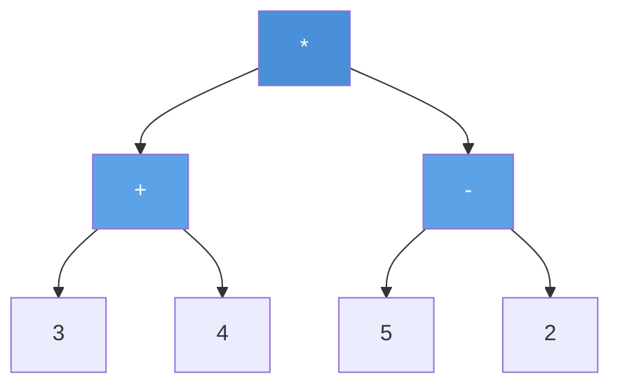

> 后序遍历: 3 4 + 5 2 - * → 后缀表达式 → 求值结果 21

**线索二叉树**（Threaded Binary Tree）：将空的 left/right 指针改为指向中序的前驱/后继的线索（thread）。遍历时无需递归或栈——从第一个节点出发，沿线索可以连续访问中序后继。内存开销为每个节点 2 bit（标记 left/right 是真指针还是线索）。线索二叉树将 $O(n)$ 空间的遍历栈需求压缩到常数空间。

#### 线索二叉树详解

**定义**：对于二叉树中的空指针：
- 若节点的 `left` 为空，令 `left` 指向其中序前驱（in-order predecessor）
- 若节点的 `right` 为空，令 `right` 指向其中序后继（in-order successor）
- 增加标志位 `ltag/rtag`：0 表示真子节点，1 表示线索

**线索化过程**：中序遍历一遍，在遍历过程中记录前一个访问的节点 `prev`。若当前节点 `left` 为空，则 `left = prev`（指向前驱）；若 `prev` 的 `right` 为空，则 `prev->right = curr`（指向后继）。

```c
typedef struct ThreadNode {
 int data;
 struct ThreadNode *left, *right;
 int ltag, rtag; // 0=子节点, 1=线索
} ThreadNode;

static ThreadNode* prev = NULL;

void inorder_thread(ThreadNode* node) {
 if (!node) return;
 inorder_thread(node->left); // 左

 // 处理当前节点的线索
 if (!node->left) {
 node->ltag = 1;
 node->left = prev; // 指向前驱
 }
 if (prev && !prev->right) {
 prev->rtag = 1;
 prev->right = node; // 前驱的右指针指向当前（后继）
 }
 prev = node;

 inorder_thread(node->right); // 右
}
```

#### 线索化手算轨迹

给定二叉树（中序序列为 D, B, A, E, C）：

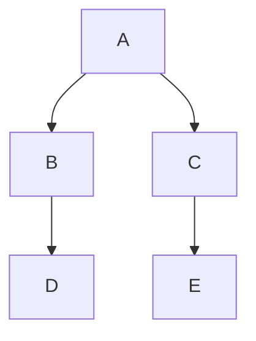

| 步 | 当前节点 | left | right | 动作 | 线索状态 |
|:--:|:--------:|:----:|:-----:|------|---------|
| 1 | D | NULL | NULL | D 的 left 指向 NULL（无前驱），D 的 right 指向 B（后继） | D→B |
| 2 | B | D | NULL | B 的 right 指向 A（后继） | D→B→A |
| 3 | A | B | C | A 的 left/right 都非空，无线索 | — |
| 4 | E | NULL | NULL | E 的 left 指向 A（前驱），E 的 right 指向 C（后继） | A→E→C |
| 5 | C | E | NULL | C 的 left = E（已处理），C 的 right 指向 NULL（无后继） | — |

最终线索化后，沿线索遍历：D → B → A → E → C（中序序列），无需栈。

**自测：线索二叉树**

二叉树中序序列为 `G, D, H, B, E, A, C, F`。① 画出线索二叉树（标注 ltag/rtag）。② 写出从节点 G 出发沿线索遍历的序列。

> 答案：
>
> ① 线索（ltag=1 表示线索，rtag=1 表示线索）：
> - G: left=NULL(ltag=1,无前驱), right=D(rtag=1,后继)
> - D: left=G(ltag=1,前驱), right=H(rtag=1,后继)
> - H: left=D(ltag=1,前驱), right=B(rtag=1,后继)
> - B: left=D(ltag=1,前驱), right=E(rtag=1,后继)
> - E: left=B(ltag=1,前驱), right=A(rtag=1,后继)
> - A: left=B(ltag=1,前驱), right=C(rtag=1,后继)
> - C: left=A(ltag=1,前驱), right=F(rtag=1,后继)
> - F: left=C(ltag=1,前驱), right=NULL(rtag=1,无后继)
>
> ② 从 G 出发沿线索遍历：G → D → H → B → E → A → C → F

**线索树中找前驱 / 后继的规则（中序线索）**

| 目标 | 规则 |
|------|------|
| 结点 X 的**前驱** | 若 `ltag==1`（无左孩子），`left` 直接指向前驱；否则前驱 = **左子树中最右下的结点**（一直沿右指针走到底）|
| 结点 X 的**后继** | 若 `rtag==1`（无右孩子），`right` 直接指向后继；否则后继 = **右子树中最左下的结点**（一直沿左指针走到底）|
| 第一个访问的结点 | 从根出发一路向左，走到 `ltag==1` 的结点 |
| 最后一个访问的结点 | 从根出发一路向右，走到 `rtag==1` 的结点 |

> 口诀：**前驱在左子树的最右，后继在右子树的最左**；只有孩子为空时才用线索。
>
> **线索数 = 空指针数 = n+1**：$n$ 个结点有 $2n$ 个指针域，其中 $n-1$ 个指向孩子，剩下 $n+1$ 个空指针全部改成线索。线索二叉树的目的就是**加快找前驱/后继**，并能不用栈、不用递归地中序遍历。

**哈夫曼树**（Huffman Tree）：贪心构造的最优前缀编码二叉树。权值最小的两个节点不断合并为新节点，最终形成一棵最优的二叉树——高频字符靠近根，低频字符在深层。这是数据压缩的基础算法。

#### 哈夫曼编码手算

给定字符频率表：a=5, b=9, c=12, d=13, e=16, f=45。

**构建过程**（每次合并两个最小频率）：

| 步 | 合并 | 结果频率 | 剩余节点 |
|:-:|------|:---:|------|
| 1 | a(5) + b(9) | (14) | (14), c(12), d(13), e(16), f(45) |
| 2 | c(12) + d(13) | (25) | (14), e(16), (25), f(45) |
| 3 | (14) + e(16) | (30) | (25), (30), f(45) |
| 4 | (25) + (30) | (55) | f(45), (55) |
| 5 | f(45) + (55) | (100) | (100) ← 根 |

**编码**（左分支=0，右分支=1）：

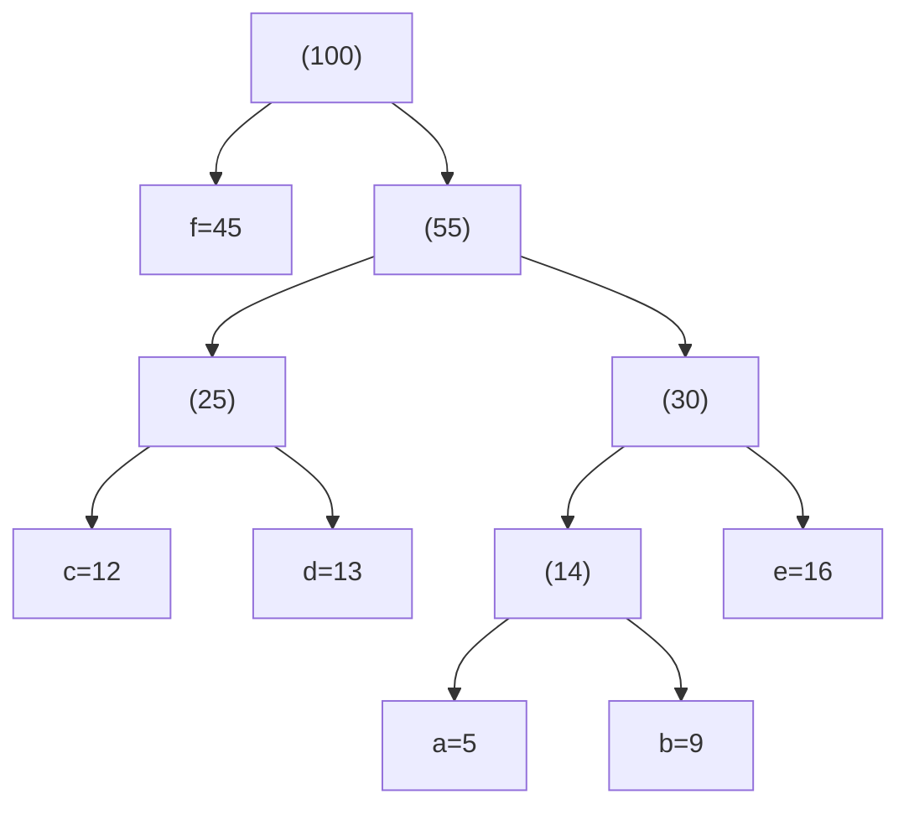

| 字符 | 编码 | 频率x位数 |
|------|------|:---------:|
| f | 0 | 45x1 = 45 |
| c | 100 | 12x3 = 36 |
| d | 101 | 13x3 = 39 |
| a | 1100 | 5x4 = 20 |
| b | 1101 | 9x4 = 36 |
| e | 111 | 16x3 = 48 |

总加权路径长度 $= 45+36+39+20+36+48 = 224$。若用等长编码（3 位/字符），总位数 $= (5+9+12+13+16+45) \times 3 = 300$。哈夫曼编码节省 $25\%$。

**自测：哈夫曼**

频率表：A=27, B=8, C=15, D=15, E=30, F=5。构建哈夫曼树并写出 F 和 B 的编码。

> 答案：
>
> 步骤：F(5)+B(8)→13；13+C(15)→28；D(15)+A(27)→42；28+E(30)→58；42+58→100
>
> ```mermaid
> graph TD
>     ROOT["(100)"] --> N42["(42)"]
>     ROOT --> N58["(58)"]
>     N42 --> D["D=15"]
>     N42 --> A["A=27"]
>     N58 --> N28["(28)"]
>     N58 --> E["E=30"]
>     N28 --> N13["(13)"]
>     N28 --> C["C=15"]
>     N13 --> F["F=5"]
>     N13 --> B["B=8"]
> ```
>
> F 的编码：**1000**（根→右→左→左→左）
> B 的编码：**1001**（根→右→左→左→右）

#### 哈夫曼树的拓展与性质

**（1）结点数公式**

$n$ 个叶子结点的哈夫曼树，总结点数为

$$
2n-1
$$

因为哈夫曼树是**正则二叉树**（每个分支结点都有两个孩子），由 $n_0=n_2+1$ 得 $n_2=n-1$，总数 $n_0+n_2=2n-1$。反过来，若已知哈夫曼树有 $N$ 个结点，则叶子数 $n=(N+1)/2$。

**（2）结构性质**

- 哈夫曼树**没有度为 1 的结点**；
- 哈夫曼树**不一定是完全二叉树**（选择题高频错误项）；
- 权值越大的叶子**离根越近**（不是越远）；
- 两个权值最小的结点在构造的第一步被合并，**一定是兄弟**；
- 任一非叶结点的权值不小于其孩子结点的权值。

**（3）$m$ 叉哈夫曼树（拓展）**

$m$ 叉哈夫曼树要求每个分支结点恰有 $m$ 个孩子（严格 $m$ 叉）。若叶子数 $n$ 不满足

$$
(n-1)\bmod(m-1)=0
$$

则需要补充若干个**权值为 0 的虚叶子**，使条件成立。需补的个数为

$$
k=\big(m-1-(n-1)\bmod(m-1)\big)\bmod(m-1)
$$

例：三叉哈夫曼树（$m=3$），若叶子数 $n=6$，$(6-1)\bmod2=1\ne0$，需补 $k=1$ 个虚叶子，变成 7 个叶子再构造。

**（4）前缀码的判断与译码**

- **前缀码**：任何一组编码中，**没有一个编码是另一个编码的前缀**。哈夫曼编码一定是前缀码。
- 判断方法：把编码按长度排序，逐对检查短码是否为长码的前缀；或把编码建成 Trie，若某个编码结点还有孩子，则它不是前缀码。
- **译码**：从哈夫曼树根出发，读 0 走左、读 1 走右，到达叶子就输出该字符并回到根，继续读下一位。

> 例：编码集 `{0, 1, 00, 11}` 不是前缀码（`0` 是 `00` 的前缀，`1` 是 `11` 的前缀）；`{0, 10, 110, 111}` 是前缀码。

## 高频考点（含真题与典型例题）

> 这一节把树与二叉树的选择题考点集中起来：先给结论，再给真题与典型例题。题目按考点分组，只讲思路，不引用题号。

### 概念考点速记

**1. 树、森林 ↔ 二叉树**

| 项目 | 规则 / 结论 |
|------|------------|
| 树 → 二叉树 | 左孩子右兄弟；转换唯一；根**无右子树** |
| 森林 → 二叉树 | 各树先转二叉树，再把后一棵树的根作为前一棵根的右孩子 |
| 二叉树 → 树/森林 | 逆规则；根有右子树 → 森林，无右子树 → 树 |
| 树先根 / 森林先根 | = 二叉树**先序** |
| 树后根 / 森林后根 | = 二叉树**中序** |
| 右指针空 | 森林有 $n$ 个非终端结点 → 二叉树右空指针 $n+1$ 个 |

**2. 核心公式**

| 公式 | 说明 |
|------|------|
| $n_0=n_2+1$ | 任何二叉树（最高频）|
| 第 $i$ 层 ≤ $2^{i-1}$ | $i$ 从 1 开始 |
| 层数 $h$ 的二叉树 ≤ $2^h-1$ | 满二叉树 |
| 完全二叉树层数 $h=\lfloor\log_2 n\rfloor+1$ | $n$ 个结点 |
| 完全二叉树度为 1 的结点 | 只能是 0 或 1 |
| 二叉链表空指针 | $n+1$ |
| 一般树 $n-1=\sum i n_i$ | 边数 = 各度贡献 |
| 满 $m$ 叉树第 $k$ 层 ≤ $m^{k-1}$ | $k$ 从 1 开始 |
| 层数 $h$ 满 $m$ 叉树总数 | $(m^h-1)/(m-1)$ |
| 正则二叉树层数 $h$ 最少 | $2h-1$ |
| 哈夫曼树 $n$ 叶 | 总 $2n-1$，无度 1 |
| 线索数 | $n+1$ |

**3. 遍历性质**

| 条件 | 结论 |
|------|------|
| 前序 = 中序 | 所有结点无左孩子（只有右子树）|
| 中序 = 后序 | 所有结点无右孩子（只有左子树）|
| 前序 = 后序 | 只有根结点 |
| 前序与后序相反 | 单分支树 ⇔ 只有一个叶子 |
| 叶子相对次序 | 三种遍历都不变 |
| 双亲编号 > 孩子 | 后序遍历 |
| 交换左右子树 | 后序遍历（教材标准答案）|
| 前序 + 中序 / 后序 + 中序 | 唯一确定树 |
| 前序 + 后序 | 一般不唯一（满二叉树才唯一）|

**4. 线索二叉树**

| 目标 | 规则 |
|------|------|
| 前驱（有左孩子）| 左子树最右结点 |
| 后继（有右孩子）| 右子树最左结点 |
| 无左孩子 | `left` 线索直接指前驱 |
| 无右孩子 | `right` 线索直接指后继 |
| 目的 | 加快找前驱/后继，遍历不用栈 |
| 线索数 | $n+1$ |

**5. 哈夫曼树**

- $n$ 个叶子 → 总 $2n-1$；无度为 1 的结点；**不一定是完全二叉树**；权大离根近；最小两权值必为兄弟；
- $m$ 叉哈夫曼：$(n-1)\bmod(m-1)\ne0$ 时补权 0 虚叶子，补 $k=(m-1-(n-1)\bmod(m-1))\bmod(m-1)$ 个；
- 前缀码：没有任何编码是另一个的前缀；哈夫曼编码必为前缀码；译码从根按 0/1 走到叶子。

**6. 其他**

- 正则二叉树：每个分支结点度 2，$n_0=n_2+1$，层数 $h$ 最少 $2h-1$；
- 满 $m$ 叉树：第 $k$ 层 $m^{k-1}$，总数 $(m^h-1)/(m-1)$；
- 树的存储：双亲表示、孩子链表、孩子兄弟；顺序存储只适合完全二叉树；
- $m$ 叉树 ≠ 度为 $m$ 的树（前者是上限，后者是取到上限）；
- 完全二叉树 ≠ 堆（堆还要满足堆序）；
- 顺序存储斜树：层数 $h$ 需要 $2^h-1$ 个单元（最大下标 $2^h-2$）。

### 真题与典型例题

#### 一、树、森林与二叉树的转换

```text
QUIZ
question: 把一棵树转换为二叉树后，这棵二叉树的形态是（ ）。
A: 唯一的
B: 有多种
C: 有多种，但根结点都没有左孩子
D: 有多种，但根结点都没有右孩子
answer: A
explanation: 左孩子右兄弟规则是确定的，所以转换唯一；转换后根结点没有右子树（D 的"有多种"表述错误）。
```

```text
QUIZ
question: 利用二叉链表存储树，则根结点的右指针是（ ）。
A: 指向最左孩子
B: 指向最右孩子
C: 空
D: 非空
answer: C
explanation: 树转成二叉树后，根没有兄弟，因此没有右孩子，右指针为空。
```

```text
QUIZ
question: 设森林 F 中有 n 个非终端结点，B 是由 F 转换得到的二叉树，则 B 中右指针域为空的结点有（ ）个。
A: n-1
B: n
C: n+1
D: n+2
answer: C
explanation: 这是转换的固定结论：右空指针数 = n+1。可用"每个非终端结点贡献一条孩子兄弟链，末尾多一个空右指针"来理解。
```

```text
QUIZ
question: 树的后根遍历序列等同于该树对应二叉树的（ ）。
A: 先序序列
B: 中序序列
C: 后序序列
answer: B
explanation: 记忆：**先根对先序，后根对中序**；森林的后根遍历同样对应二叉树的中序。
```

#### 二、二叉树的性质与公式

```text
QUIZ
question: 由 3 个结点可以构造出多少种不同的二叉树？
A: 2
B: 3
C: 4
D: 5
answer: D
explanation: n 个结点不同形态二叉树数为卡特兰数 Cₙ，C₃ = 1/4C(6,3) = 5。
```

```text
QUIZ
question: 一棵完全二叉树上有 1001 个结点，其中叶子结点的个数是（ ）。
A: 250
B: 500
C: 254
D: 501
answer: D
explanation: 层数 h = ⌊ log₂ 1001⌋+1 = 10；最后一层 1001-(2⁹-1) = 490 个；其父结点 ⌈490/2⌉ = 245 个；第 9 层共 2⁸ = 256 个，其中叶子 256-245 = 11 个；叶子总数 490+11 = 501。
```

```text
QUIZ
question: 一个具有 1025 个结点的二叉树的高 h 为（ ）。
A: 11
B: 10
C: 11 至 1025 之间
D: 10 至 1024 之间
answer: C
explanation: 最矮是接近完全二叉树：⌊ log₂ 1025⌋+1 = 11；最高是单链：h = 1025。所以范围是 11 至 1025。
```

```text
QUIZ
question: 在一棵具有 5 层的满二叉树中，结点总数为（ ）。
A: 31
B: 32
C: 33
D: 16
answer: A
explanation: 层数 h = 5 的满二叉树总数 2ʰ-1 = 31。
```

```text
QUIZ
question: 若一棵二叉树具有 10 个度为 2 的结点、5 个度为 1 的结点，则度为 0 的结点个数是（ ）。
A: 9
B: 11
C: 15
D: 不确定
answer: B
explanation: 由 n₀ = n₂+1 = 10+1 = 11，与度为 1 的结点数无关。
```

```text
QUIZ
question: 具有 100 个结点的二叉树中，若用二叉链表存储，其中空指针域的个数是（ ）。
A: 50
B: 99
C: 100
D: 101
answer: D
explanation: n 个结点的二叉链表空指针数 = n+1 = 101。
```

```text
QUIZ
question: 设树 T 的度为 4，其中度为 1、2、3、4 的结点个数分别为 4、2、1、1，则 T 中的叶子数为（ ）。
A: 5
B: 6
C: 7
D: 8
answer: D
explanation: 边数 = 1×4+2×2+3×1+4×1 = 15，总结点 n = 16；叶子 n₀ = 16-(4+2+1+1) = 8。
```

```text
QUIZ
question: 在一棵三元树中，度为 3 的结点数为 2，度为 2 的结点数为 1，度为 1 的结点数为 2，则度为 0 的结点数为（ ）。
A: 4
B: 5
C: 6
D: 7
answer: C
explanation: 边数 = 3×2+2×1+1×2 = 10，n = 11；叶子 n₀ = 11-(2+1+2) = 6。
```

```text
QUIZ
question: 对于有 n 个结点的二叉树，其高度为（ ）。
A: n log₂ n
B: log₂ n
C: ⌊ log₂ n⌋+1
D: 不确定
answer: D
explanation: 只有在"完全二叉树"或"最矮"的前提下才是 ⌊ log₂ n⌋+1；一般二叉树可能退化成链，高度可达 n。
```

#### 三、遍历序列

```text
QUIZ
question: 已知某二叉树的后序遍历序列是 `dabec`，中序遍历序列是 `debac`，它的前序遍历序列是（ ）。
A: `acbed`
B: `decab`
C: `deabc`
D: `cedba`
answer: D
explanation: 后序末元素 `c` 是根；中序中 `c` 在最后 → 无右子树；左子树后序 `dabe`、中序 `deba`，根 `e`；继续分治得前序 `c e d b a`，即 `cedba`。
```

```text
QUIZ
question: 已知一棵二叉树的前序遍历结果为 `ABCDEF`，中序遍历结果为 `CBAEDF`，则后序遍历的结果为（ ）。
A: `CBEFDA`
B: `FEDCBA`
C: `CBEDFA`
D: 不定
answer: A
explanation: 根 `A`；左子树中序 `CB`、前序 `BC`，根 `B`、左孩子 `C`；右子树中序 `EDF`、前序 `DEF`，根 `D`、左 `E`、右 `F`。后序 `C B E F D A`。
```

```text
QUIZ
question: 二叉树的先序遍历为 `EFHIGJK`，中序遍历为 `HFIEJKG`，该二叉树根的右子树的根是（ ）。
A: `E`
B: `F`
C: `G`
D: `H`
answer: C
explanation: 根 `E`；中序中 `E` 左边 `HFI`、右边 `JKG`，右子树有 3 个结点；前序中右子树为 `GJK`，首元素 `G` 即右子树的根。
```

```text
QUIZ
question: 一棵非空二叉树的先序遍历序列与后序遍历序列正好相反，则该二叉树一定满足（ ）。
A: 所有结点均无左孩子
B: 所有结点均无右孩子
C: 只有一个叶子结点
D: 任意二叉树
answer: C
explanation: 先序与后序相反 ⇔ 单分支树（每个结点至多一个孩子），单分支树恰好只有一个叶子。注意单分支树可以左右交替，所以 A、B 不一定成立。
```

```text
QUIZ
question: 任何一棵二叉树的叶结点在先序、中序和后序遍历序列中的相对次序（ ）。
A: 不发生变化
B: 发生变化
C: 不能确定
answer: A
explanation: 叶子之间没有祖先关系，遍历只改变"根"的访问位置，不改变叶子之间的左右相对次序。
```

```text
QUIZ
question: 对二叉树的结点从 1 开始连续编号，要求每个结点的编号大于其左、右孩子的编号，同一结点的左右孩子中左孩子的编号小于右孩子，可采用（ ）遍历实现。
A: 先序
B: 中序
C: 后序
D: 层次
answer: C
explanation: 要求"孩子先编号、双亲后编号"，正是后序"左右根"的顺序。
```

```text
QUIZ
question: 若二叉树采用二叉链表存储，要交换其所有分支结点左、右子树的位置，利用（ ）遍历方法最合适。
A: 前序
B: 中序
C: 后序
D: 层次
answer: C
explanation: 先递归交换左右子树，再交换当前结点的左右孩子；教材标准答案写后序（前序/中序也能实现，但后序最自然）。
```

#### 四、线索二叉树

```text
QUIZ
question: 若 X 是二叉中序线索树中一个有左孩子的结点，且 X 不为根，则 X 的前驱为（ ）。
A: X 的双亲
B: X 的右子树中最左的结点
C: X 的左子树中最右结点
D: X 的左子树中最右叶结点
answer: C
explanation: 前驱 = 左子树"最右下的结点"（不一定是叶子，只要没有右孩子即可）。
```

```text
QUIZ
question: 引入二叉线索树的目的是（ ）。
A: 加快查找结点的前驱或后继的速度
B: 方便插入删除
C: 方便找双亲
D: 使遍历结果唯一
answer: A
explanation: 线索把 n+1 个空指针改为前驱/后继，遍历时不需要栈或递归。
```

#### 五、哈夫曼树

```text
QUIZ
question: 设哈夫曼树中有 199 个结点，则该哈夫曼树中有（ ）个叶子结点。
A: 99
B: 100
C: 101
D: 102
answer: B
explanation: 哈夫曼树总点数 2n-1 = 199，解得 n = 100。
```

```text
QUIZ
question: 有 n 个叶子的哈夫曼树的结点总数为（ ）。
A: 不确定
B: 2n
C: 2n+1
D: 2n-1
answer: D
explanation: 哈夫曼树是正则二叉树，n₂ = n-1，总数 n+(n-1) = 2n-1。
```

```text
QUIZ
question: n（n≥2）个权值均不相同的字符构成哈夫曼树，关于该树的叙述中，错误的是（ ）。
A: 该树一定是一棵完全二叉树
B: 树中一定没有度为 1 的结点
C: 两个权值最小的结点一定是兄弟结点
D: 任一非叶结点的权值一定不小于下一层任一结点的权值
answer: A
explanation: 哈夫曼树不一定是完全二叉树；B、C、D 都是哈夫曼树的性质。
```

```text
QUIZ
question: 下述编码中哪一个不是前缀码？
A: `{00, 01, 10, 11}`
B: `{0, 1, 00, 11}`
C: `{0, 10, 110, 111}`
D: `{1, 01, 000, 001}`
answer: B
explanation: `0` 是 `00` 的前缀，`1` 是 `11` 的前缀；其余三组都没有"一个是另一个前缀"的情况。
```

#### 六、其他概念

```text
QUIZ
question: 在下列存储形式中，（ ）不是树的存储形式。
A: 双亲表示法
B: 孩子链表表示法
C: 孩子兄弟表示法
D: 顺序存储表示法
answer: D
explanation: 前三种是树的经典存储；顺序存储只适合完全二叉树，不是一般树的通用存储形式。
```

```text
QUIZ
question: 树型结构最适合用来表示（ ）。
A: 有序数据元素
B: 元素之间具有分支层次关系的数据
C: 无序数据元素
D: 元素之间无联系的数据
answer: B
explanation: 树的本质是层次关系（一对多），不是简单的线性次序。
```

```text
QUIZ
question: 在下述结论中，正确的是（ ）。
A: ①②③
B: ②③④
C: ②④
D: ①④
answer: D
explanation: ① 单结点度为 0，正确；② 二叉树度可以是 0/1/2，错误；③ 左右子树有序，不能任意交换，错误；④ 完全二叉树结点数不超过同深度满二叉树，正确。
```

```text
QUIZ
question: 一棵完全二叉树一定是一棵（ ）。
A: 堆
B: 哈夫曼树
C: 二叉排序树
D: 平衡二叉树
E: 以上都不是
answer: E
explanation: 完全二叉树只保证"形状"，不保证堆序、BST 序或平衡性；堆一定是完全二叉树，但反过来不成立。这类题若选项中没有"以上都不是"，要警惕题目本身不严谨。
```
---

## 各语言标准库对比

| 语言 | 树 / 平衡树容器 | 说明 |
|------|----------------|------|
| C | 无（手写）| 标准库不提供树容器，需手写 BST/AVL |
| C++ | `std::map` / `std::set`（红黑树）| 有序关联容器，查找/插入/删除 $O(\log n)$ |
| Java | `TreeMap` / `TreeSet`（红黑树）| 有序 Map/Set；`HashMap` 是哈希表 |
| Python | 无内置平衡树 | `dict` 是哈希表；需要有序树可用 `sortedcontainers` |
| Rust | `BTreeMap` / `BTreeSet` | 标准库用 B 树实现有序映射 |
| Go | 无内置 | 需手写或用第三方库 |

> 工程结论：**需要有序遍历/范围查询时选平衡树，只需要键值查找时选哈希表**。C++/Java 的 `map` 是红黑树，Rust 的 `BTreeMap` 是 B 树——都是"有序 + $O(\log n)$"的不同实现。

---

## 应用场景

- **文件系统 (目录树)**：Linux 的 dentry cache 使用树结构组织路径。每个目录是一个节点，子目录/文件是子节点
- **数据库索引**：BST → AVL → 红黑树 → B+树。自平衡 BST 是 B+树的元实现基础。详见 [[M_红黑树_RedBlackTree|红黑树]] 和 [[N_B树_BTree|B树]]
- **编译器 语法树 (AST)**：编译器将源代码解析为抽象语法树——每个产生式规则对应一个节点，终结符在叶子
- **域名系统 (DNS)**：域名本身就是一棵倒挂的树——根域 `.` → 顶级域 `.com` → 二级域 `example` → 主机名 `www`
- **计算机网络 路由表**：IP 路由的最长前缀匹配算法使用 Patricia Trie（压缩二叉 Trie）

---

## 练习

| 题号 | 题目 | 说明 |
|------|------|------|
| [94](https://leetcode.cn/problems/binary-tree-inorder-traversal/) | 二叉树的中序遍历 | 树遍历 |
| [98](https://leetcode.cn/problems/validate-binary-search-tree/) | 验证二叉搜索树 | BST 性质 |
| [108](https://leetcode.cn/problems/convert-sorted-array-to-binary-search-tree/) | 将有序数组转换为 BST | 构建平衡树 |
| [450](https://leetcode.cn/problems/delete-node-in-a-bst/) | 删除二叉搜索树中的节点 | BST 删除三种情况 |
| [105](https://leetcode.cn/problems/construct-binary-tree-from-preorder-and-inorder-traversal/) | 从前序与中序构造二叉树 | 前序+中序重建 |
| [222](https://leetcode.cn/problems/count-complete-tree-nodes/) | 完全二叉树的节点个数 | 树的性质 |

### 核心推演清单

练习题与上面的 LeetCode 互补——侧重手算推演，全部在正文中带完整答案：

| 自测 | 位置 | 内容 |
|------|------|------|
| 遍历序列 ×1 问 | 遍历手算轨迹节 | 四种遍历的序列输出 |
| 前序+中序重建 ×1 问 | 重建手算节 | 从序列画出二叉树 |
| BST 删除 ×1 问 | BST 删除手算节 | 三种情况的逐步操作 |
| AVL 建树 ×1 问 | AVL 建树手算节 | 逐步画树+标注旋转类型 |
| 哈夫曼编码 ×1 问 | 哈夫曼手算节 | 构建树+写出编码 |
| 树/森林转二叉树 | 转换节 | 左孩子右兄弟、根无右子树、右空指针 $n+1$ |
| 性质公式 | 性质节 | $n_0=n_2+1$、层/高度上限、完全二叉树叶子数 |
| 遍历序列互推 | 遍历性质节 | 前序+中序/后序+中序、前序+后序不唯一 |
| 线索树前驱/后继 | 线索树节 | 左子树最右、右子树最左 |
| 哈夫曼拓展 | 哈夫曼拓展节 | $2n-1$、$m$ 叉补虚叶、前缀码 |

## 动手实验

| 编号 | 题目 | 说明 |
|:----:|------|------|
| E1 | 四种遍历递归 vs 迭代 | 实现中序遍历的递归版和迭代版（用显式栈），对随机生成的 1000 节点 BST 分别执行并计时。对比递归的隐式栈和迭代的显式栈的性能差异 |
| E2 | BST 退化的渐进分析 | 随机顺序插入 1..10000 到 BST，每插入 1000 个测量一次树高，画出"树高 vs 插入量"曲线。再以递增顺序（1,2,3...）插入同样值——观察退化链的高 = n。解释差距的数学来源 |
| E3 | AVL 旋转计数 | 随机插入 1..10000 到 AVL，统计 LL/RR/LR/RL 四种旋转各自发生了多少次。验证 LR 和 RL 的发生频率是否显著低于 LL 和 RR |
