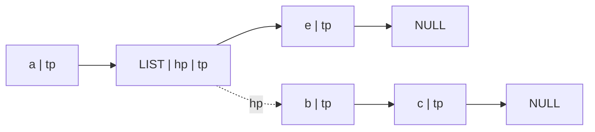

建议先阅读: [[D_链表_LinkedList|链表]] — 广义表是线性表的推广，通常用链式结构存储，"表头/表尾"的递归定义与链表的头尾操作一脉相承。

广义表（Generalized List）是线性表的推广：线性表的元素只能是原子，而广义表的元素**既可以是原子，也可以是另一个广义表（子表）**。这个"元素可以是表"的递归定义，使它成为 Lisp 的 S-表达式、树/森林的孩子兄弟表示、嵌套结构的统一模型。

---

## 原理

### 什么是广义表

**定义**：广义表是 $n$（$n\ge 0$）个元素 $a_1,a_2,\dots,a_n$ 的有限序列，记作

$$
LS = (a_1,\ a_2,\ \dots,\ a_n)
$$

其中每个 $a_i$ 要么是**原子**（不可再分的单元素），要么是**子表**（另一个广义表）。$n=0$ 时称为**空表**，记作 `()`。

| 概念 | 含义 | 例（$LS=(a,(b,c),d)$）|
|------|------|------------------------|
| 原子 | 不可再分的元素 | `a`、`b`、`c`、`d` |
| 子表 | 作为元素的广义表 | `(b,c)` |
| 表头 Head | 第一个元素（原子或子表）| `Head(LS)=a` |
| 表尾 Tail | 去掉表头后剩余元素组成的广义表 | `Tail(LS)=((b,c),d)` |
| 长度 Length | 最外层元素的个数 | `Length(LS)=3` |
| 深度 Depth | 括号嵌套的最大层数 | `Depth(LS)=2` |

> 注意：**表尾一定是广义表**（一定带括号，可以是空表 `()`）；表头是"第一个元素"，可能是原子，也可能是子表。例如 `Tail((a)) = ()`，`Tail((a,b)) = (b)`。

### 广义表的两个基本运算：Head 与 Tail

这两个运算只动"最外层"，是嵌套提取的全部基础：

- **`Head(LS)`**：取第一个元素。空表没有表头，非法。
- **`Tail(LS)`**：去掉第一个元素，剩余元素**仍组成一个广义表**（带括号）。空表没有表尾，非法；单元素表的表尾是空表 `()`。

**嵌套提取要由内向外逐层算**。以 $A=(a,\ b,\ (c,d),\ e)$ 为例：

| 表达式 | 结果 | 说明 |
|--------|------|------|
| `Head(A)` | `a` | 第一个元素是原子 |
| `Tail(A)` | `(b,(c,d),e)` | 去掉 `a`，剩余仍是表 |
| `Head(Tail(A))` | `b` | 表尾的第一个元素 |
| `Tail(Tail(A))` | `((c,d),e)` | 再去掉 `b` |
| `Head(Tail(Tail(A)))` | `(c,d)` | 第三个元素是子表 |
| `Tail(Head(Tail(Tail(A))))` | `(d)` | 子表去掉 `c` |
| `Head(Tail(Head(Tail(Tail(A)))))` | `d` | 最终取出 `d` |
| `Tail(Head(Tail(Tail(A))))` 再 `Tail` | `()` | `(d)` 去掉 `d` 得空表 |

> 手算口诀：**从最内层括号开始，一层层把 `Head`/`Tail` 换成具体结果**；`Tail` 的结果永远保留括号。

### 长度与深度

- **长度**：最外层元素的个数，只数"逗号分隔的项"，不往括号里数。`Length((a,(b,c),d))=3`，`Length(())=0`，`Length((a))=1`。
- **深度**：括号嵌套的最大层数。约定 **原子深度为 0，空表深度为 1**，非空表深度为

$$
\text{Depth}(LS)=1+\max_{a_i\in LS}\text{Depth}(a_i)
$$

| 广义表 | 长度 | 深度 |
|--------|:---:|:---:|
| `()` | 0 | 1 |
| `(a)` | 1 | 1 |
| `(a,b,c)` | 3 | 1 |
| `(a,(b,c))` | 2 | 2 |
| `((a,b),c,d)` | 3 | 2 |
| `((a,(b,c)),d)` | 2 | 3 |

> 长度看"最外层有几项"，深度看"最多套了几层括号"。二者不要混。

### 递归表

若广义表**包含自身**，则称为**递归表**。例如

$$
L = (a,\ L)
$$

它的展开是 $L=(a,(a,(a,\dots)))$，括号可以无限套下去，因此**递归表的深度为无穷大** $\infty$。同理，若通过子表间接包含自身（如 $A=(B),\ B=(A)$），深度也为 $\infty$。

> 考点：普通广义表的深度是有限整数；只要出现"自己包含自己"（直接或间接），深度就是 $\infty$。实现求深度时必须检测环，否则会无限递归。

### 广义表的存储结构

广义表不能用简单的顺序结构存储——因为元素可以是子表，长度和嵌套层数都不固定，顺序存储难以表达"表中套表"。教材给出两种链式结构，都用 `tag` 区分原子/子表：

**（1）头尾链表存储结构**（最经典）

```c
typedef enum { ATOM, LIST } ElemTag;

typedef struct GLNode {
    ElemTag tag;              /* ATOM：原子；LIST：子表 */
    union {
        char atom;            /* tag == ATOM：原子值 */
        struct GLNode *hp;    /* tag == LIST：指向子表的第一个结点 */
    } ptr;
    struct GLNode *tp;        /* 指向同层的下一个元素 */
} GLNode, *GList;
```

- 整个广义表是一条由 `tp` 串起来的链；
- 原子结点用 `ptr.atom` 存值；子表结点用 `ptr.hp` 指向子表内部的第一条链；
- 空表用 `NULL` 表示；空子表 `()` 是一个 `LIST` 结点且 `hp == NULL`。



**（2）扩展线性链表（同层链）存储结构**

原子结点存 `data + next`；子表结点存 `hp + next`。它把"同层元素"和"子表入口"分开表示，本质与头尾链相同，只是结点字段组织不同（类似树的孩子兄弟表示法）。考试若只问"广义表适合什么存储结构"，答**链式存储（头尾链表 / 同层链）**即可。

---

## 实现

下面用头尾链表示给出核心操作的 C 实现（原子用 `char` 演示）。

### 求长度

```c
int GLLength(GList L) {
    int n = 0;
    for (GList p = L; p != NULL; p = p->tp)   /* 只数最外层 */
        n++;
    return n;
}
```

### 求深度

```c
int GLDepth(GList L) {
    if (L == NULL) return 1;                  /* 空表深度为 1 */
    int maxd = 0;
    for (GList p = L; p != NULL; p = p->tp) {
        int d = (p->tag == ATOM) ? 0 : GLDepth(p->ptr.hp);
        if (d > maxd) maxd = d;
    }
    return maxd + 1;                          /* 非空表 = 1 + 子项最大深度 */
}
```

> 递归表（如 `L=(a,L)`）会让上面的函数无限递归。工程实现要带一个 `visited` 集合检测环；一旦检测到环，直接返回 $\infty$ 的标记。

### 取表头 / 表尾

```c
/* 取表头：返回第一个元素结点（原子或子表）；空表返回 NULL */
GList GLHead(GList L) {
    return L;                                 /* 第一个结点就是表头 */
}

/* 取表尾：返回去掉首元素后的链；空表返回 NULL */
GList GLTail(GList L) {
    return (L == NULL) ? NULL : L->tp;
}
```

调用者根据返回结点的 `tag` 判断是原子还是子表：`ATOM` 读 `ptr.atom`，`LIST` 读 `ptr.hp`。注意 `Tail` 返回的仍是一条链，它对应的广义表**隐含外层括号**。

### 从括号串递归建表

```c
/* s 指向 '(' 之后；返回建好的表；结束时 *s 停在 ')' */
GList GLCreate(char **s) {
    GList head = NULL, tail = NULL;
    while (**s != '\0' && **s != ')') {
        GLNode *node = malloc(sizeof(GLNode));
        if (**s == '(') {
            node->tag = LIST;
            (*s)++;
            node->ptr.hp = GLCreate(s);       /* 递归建子表 */
            if (**s == ')') (*s)++;
        } else {
            node->tag = ATOM;
            node->ptr.atom = **s;
            (*s)++;
        }
        node->tp = NULL;
        if (head == NULL) head = node;
        else tail->tp = node;
        tail = node;
        if (**s == ',') (*s)++;
    }
    return head;
}
```

### 销毁

```c
void GLDestroy(GList L) {
    while (L != NULL) {
        GList next = L->tp;
        if (L->tag == LIST) GLDestroy(L->ptr.hp);  /* 先递归销毁子表 */
        free(L);
        L = next;
    }
}
```

---

## 高频考点（含典型题）

> 先给概念考点速记，再给典型题——考点在上、题目在下。广义表不在 408 统考大纲内，但**期末、自命题、教材习题必考**，下面按考试题型整理。

### 概念考点速记

**1. Head / Tail 的定义与边界**

| 运算 | 结果 | 空表 | 单元素表 |
|------|------|------|----------|
| `Head(LS)` | 第一个元素（原子或子表）| 非法（无表头）| 该元素 |
| `Tail(LS)` | 去掉表头后的**广义表**（带括号）| 非法（无表尾）| `()` 空表 |

- `Tail` 的结果**一定是广义表**，可能为空表；
- `Head` 的结果可能是原子，也可能是子表；
- 嵌套提取从**最内层**开始算，`Tail` 的结果始终带括号。

**2. 长度与深度**

- 长度 = 最外层元素个数（只数逗号分隔的项），空表长度 0；
- 深度 = 括号最大嵌套层数；原子深度 0，空表深度 1，非空表深度 $=1+\max$ 子项深度；
- 递归表（直接或间接包含自身）深度为 $\infty$。

| 广义表 | 长度 | 深度 |
|--------|:---:|:---:|
| `()` | 0 | 1 |
| `(a,b,c)` | 3 | 1 |
| `(a,(b,c))` | 2 | 2 |
| `((a,b),c,d)` | 3 | 2 |
| `((a,(b,c)),d)` | 2 | 3 |
| `L=(a,L)` | 2 | $\infty$ |

**3. 结构特性辨析**

- 广义表是**线性表的推广**：线性表的元素只能是原子，广义表的元素还可以是表；
- **表尾一定是广义表**（可以是空表），**表头不一定是广义表**（可能是原子）；
- "表头不能是空表"这类绝对化说法要结合定义：若第一个元素本身就是空子表 `()`，`Head` 的结果就是 `()`；考试以教材定义为准；
- 广义表**不适合简单顺序存储**：元素长度不一、嵌套层数不定，需要链式结构；
- 广义表可以共享子表（同一子表被多个表引用），形成**有向无环图（DAG）**结构。

**4. 存储结构**

| 结构 | 结点 | 特点 |
|------|------|------|
| 头尾链表 | `tag + (atom / hp) + tp` | 最经典，`hp` 指向子表、`tp` 指向同层下一个 |
| 扩展线性链表（同层链）| 原子：`data + next`；子表：`hp + next` | 与孩子兄弟表示法同构 |
| 顺序存储 | 难以表达嵌套 | 只适合极简单的定长情形 |

### 典型题索引

| 题目 | 考点 | 本题解位置 |
|------|------|-----------|
| 求 Head / Tail 嵌套提取 | Head/Tail 逐层拆解 | [[#典型题 1：嵌套 Head/Tail]] |
| 求长度与深度 | 长度/深度定义 | [[#典型题 2：长度与深度]] |
| 递归表的深度 | 递归表 | [[#典型题 3：递归表的深度]] |
| 表头/表尾辨析 | 结构特性 | [[#典型题 4：表头与表尾辨析]] |

### 典型题 1：嵌套 Head/Tail

**题目**：已知 $A=(a,\ b,\ (c,d),\ e)$，求 `Head(Tail(Head(Tail(Tail(A)))))`。

**解析**：由内向外：

1. `Tail(A) = (b,(c,d),e)`
2. `Tail(Tail(A)) = ((c,d),e)`
3. `Head(Tail(Tail(A))) = (c,d)`
4. `Tail(Head(Tail(Tail(A)))) = (d)`
5. `Head(Tail(Head(Tail(Tail(A))))) = d`

> **答案：`d`**。若再求一次 `Tail`，得到 `()`。

### 典型题 2：长度与深度

**题目**：求 $B=((a,b),c,d)$ 与 $C=(a,(b,(c,d)))$ 的长度和深度。

**解析**：

- $B$：最外层有 3 项 `(a,b)`、`c`、`d`，长度 3；最深括号是内层 `(a,b)`，共 2 层，深度 2。
- $C$：最外层有 2 项 `a`、`(b,(c,d))`，长度 2；嵌套为 `a`（0 层）、`(b,(c,d))`（1 层）、`(c,d)`（2 层），最深 3 层，深度 3。

> **答案：$B$ 长度 3、深度 2；$C$ 长度 2、深度 3。**

### 典型题 3：递归表的深度

**题目**：广义表 $L=(a,\ L)$ 的深度是多少？

**解析**：$L$ 包含自身，展开为 $L=(a,(a,(a,\dots)))$，括号可以无限嵌套，故深度为 $\infty$。实现求深度时必须检测环，否则无限递归。

> **答案：$\infty$。**

### 典型题 4：表头与表尾辨析

**题目**：判断下列说法：
① `Tail((a,b,c)) = (b,c)`；
② `Head((a,b,c)) = a`；
③ `Tail((a)) = ()`；
④ `Head(())` 合法。

**解析**：①②③ 正确。④ 错误：空表没有表头，`Head(())` 非法（同理 `Tail(())` 也非法）。

> **答案：①②③ 正确，④ 错误。**

---

## 扩展

### 广义表与 Lisp / S-表达式

Lisp 的代码和数据都用 S-表达式表示，而 S-表达式就是广义表：原子是符号/数字，子表是括号包起来的列表。`(defun square (x) (* x x))` 本身就是一个广义表。`car` 对应 `Head`（取第一个元素），`cdr` 对应 `Tail`（取剩余部分）——广义表的两个基本运算正是 Lisp 的基石。

### 广义表与树、森林的孩子兄弟表示

孩子兄弟表示法把一棵多叉树变成二叉树：`firstChild` 指向第一个孩子，`nextSibling` 指向同层下一个兄弟。这与广义表的"头尾链"完全同构：

| 广义表 | 树/森林 |
|--------|---------|
| 子表 `hp` | 第一个孩子 `firstChild` |
| 同层 `tp` | 下一个兄弟 `nextSibling` |
| 原子 | 叶子/结点数据 |

因此，**广义表可以表示树和森林**，树的先根遍历对应广义表的深度优先展开。

### 共享子表与 DAG

广义表允许子表被多个表共享。例如 $A=(a,B)$、$C=(c,B)$ 共享同一个 $B$。若把共享子表画成结点，整个结构就是一个**有向无环图（DAG）**而非树——这也是广义表比普通树更一般的地方。实现时要小心：销毁时不能重复释放共享子表（需要引用计数或不做深销毁）。

---

## 各语言标准库对比

| 语言 | 广义表/嵌套列表表示 | 说明 |
|------|---------------------|------|
| Lisp / Scheme | 原生 S-表达式 | `car`/`cdr` 即 Head/Tail |
| Python | 嵌套 `list` | `lst[0]` 近似 Head，`lst[1:]` 近似 Tail |
| JavaScript | 嵌套 `Array` | 同理，但要注意浅拷贝 |
| C | 手写 `GLNode` | 头尾链 / 同层链，最能看清指针 |
| Java | `List<Object>` 嵌套 | 用 `Object` 兼容原子与子表 |
| Rust | `enum GL { Atom(T), List(Vec<GL>) }` | 枚举天然表达"原子或子表" |

> Python/JS 的嵌套列表是广义表最直观的"高层等价物"；C 的头尾链则展示了它真正的指针结构。

---

## 应用场景

- **Lisp / Scheme 的代码与数据**：S-表达式即广义表；
- **树与森林的存储**：孩子兄弟表示法与广义表同构；
- **嵌套配置/文档结构**：JSON、XML 的嵌套对象可看作广义表；
- **符号计算**：计算机代数系统用嵌套表表示表达式；
- **编译器的抽象语法树（AST）**：本质是带标签的广义表；
- **共享子结构的建模**：DAG、表达式共享。

---

## 练习

### 核心推演清单

| 题目 | 考点 | 答案 |
|------|------|------|
| $A=(a,(b,c),d)$，求 `Head(A)`、`Tail(A)` | Head/Tail | `a`、`((b,c),d)` |
| $A=(a,(b,c),d)$，求长度、深度 | 长度/深度 | 3、2 |
| $A=(a,b,(c,d),e)$，求 `Head(Tail(Head(Tail(Tail(A)))))` | 嵌套提取 | `d` |
| $L=(a,L)$ 的深度 | 递归表 | $\infty$ |
| `Tail((a))` | 边界 | `()` |
| `Head(())` 是否合法 | 边界 | 非法 |

### LeetCode / 练习题

| 题号 | 题目 | 说明 |
|------|------|------|
| [341](https://leetcode.cn/problems/flatten-nested-list-iterator/) | 扁平化嵌套列表迭代器 | 嵌套列表的遍历（广义表的展开）|
| [385](https://leetcode.cn/problems/mini-parser/) | 迷你语法分析器 | 从括号串递归建广义表 |
| [339](https://leetcode.cn/problems/nested-list-weight-sum/) | 嵌套列表加权和（会员）| 递归求深度加权 |
| [364](https://leetcode.cn/problems/nested-list-weight-sum-ii/) | 嵌套列表加权和 II（会员）| 自底向上递归 |

---

## 动手实验

| 编号 | 题目 | 说明 |
|:----:|------|------|
| E1 | 头尾链建表与打印 | 实现 `GLCreate`，把 `(a,(b,c),d)` 建成头尾链，再递归打印回原串，验证括号与逗号正确 |
| E2 | 长度/深度/Head/Tail | 对 E1 的表实现 `GLLength`、`GLDepth`、`GLHead`、`GLTail`，并验证典型题 1、2 的结果 |
| E3 | 递归表检测 | 构造 `L=(a,L)`（让 `tp` 或 `hp` 指回自身），给 `GLDepth` 加 `visited` 检测，验证返回 $\infty$ 而不是栈溢出 |
| E4 | 广义表转树 | 把 `(a,(b,c),d)` 按"孩子兄弟"规则转成二叉树，比较先根遍历与广义表深度优先展开的顺序 |
