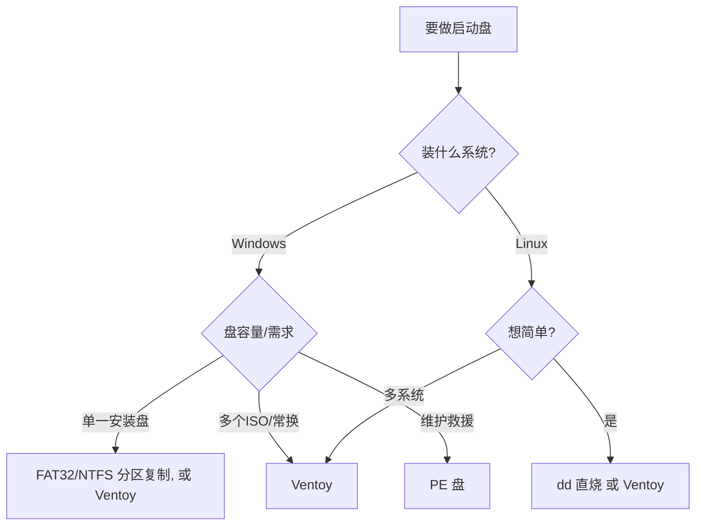

# 制作系统启动盘与 PE

> 这是 U 盘最重要的用途之一：把系统镜像做成"能启动"的安装盘或维护盘。看似简单，却涉及**镜像格式、分区表、文件系统、固件引导方式（BIOS/UEFI）、镜像压缩、校验**一整条链。本篇把这条链讲透，并给出**决策树**和**常见错误处理**。

---

## 一、先搞清：你要"启动"的是什么

| 目标 | 说明 | 载体 |
|------|------|------|
| **安装盘** | 启动后把系统装到目标硬盘 | Windows/Linux ISO |
| **Live 盘** | 启动后直接使用系统（不安装） | Linux Live ISO |
| **PE 维护盘** | 启动进一个精简 Windows，做分区/备份/救援 | WinPE / 微PE |
| **多启动盘** | 一个盘放多个 ISO，菜单选择 | Ventoy |
| **随身系统（WTG）** | 系统装在盘上随身用 | Windows To Go / Linux |

---

## 二、镜像的本质：ISO / UDF / El Torito

一个 `.iso` 不是普通文件，而是"**光盘映像**"，内部是文件系统 + 引导目录：

| 概念 | 作用 |
|------|------|
| **ISO9660** | 光盘文件系统标准 |
| **Joliet** | 给 Windows 长文件名/Unicode |
| **Rock Ridge** | 给 Unix 权限/符号链接 |
| **UDF** | 允许大文件；**Windows ISO 使用 UDF** |
| **El Torito** | **光盘引导目录**标准，定义"从哪里、以什么方式启动" |

### El Torito 的两种引导项
| 平台 | 文件（Windows ISO） | 用途 |
|------|--------------------|------|
| BIOS（平台 0x00） | `boot/etfsboot.com` | 传统 BIOS 启动 |
| UEFI（平台 0xEF） | `efi/microsoft/boot/efisys.bin` | UEFI 启动（**带"按任意键"提示**） |
| UEFI（免提示） | `efi/microsoft/boot/efisys_noprompt.bin` | UEFI 启动（**免按键**） |

> Windows ISO 是 **UDF + ISO9660 + El Torito** 的组合。Linux ISO 大多是 **ISO9660 + El Torito（+ isohybrid）**。

---

## 三、引导方式：BIOS 与 UEFI 是两套体系

### Legacy BIOS 启动链
```
MBR 引导代码 → 活动分区的引导记录(VBR) → bootmgr/NTLDR → 加载系统
```

### UEFI 启动链
```
固件 → 读取 FAT 分区上的 .efi 文件 → 加载系统
```
UEFI 找启动文件的两条路径：
| 路径 | 位置 | 场景 |
|------|------|------|
| **ESP** | 分区类型 `0xEF`(MBR)/`EF00`(GPT) 里的 `\EFI\BOOT\BOOTX64.EFI` | 固定/硬盘 |
| **Removable Media Path** | 任意 **FAT 分区**里的 `\EFI\BOOT\BOOTX64.EFI` | **可移动介质（U 盘）** |

> 关键结论：**U 盘做 UEFI 启动盘，只要有一个 FAT 分区并放入 `\EFI\BOOT\BOOTX64.EFI` 即可**（这正是 Rufus/微软 MCT 的原理）。

| | Legacy BIOS | UEFI |
|---|---|---|
| 引导入口 | MBR → VBR → bootmgr | ESP/removable 里的 `.efi` |
| 分区表 | MBR | GPT 为主（MBR 也可） |
| 安全 | 无 | Secure Boot（验签） |
| 题外按钮 | F12 选"普通/U盘" | F12 选 `UEFI: U盘` |

- **CSM**：UEFI 里兼容 Legacy 的开关，开了可能"两边都能引导"，也可能互相干扰。
- **Secure Boot**：只放行有签名的引导器；微软官方 `bootx64.efi` 是签名的，一般没问题。

---

## 四、启动盘的四种做法

| 做法 | 命令/工具 | 适用 | 优点 | 缺点 |
|------|----------|------|------|------|
| **① 纯 ISO 直烧（dd）** | `dd if=x.iso of=/dev/sdX` | Linux / 部分 Windows | 一条命令 | **Windows ISO 常不能 UEFI 启动**（无分区表，靠固件 El Torito） |
| **② 分区复制（FAT32/NTFS）** | Rufus、MCT、手动分区拷文件 | Windows | 固件识别好、最稳 | 大文件需 NTFS 或拆 WIM |
| **③ 多启动（Ventoy）** | Ventoy2Disk | 多 ISO | 一个盘放多个、免重烧 | 需先装 Ventoy |
| **④ PE 盘** | 微PE/优启通/WinPE | 维护/救援 | 轻量、功能强 | 非安装用途 |

### 决策树


---

## 五、Windows 与 Linux 启动盘的区别与注意

| 维度 | Windows 安装盘 | Linux 安装盘 |
|------|---------------|-------------|
| 镜像格式 | UDF + ISO9660 + El Torito | 多数 ISO9660 + El Torito（常 isohybrid） |
| 大文件 | `install.wim` 常 >4G | 一般无 >4G 单文件 |
| 直烧(dd)能否 UEFI 启动 | **常不行**（固件可能不认） | **通常可以**（isohybrid） |
| 推荐做法 | **FAT32/NTFS 分区复制** 或 Ventoy | dd 或 Ventoy |
| 版本选择 | 多版本 ISO 会弹"选择版本" | 通常无 |
| 提示 | 可能显示 **Press any key to boot from CD/DVD** | 无 |

> **一句话**：Linux 可以图省事 `dd`；Windows 想稳，就用**分区复制**或 **Ventoy**。

### Windows 安装盘关键点
- **`install.wim` >4G 无法放 FAT32**：解决方式：
  1. 用 **NTFS** 分区；
  2. 把 WIM **拆分**成 `<4G` 的分片（`install.swm` + `install2.swm`）；
  3. 把 WIM **转成 ESD**（固实压缩，通常 <4G）。
- 免按键：把 `efi/boot/bootx64.efi` 换成 `efisys_noprompt.bin` 里的版本。

---

## 六、工具选择

| 工具 | 平台 | 特点 |
|------|------|------|
| **Rufus** | Windows | 最常用，支持 GPT/MBR、UEFI/BIOS、FAT32/NTFS |
| **Ventoy** | 跨平台 | 多 ISO，把镜像当文件放 |
| **balenaEtcher** | 跨平台 | 简单，主要给 Linux/镜像直烧 |
| **微软 MCT** | Windows | 官方做 Windows 安装盘 |
| **WoeUSB / woeusb-ng** | Linux | 在 Linux 写 Windows 安装盘 |
| **dd** | Linux/macOS | 通用直烧 |
| **微PE / 优启通 / WinPE** | Windows | 维护/救援 PE 盘 |
| **`ms-sys`** | Linux | 写 MBR/VBR 引导代码（补 BIOS 引导） |

> **选择原则**：图省事且是 Linux → `dd`；做 Windows → **Rufus/Ventoy**；多镜像 → **Ventoy**；维护 → **PE 盘**。

---

## 七、镜像压缩与瘦身

Windows 安装盘常因 `install.wim` 太大放不下 FAT32，或想塞进小 U 盘，需要**瘦身**：

| 手段 | 工具 | 效果 |
|------|------|------|
| 单版本导出（只留专业版） | `wimlib-imagex export install.wim 索引 新.wim` | 去掉其他版本冗余 |
| **固实压缩 ESD** | `wimlib-imagex export ... --solid --compress=LZX` | 体积大减（≈ -30%），生成 `install.esd` |
| 拆分成 SWM | `wimlib-imagex split install.wim install.swm 3800` | 每片 <4G 可放 FAT32 |
| 重打包 ISO | `mkisofs`/`xorriso` | 生成新的可引导 ISO |

> 示例（本手册实战用过）：多版本 `install.wim` 5.06G → 只留专业版普通压缩 4.76G → **固实 ESD 3.72G**，即可放进 FAT32；总 ISO 4.75G。

---

## 八、标准制作流程（清单）

```text
1. 选镜像 + 下载 + 校验官方哈希(SHA256/PGP)
2. 确认目标设备: lsblk -o NAME,SIZE,RM,MODEL  (认准 U 盘)
3. 卸载: umount /dev/sdX1
4. 选择做法:
   - dd:  dd if=镜像 of=/dev/sdX bs=4M conv=fsync status=progress
   - 分区复制: 建 MBR(FAT32/NTFS) → 格式化 → 拷文件
   - Ventoy: Ventoy2Disk 安装 → 拷贝 ISO
5. sync / 安全弹出
6. 校验: cmp -n <镜像大小> 镜像 /dev/sdX  (或比对文件哈希)
7. 真机测试(F12 选 UEFI 项)
```

---

## 九、校验：杜绝"看似成功"

| 方法 | 命令 | 校验对象 |
|------|------|---------|
| 哈希 | `sha256sum 文件` | 镜像/文件内容 |
| 逐字节 | `cmp 文件 /dev/sdX` | 镜像 vs 设备 |
| 限定长度 | `cmp -n <字节数> 文件 /dev/sdX` | 只比前 N 字节 |
| 写后读回 | `dd` 后 `sha256sum` | 实际落盘内容 |

> `dd` 显示"成功"**不代表数据正确**，尤其是虚标盘/坏盘——**必须校验**。

---

## 十、实战案例（本手册踩过的坑）

| 现象 | 原因 | 解决 |
|------|------|------|
| dd 写 Windows ISO，写到 ~2.4G 报"设备没有空间"并掉线 | U 盘**虚标/损坏**，超出真实容量 | 换盘；先用 `f3probe` 测真容量 |
| dd 的 Windows ISO 在真机 F12 启动报错 | 盘上**无分区表**，固件不支持 El Torito on USB | 改用 **FAT32 分区复制** |
| 重建的单版本 ISO 在虚拟机 UEFI 卡住 | 标准 `efisys.bin` 的"**按任意键**"提示未响应 | 换 `efisys_noprompt.bin` 或按键 |
| 精简 ISO 重建后无法用官方哈希校验 | 容器被重打包 | 校验内部文件哈希 + `cmp` 比对设备 |

---

## 其他问题（Q&A）

**Q1：F12 里有 `UEFI: U盘` 和普通两项，选哪个？**
A：现代机器选 **UEFI** 那项；老机器或 GPT/MBR 不匹配时再试另一个。

**Q2：启动后停在 `Press any key to boot from CD or DVD` 就没了？**
A：几秒内没按键会跳过 U 盘。**敲空格/回车**即可；或换免按键的 `efisys_noprompt.bin`。

**Q3：`dd` 写 Windows ISO 后能进引导，但装到一半报文件错误？**
A：多半是**盘虚标/坏**或写入未校验。用 `cmp` 逐字节校验，或换好盘。

**Q4：UEFI 启动报 `No bootable device` / `Reboot and select proper boot device`？**
A：①dd 的 ISO 无分区表，固件不认 → 改分区复制；②F12 选错启动项；③Secure Boot 拦截（换签名引导或关 Secure Boot）。

**Q5：Windows 安装盘放不进 FAT32，提示文件过大？**
A：`install.wim` >4G。改用 NTFS，或把 WIM 拆分成 SWM，或转成 ESD。

**Q6：做好了却装不了，报"找不到驱动程序/安装介质"？**
A：常见于**非官方修改的镜像**或**写入损坏**。优先用官方原版镜像 + 校验；换 USB 口（优先 USB 2.0 口）有时能过老机器的驱动问题。

**Q7：一个 U 盘能同时装 Windows 和 Linux 吗？**
A：能。用 **Ventoy** 把多个 ISO 放进去，启动时菜单选择即可。

**Q8：PE 盘和安装盘有什么区别？**
A：**PE 盘**是一个精简 Windows 运行环境（分区、备份、联网工具），用于维护/救援；**安装盘**是系统安装器。两者可共存（有些 PE 盘也能装系统）。

**Q9：怎么做才能既支持 UEFI 又支持 Legacy？**
A：分区方案上做"双引导"：FAT32/NTFS 分区放文件（UEFI 用 `\EFI\BOOT\BOOTX64.EFI`），再用 `ms-sys` 写入 Windows MBR/VBR（Legacy 用 `bootmgr`）。Ventoy 默认就同时支持两者。

**Q10：为什么同样的镜像，别人能启动我的不行？**
A：固件设置（UEFI/CSM/Secure Boot）、启动项选择、盘的真假、写入是否完整——逐项对照上文排查。

---

## 相关阅读

- [[02_分区文件系统与格式化|上一篇：分区、文件系统与格式化]]
- [[04_盘内微型系统与持久化|下一篇：盘内微型系统与持久化]]
