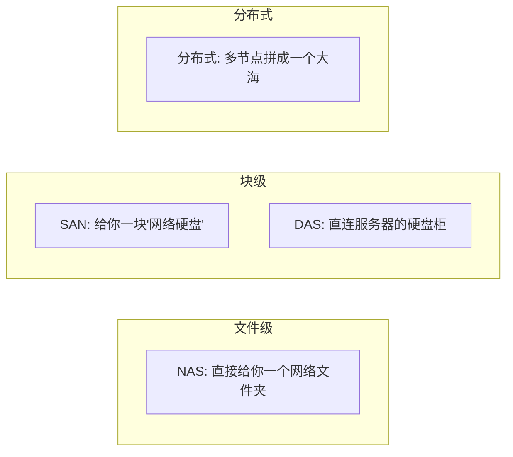

# 02 网络存储

> **网络存储**指通过网络协议访问的存储设备/系统，用于让**多台设备共享**数据、集中备份、7×24 在线。它把"存储"从"插在主机上的盘"变成"网络里的服务"。本目录按**架构类型**分：NAS、SAN、DAS、分布式与集群。

---

## 目录

| 子目录 | 架构 | 访问粒度 | 典型协议 |
|--------|------|---------|---------|
| [[01_NAS/README\|01 NAS 网络附加存储]] | 文件级 | 文件 | SMB/NFS/AFP |
| [[02_SAN/README\|02 SAN 存储区域网络]] | 块级 | 块设备 | iSCSI/FC/FCoE |
| [[03_DAS/README\|03 DAS 直连存储]] | 直连 | 块设备 | SAS/SATA/NVMe |
| [[04_分布式与集群存储/README\|04 分布式与集群存储]] | 分布式 | 文件/对象/块 | Ceph/HDFS/GlusterFS |

---

## 一、四种架构的本质区别

| 架构 | 你怎么用 | 优点 | 缺点 |
|------|---------|------|------|
| **NAS** | 直接访问共享文件夹 | 简单、便宜、跨平台 | 性能受网络/CPU 限制 |
| **SAN** | 挂载成一块本地磁盘 | 高性能、块级 | 贵、复杂 |
| **DAS** | 服务器直连磁盘柜 | 简单、快 | 只能一台主机用 |
| **分布式** | 多机组成一个大池 | 弹性扩展、高可用 | 复杂、需多节点 |

---

## 二、关键协议

| 协议 | 层级 | 用途 |
|------|------|------|
| **SMB/CIFS** | 文件 | Windows/NAS 共享 |
| **NFS** | 文件 | Linux/Unix 共享 |
| **AFP** | 文件 | 苹果（渐淘汰） |
| **iSCSI** | 块 | 以太网上的"硬盘" |
| **FC / FCoE** | 块 | 光纤通道，高性能 |
| **S3** | 对象 | 云/对象存储 API |

---

## 三、怎么选

| 需求 | 推荐 |
|------|------|
| 家里/小团队共享文件 | **NAS** |
| 数据库/虚拟化要高性能块存储 | **SAN** |
| 单台服务器扩盘 | **DAS** |
| 大规模/高可用/弹性 | **分布式存储** |

---

## 相关阅读

- [[计算机硬件基础/外部存储/01_移动存储/README|移动存储]]
- [[计算机硬件基础/外部存储/03_云端存储/README|云端存储]]
