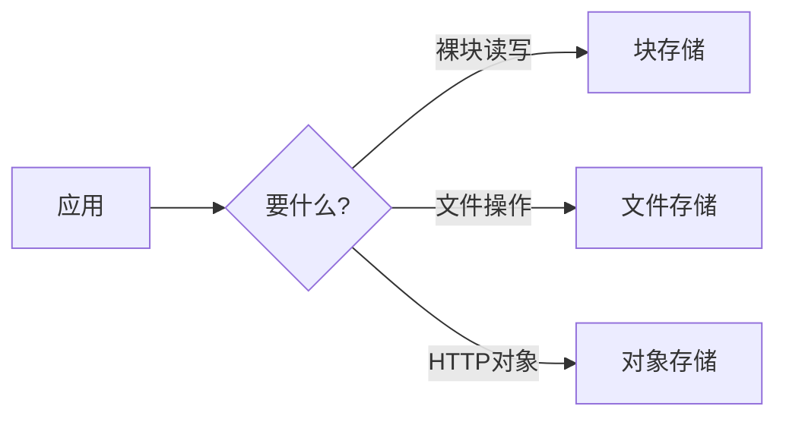

# 三种存储范式：块、文件、对象

> 所有存储方案，本质上都在回答同一个问题：**"上层应用看到的是什么？"** 答案只有三种：块、文件、对象。理解它们，就能看懂 NAS/SAN/对象存储/云盘的定位差异。

---

## 一、三种范式对比

| | 块存储 | 文件存储 | 对象存储 |
|--|:------:|:--------:|:--------:|
| 上层看到 | 一块裸盘 | 目录与文件 | 对象 + 元数据 |
| 寻址 | LBA/扇区 | 路径 `/a/b` | Key（键） |
| 修改 | 随机改写 | 随机改写 | 整体覆盖 |
| 协议 | iSCSI/FC/SATA | SMB/NFS | S3/HTTP |
| 延迟 | 最低 | 中 | 较高 |
| 扩展 | 有限 | 中 | 近乎无限 |
| 典型 | 数据库盘、云盘 | 共享文件夹、NAS | 图片/视频/备份 |

---

## 二、怎么被"翻译"

- **块**：应用（或文件系统）自己管理结构，性能最好。
- **文件**：由存储系统管理目录树，方便共享。
- **对象**：用扁平命名空间 + 元数据，方便海量扩展。

---

## 三、选择口诀

> **性能敏感、随机改 → 块；共享方便 → 文件；海量静态 → 对象。**

| 场景 | 选 |
|------|----|
| 数据库、虚拟化 | 块（SAN/本地盘/云盘） |
| 团队共享、家庭 NAS | 文件（SMB/NFS） |
| 网站静态资源、备份归档 | 对象（S3） |

---

## 其他问题（Q&A）

**Q1：NAS 是文件还是块？**
A：以**文件**为主（SMB/NFS）；很多 NAS 也能提供 iSCSI（块）。

**Q2：云盘是块还是对象？**
A：云主机挂载的"云硬盘"是**块**；网盘/OSS 是**对象**（网盘上层做了文件语义）。

**Q3：能用对象存储跑数据库吗？**
A：一般不行（延迟高、无随机改）；除非专门为对象设计的新式数据库。

**Q4：为什么对象存储"改文件"要整个重传？**
A：对象不可变，修改即产生新版本（或整体覆盖）。

---

## 相关阅读

- [[03_存储虚拟化与软件定义存储|存储虚拟化与 SDS]]
- [[计算机硬件基础/外部存储/03_云端存储/02_对象存储/README|对象存储]]
