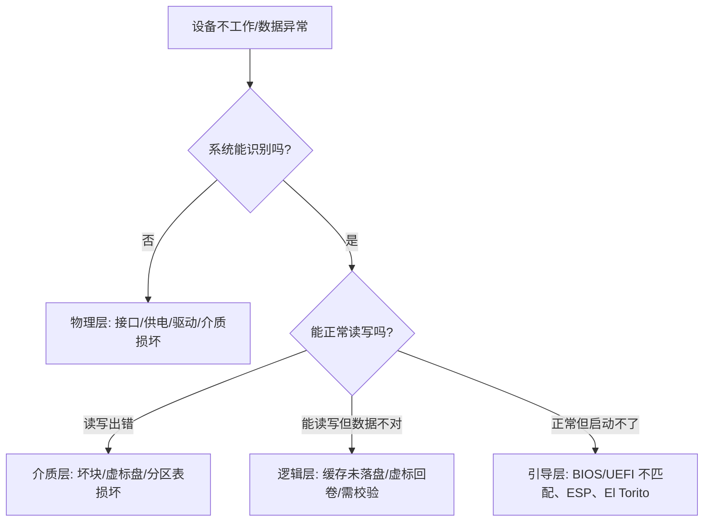

# 外部存储

> **外部存储**指计算机主机之外、用于存放数据的存储设备与体系。它解决的核心问题：内置硬盘容量有限、数据需要携带、多设备之间需要共享与备份。本手册从**原理 → 选型 → 使用**三个层面，系统讲清移动存储、网络存储、云端存储，并延伸到**备份归档与容灾、存储架构与范式、去中心化与边缘存储、设备内与嵌入式存储**等体系，目标是让你遇到问题时能理解背后的机制、自行推理解决方案。
>
> **写作约定**：每篇文章按"方向"组织；文章最下方有一个 **「其他问题」** 小标题，那里才用**问答**形式收录该方向常见问题与排查思路。

---

## 目录

### 一、移动存储（随身直连）

| 子目录 | 内容 |
|--------|------|
| [[01_移动存储/01_U盘/README\|U 盘]] | 随身小容量、系统启动盘、PE、Live 系统 |
| [[01_移动存储/02_移动硬盘/README\|移动硬盘]] | 机械/固态便携存储、备份、随身系统 |
| [[01_移动存储/03_SD卡与存储卡/README\|SD 卡与存储卡]] | 相机/手机/无人机存储卡 |
| [[01_移动存储/04_光盘/README\|光盘]] | CD/DVD/蓝光、刻录、长期归档 |
| [[01_移动存储/05_磁带/README\|磁带]] | LTO 磁带、冷数据归档 |
| [[01_移动存储/06_手机与便携设备存储/README\|手机与便携设备存储]] | 手机/U 盘化手机/随身听 |
| [[01_移动存储/07_软盘与其他历史介质/README\|软盘与其他历史介质]] | 软盘、ZIP、MD 等 |

### 二、网络存储（局域网共享）

| 子目录 | 内容 |
|--------|------|
| [[02_网络存储/01_NAS/README\|NAS 网络附加存储]] | 家用/企业文件服务器 |
| [[02_网络存储/02_SAN/README\|SAN 存储区域网络]] | 块级存储、iSCSI/FC |
| [[02_网络存储/03_DAS/README\|DAS 直连存储]] | 服务器直挂磁盘阵列 |
| [[02_网络存储/04_分布式与集群存储/README\|分布式与集群存储]] | Ceph/HDFS/对象集群 |

### 三、云端存储（互联网）

| 子目录 | 内容 |
|--------|------|
| [[03_云端存储/01_网盘与同步盘/README\|网盘与同步盘]] | 百度网盘、OneDrive、iCloud |
| [[03_云端存储/02_对象存储/README\|对象存储]] | S3/OSS/COS、API |
| [[03_云端存储/03_云备份与归档/README\|云备份与归档]] | 整机备份、冷归档 |

### 四、其他存储体系与范式

| 子目录 | 内容 |
|--------|------|
| [[04_备份归档与容灾/README\|备份归档与容灾]] | 备份 vs 归档 vs 容灾、RTO/RPO、3-2-1、勒索防护 |
| [[05_存储架构与范式/README\|存储架构与范式]] | 块/文件/对象、存储层级与性能、存储虚拟化/SDS |
| [[06_去中心化与边缘存储/README\|去中心化与边缘存储]] | IPFS/Filecoin、边缘存储与 CDN |
| [[07_设备内与嵌入式存储/README\|设备内与嵌入式存储]] | eMMC/UFS/SPI NAND/EEPROM、固件存储 |

---

## 一、外部存储怎么分类

按"**数据在哪里、怎么访问**"，外部存储分三大体系；再叠加若干**跨切面的体系/范式**：

| 体系 | 数据位置 | 访问方式 | 典型设备 | 特点 |
|------|---------|---------|---------|------|
| **移动存储** | 随身设备本体 | 直连（USB/读卡器） | U 盘、移动硬盘、SD 卡、光盘 | 即插即用、离线、可随身 |
| **网络存储** | 局域网内的服务器 | 网络协议（SMB/NFS/iSCSI/FC） | NAS、SAN、DAS | 多设备共享、集中管理 |
| **云端存储** | 服务商数据中心 | 互联网 HTTP/API | 网盘、对象存储、云备份 | 异地容灾、近乎无限 |
| **备份归档与容灾** | 本地/异地/离线 | 备份/复制/切换 | restic/Borg、磁带、云归档 | 出事能恢复、长期留存 |
| **存储架构与范式** | 概念层 | 块/文件/对象 | — | 理解一切的底层框架 |
| **去中心化与边缘存储** | 众节点/边缘 | P2P/内容寻址、就近缓存 | IPFS、CDN | 抗单点、低延迟 |
| **设备内与嵌入式存储** | 设备内部 | eMMC/UFS/SPI | 手机、路由器、固件 | 决定刷机与寿命 |

本质区别是**"距离"**：移动存储最近但容量有限；网络存储在一个局域网内、可共享；云端最远、依赖网络但弹性可扩展；其余体系则从"**目的（备份/归档/容灾）**"和"**形式（块/文件/对象）**"两个维度补充理解。

---

## 二、贯穿全篇的 6 个核心概念

| 概念 | 含义 | 为什么重要 |
|------|------|-----------|
| **介质 / 颗粒** | 真正存数据的物理单元（NAND、盘片、磁带） | 决定寿命、速度、可靠性 |
| **控制器** | 介质与主机间的"翻译官"（FTL/纠错/磨损均衡） | 控制器会"谎报"，假盘由此而来 |
| **分区表** | 描述分区布局的元数据（MBR/GPT） | 决定系统怎么识别这块盘 |
| **文件系统** | 分区上组织文件的结构（FAT/exFAT/NTFS/ext4） | 决定单文件大小、跨平台性 |
| **接口 / 协议** | 通信的物理接口与规则（USB/SATA/NVMe/SMB） | 决定速度上限与兼容性 |
| **引导 / 启动** | 让固件识别并启动系统的机制（ESP/El Torito） | 决定能不能当系统盘 |

> 一句话：**介质决定可靠性，控制器决定真实性，分区+文件系统决定可用性，接口决定速度，引导决定能不能启动。**

---

## 三、遇到问题时的通用排查框架

四个方向对应四层知识：**物理层 → 介质层 → 逻辑层 → 引导层**。

---

## 四、三句话记住全篇

1. **盘要真**——先验证真实容量与健康。
2. **系统要对**——分区表 + 文件系统 + 引导方式要匹配固件与用途。
3. **写完必校验**——哈希 / 逐字节比对，杜绝"看似成功"。

---

## 相关阅读

- [[计算机硬件基础/README|计算机硬件基础]]
- [[计算机硬件基础/01_日用计算机硬件/02_台式座机/04_硬盘|台式机硬盘]]
- [[计算机硬件基础/02_服务器硬件/03_存储|服务器存储]]
